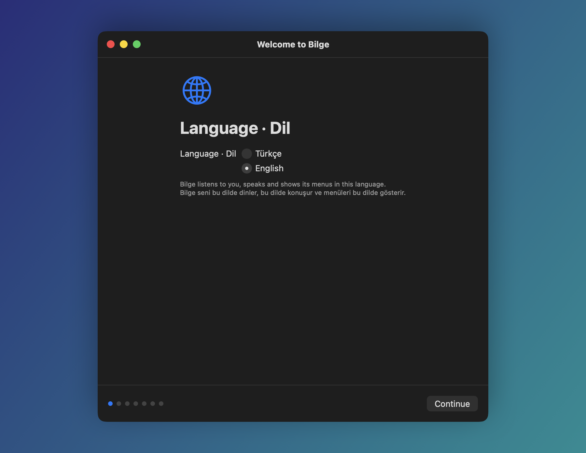
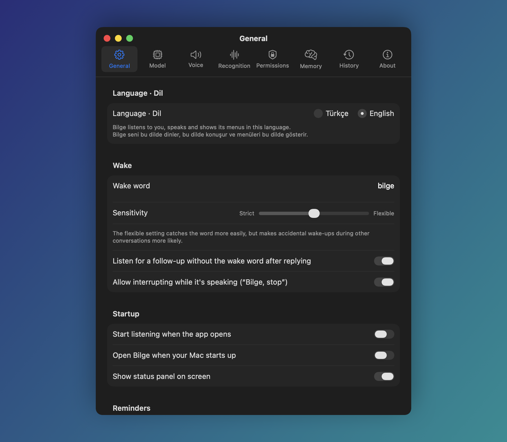

<p align="center">
  
</p>

<h1 align="center">Bilge</h1>

<p align="center">
  A voice assistant for the Mac that speaks Turkish and English. It runs entirely on your Mac:
  your voice and your commands never leave it.
</p>

<p align="center">
  <a href="LICENSE"></a>
  
  
  
</p>

<p align="center">
  <b>English</b> · <a href="README.tr.md">Türkçe</a>
</p>

<p align="center">
  
</p>

Say “Bilge” and it wakes up, works out what you want, does it on your Mac and answers out loud. Speech
recognition, the language models and speech synthesis all run locally; there is no cloud service, account
or subscription. The internet is used only for data you ask for, such as weather, exchange rates and news,
and for downloading models the first time.

“Bilge” means *wise* in Turkish and is pronounced *BIL-geh*. The wake word stays the same in English.

## Contents

- [What it does](#what-it-does)
- [Screenshots](#screenshots)
- [How it works](#how-it-works)
- [Installation](#installation)
- [Usage](#usage)
- [Models](#models)
- [Languages](#languages)
- [Privacy](#privacy)
- [Troubleshooting](#troubleshooting)
- [Building from source](#building-from-source)
- [License and credits](#license-and-credits)

## What it does

| | |
|---|---|
| **Mac control** | Open and quit apps, volume, music, screenshots, Wi-Fi, dark mode, Shortcuts, finding and opening files, moving files to the Trash |
| **Calendar and reminders** | Ask, add, complete; it tells you about upcoming meetings and due reminders on its own |
| **Messages** | Find contacts, send with Mail and Messages. Sending always needs a clear “yes” |
| **Excel** | “Put the sum of B1 and B2 into D3”, “what's the total of column B”, “undo” |
| **Context** | “Summarize this” or “send this to Ahmet” for selected text, the file selected in Finder, or the open page |
| **Browser** | Switch tabs, go back and forward, scroll, find on the page |
| **Dictation** | Type into the front app by voice; “comma”, “new line”, “delete the last sentence” |
| **Daily briefing** | Say “good morning” for the weather, today's events, reminders and unread mail |
| **Memory** | “Remember that …”, “forget that”. You can see and delete what it remembers in Settings |
| **Voice ID** | Enroll your voice and it only follows your commands and confirmations |

Anything that can't be undone, like deleting, sending or adding, needs a spoken yes first. While Bilge
is talking you can cut it off with “Bilge, stop”.

## Screenshots

<table>
  <tr>
    <td width="50%"></td>
    <td width="50%"></td>
  </tr>
  <tr>
    <td align="center">Setup starts with the language: Türkçe or English.</td>
    <td align="center">Pick a conversation model, download one, or add your own MLX model.</td>
  </tr>
  <tr>
    <td width="50%"></td>
    <td width="50%"></td>
  </tr>
  <tr>
    <td align="center">Language, wake word, sensitivity and reminders.</td>
    <td align="center">The status panel at the top of the screen shows what it heard and what it answered.</td>
  </tr>
</table>

## How it works

<p align="center">
  
</p>

1. The microphone is on, but audio is only handled in memory, in short pieces. If nobody is speaking, nothing happens.
2. If an utterance doesn't start with “Bilge”, it is thrown away.
3. The command is transcribed (Apple dictation or Whisper) and Apple's on-device model decides which tool to call.
   Conversation and general-knowledge questions can go to a larger model you download, if you want one.
4. The tool does the job. If the job is risky, Bilge asks first and does nothing until you say yes.
5. The reply is spoken with Supertonic-3, generated on the Mac.

## Installation

**Requirements**

- An Apple Silicon Mac with **macOS 27** or later.
- **Apple Intelligence turned on.** Apple's on-device language model understands the commands; Bilge
  doesn't work without it.
- A small download for the voice models on first run (1.5 GB more for Whisper, the default in English).
  The optional conversation model is a 16-19 GB download and needs at least 32 GB of memory.

**Steps**

1. Download the latest `Bilge-<version>.dmg` from [Releases](../../releases) and drag Bilge into Applications.
2. Open Bilge. Setup asks for the language (Türkçe or English), then the permissions it needs
   (microphone, speech recognition, Accessibility; calendar and contacts if you want them), prepares the
   voice models and lets you choose a conversation model.
3. Try it: “Bilge, what time is it?”

> Releases are not notarized by Apple yet. If macOS warns you the first time, click “Open Anyway” in
> System Settings > Privacy & Security, or build it yourself from source.

Bilge lives in the menu bar and has no Dock icon. Settings and the setup guide are in the menu bar menu.

## Usage

Start every command with “Bilge”: “Bilge, open Safari”. After answering, Bilge keeps listening for a few
seconds, so you can ask a follow-up without saying its name again.

<details>
<summary><b>Mac and apps</b></summary>

- Open Safari / Close Spotify / What apps are open
- Set the volume to 30 percent / Pause the music / Play Tarkan
- Lock the screen / Turn wi-fi on / What's my battery level
- Open my Downloads folder / Take a screenshot
- Run the shortcut called Good Morning
</details>

<details>
<summary><b>Calendar, reminders, timers</b></summary>

- What's on my calendar today
- Add a dentist appointment tomorrow at 10
- Add eggs to my shopping list
- Set a timer for 10 minutes
</details>

<details>
<summary><b>Excel</b></summary>

With a workbook open in Excel:

- Put the sum of B1 and B2 into D3
- Write 1250 in C5
- What's the total of column B
- Undo
</details>

<details>
<summary><b>Selected text, files and pages</b></summary>

- (With text selected) Summarize this
- Translate the selected text to Turkish
- (With a file selected in Finder) Send this to Ahmet
- What's on my screen
</details>

<details>
<summary><b>Browser and web</b></summary>

- Switch to the YouTube tab
- Find price on this page
- Search YouTube for cat videos
- What's the weather in London / How much is the dollar in lira
</details>

<details>
<summary><b>Dictation</b></summary>

- Start dictation, then talk. “Comma”, “period”, “new line” and “delete the last sentence” work as commands.
- Stop dictation
</details>

<details>
<summary><b>Memory</b></summary>

- Remember that I take my coffee without sugar
- Forget my coffee order
</details>

## Models

Commands are **always** routed by Apple's on-device model: it is fast, and in our tests it sent every
Turkish command to the right tool. For conversation, general-knowledge questions and screen summaries you
can download a more knowledgeable model. Bilge runs it **inside the app with MLX**; you don't need LM Studio
or any other program. The model loads when you say “Bilge” and leaves memory after the conversation (the
delay is adjustable).

| Option | Download | Minimum memory | Notes |
|---|---|---|---|
| Apple on-device model | none | - | All commands, small talk. More often wrong on general knowledge; can't plan linked multi-step tasks. |
| Qwen3.6 27B (4-bit) | 16.1 GB | 32 GB | The previous version of Qwen 3.8. |
| Qwen3.8 27B (4-bit) | 16.1 GB | 32 GB | Got 19 of 20 Turkish general-knowledge questions (20/20 within one conversation); first word in ~2.2 s. |
| Gemma 4 31B (4-bit) | 18.4 GB | 32 GB | 19/20 on the same test (measured in vMLX); quick to start answering. |

Measured on an M5 Pro with 48 GB of memory. Qwen3.8 was measured inside Bilge with a community build of the
same model, Gemma with another 4-bit build in vMLX. Apple's model got 14/20 on the same test.

Listed models are downloaded from Hugging Face pinned to an exact revision, and large files are checked
against their SHA-256. Long instructions and the tool list are read once and kept, so each step of a
multi-step task takes a few seconds. If you use LM Studio or vMLX, you can pick their models in Settings > Model too.

### Your own model

You can use a model that isn't on the list. Download an MLX model from Hugging Face (for example from
[mlx-community](https://huggingface.co/mlx-community)) and put its folder here:

```
~/Library/Application Support/Asistan/Models/Kendi Modellerim/<model name>/
```

The folder needs `config.json`, `tokenizer.json` (or `tokenizer.model`) and the `.safetensors` files.
“Open Folder” in Settings > Model opens this folder in Finder and “Refresh” updates the list. Instead of
copying a model you can also put a symbolic link to its folder elsewhere (LM Studio's, for instance). If
Bilge's MLX version can't open a model type, Apple's model answers instead.

## Languages

Turkish or English is chosen in the first setup step and can be changed in Settings > General (the app
restarts). Bilge then listens, speaks and shows its menus in that language. Commands, Excel, dictation,
the browser, memory and the daily briefing work in both.

Bilge was built for Turkish first. In English:

- Speech recognition defaults to Whisper (a 1.5 GB download). Apple dictation in English almost never
  recognized a Turkish-pronounced “Bilge” (it wrote “Bill” or “Build”); Whisper got it in 17 of 20 tries.
- News comes from BBC News, and exchange rates default to the dollar when you don't name a currency.
- Cutting Bilge off while it talks (“Bilge, stop”) is less reliable than in Turkish: Whisper misses the wake
  word more often over the echo of Bilge's own voice.
- In tests English commands were routed correctly 75 of 76 times (37 of 40 on sentences never used in
  development). They take a little longer than Turkish ones (~1.8 s), because the shortcut for the most common
  Turkish commands has no English version yet.

## Privacy

- No audio is stored. Nothing before the wake word is listened to.
- Speech recognition, the language models and speech synthesis run on the Mac.
- Network connections are only for data you ask for (weather, exchange rates, news, web pages) and model
  downloads. Local network addresses are blocked when reading web pages.
- Memory, the voice ID and the action log are kept under `~/Library/Application Support/Asistan`, in files
  only you can read.

## Troubleshooting

**It doesn't wake up when I say “Bilge”.** Move the sensitivity towards “Flexible” in Settings > General.
You can also try the other speech recognition engine in Settings > Recognition.

**It wakes up by itself.** Move the sensitivity towards “Strict”, or enroll your voice under Settings >
Recognition > Voice ID so it only answers you.

**It says the language model isn't ready yet.** Turn on Apple Intelligence in System Settings > Apple
Intelligence & Siri and wait for the model to download.

**It can't control an app.** Check that Bilge is allowed under Accessibility and Automation in System
Settings > Privacy & Security. Bilge's own Settings > Permissions tab shows the status too.

## Building from source

You need Xcode 27, [XcodeGen](https://github.com/yonaskolb/XcodeGen) and Xcode's Metal toolchain.

```bash
brew install xcodegen
xcodebuild -downloadComponent MetalToolchain
xcodegen generate
open Asistan.xcodeproj
```

Sign with your Apple ID so permissions aren't reset on every build: create `Config/Signing.local.xcconfig`
containing `DEVELOPMENT_TEAM = <your team ID>` (git ignores this file).

Tests:

```bash
cd Packages/AsistanKit && swift test
```

Release package (`build/release/Bilge-<version>.dmg`):

```bash
scripts/release.sh
```

With a Developer ID certificate the app is signed for distribution, and if `NOTARY_PROFILE` names a profile
saved with `xcrun notarytool store-credentials`, it is notarized too. Without a certificate the DMG only has
a development signature.

**Project layout**

| Folder | Contents |
|---|---|
| `App/Sources/Assistant` | The listening loop, wake word, confirmations and interruptions |
| `App/Sources/Brain` | Command routing, conversation, multi-step tasks, local models (MLX) |
| `App/Sources/Tools` | The tools that act on the Mac (calendar, Excel, browser, files…) |
| `App/Sources/UI` | Menu bar, status panel, settings, setup |
| `Packages/AsistanKit` | The tested, UI-free core: Turkish and English parsers, number reading, wake word matching |
| `Bench` | Speech recognition, routing and end-to-end test sets |

## License and credits

Bilge is released under the [GNU GPL 3.0](LICENSE). The open-source components and models it uses are
listed with their licenses in [THIRD_PARTY_NOTICES.md](THIRD_PARTY_NOTICES.md); the same list is in the
app under Settings > About. In particular:

- Voice activity detection, speech synthesis, echo cancellation and voice ID use
  [FluidAudio](https://github.com/FluidInference/FluidAudio) (Apache 2.0).
- Speech recognition uses [WhisperKit](https://github.com/argmaxinc/argmax-oss-swift) (MIT) or Apple dictation.
- Conversation models run on [MLX Swift](https://github.com/ml-explore/mlx-swift) and
  [mlx-swift-lm](https://github.com/ml-explore/mlx-swift-lm) (MIT).
- The voice is the [Supertonic-3](https://huggingface.co/Supertone/supertonic-3) model (OpenRAIL-M); its use
  restrictions are listed in the notices file.
