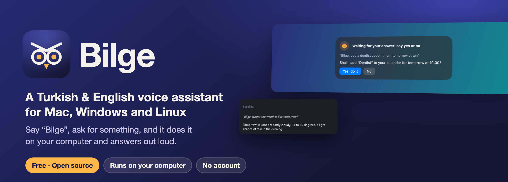

<p align="center">
  
</p>

<p align="center">
  <a href="https://github.com/coderssociety/bilge-assistant/releases/latest"></a>
  <br>
  <sub>Free and open source · Mac, Windows and Linux · no account, no subscription</sub>
</p>

<p align="center">
  <a href="LICENSE"></a>
  
  
  
  
  
</p>

<p align="center">
  <b>English</b> · <a href="README.tr.md">Türkçe</a>
</p>

<table>
  <tr>
    <td width="62%"></td>
    <td width="38%"></td>
  </tr>
  <tr>
    <td align="center">On the Mac: it asks before adding an event.</td>
    <td align="center">On Windows: the corner window shows the answer.</td>
  </tr>
</table>

Bilge listens for its name, works out what you want, does it on your computer and answers out loud: your calendar,
mail, messages, files and documents, music, the browser, spreadsheets and your smart home. Anything that can't be
undone waits for a spoken yes. Speech recognition, the language model and the voice can all run on your computer;
the internet is used only for what you ask for, such as the weather or a song, and to download the models once.

“Bilge” means *wise* in Turkish and is pronounced *BIL-geh*. The wake word stays the same in English.

## Contents

- [Why Bilge](#why-bilge)
- [Download and install](#download-and-install)
- [What it can do](#what-it-can-do)
- [Asking first](#asking-first)
- [Screenshots](#screenshots)
- [How it works](#how-it-works)
- [Models and speech recognition](#models-and-speech-recognition)
- [Languages](#languages)
- [Privacy](#privacy)
- [Troubleshooting](#troubleshooting)
- [Building from source](#building-from-source)
- [Contributing](#contributing)
- [License](#license)

## Why Bilge

- **Made for Turkish.** It understands everyday Turkish and knows what a Turkish user asks for: prayer times,
  earthquake alerts from AFAD, Süper Lig, Borsa İstanbul, gold and fuel prices. It speaks English too.
- **Private by default.** Speech recognition, the language model and the voice can all run on your computer. No
  account, no subscription, no recording kept.
- **Your choice of brain.** A model on your computer (MLX on the Mac; Ollama, LM Studio or llama.cpp) or a hosted
  API with your own key (OpenAI, Anthropic, Google Gemini, OpenRouter, Groq, DeepSeek).
- **Safe by design.** Sending, deleting, powering off and locks at home wait for a yes, and text read from a web page
  or an e-mail can never send anything on its own.
- **Keeps itself up to date.** A new version is announced once and installed from inside the app with
  “Update and restart”.

## Download and install

Every release has all three, under [Releases](https://github.com/coderssociety/bilge-assistant/releases/latest):

| System | File | Needs |
|---|---|---|
| **Mac** | `Bilge-<version>.dmg` | macOS 27 or later on Apple silicon, with Apple Intelligence on |
| **Windows** | `Bilge-Setup-<version>.exe` | Windows 10 or 11, 64-bit |
| **Linux** | `Bilge-<version>-x86_64.AppImage`, `Bilge-<version>-aarch64.AppImage` | glibc 2.34+ (Ubuntu 22.04, Debian 12, Fedora 36 or newer); 2.39+ for arm64 |

`SHA256SUMS` lists the checksums.

<details open>
<summary><b>Mac</b></summary>

1. Open the DMG and drag Bilge to Applications.
2. Open Bilge. Setup asks for the language, then the permissions it needs (microphone, speech recognition,
   Accessibility; calendar and contacts if you want them), prepares the voice and lets you choose a model.
3. Say “Bilge, what time is it?”.

The app isn't notarized yet, so the first time macOS refuses to open it: go to System Settings > Privacy &
Security and press **Open Anyway**. Apple Intelligence must be on: Apple's on-device model understands the commands.
Bilge lives in the menu bar. More: [mac/README.md](mac/README.md).
</details>

<details open>
<summary><b>Windows</b></summary>

1. Run `Bilge-Setup-<version>.exe`. It installs for your user only, without administrator rights, and can start
   Bilge with Windows.
2. Setup asks for the language, the language model (one on your computer or an API) and speech recognition, and
   downloads the voice models (1–2 GB).
3. Say “Bilge, what time is it?”.

The installer isn't signed yet, so Windows warns the first time: **More info → Run anyway**. Bilge lives in the
tray. More: [desktop/README.md](desktop/README.md).
</details>

<details open>
<summary><b>Linux</b></summary>

1. Make the AppImage executable (`chmod +x Bilge-*.AppImage`) and run it.
2. Setup asks for the language, the language model and speech recognition, and downloads the voice models.
3. Say “Bilge, what time is it?”.

On GNOME the tray icon needs the AppIndicator extension (Ubuntu has it); without it Bilge opens a small window.
Some features use the desktop's own tools (`wpctl`, `xdotool`, Tesseract…); the app's README lists them.
More: [desktop/README.md](desktop/README.md).
</details>

**Calling Bilge:** say “Bilge” and your request, or press the listening shortcut you choose in Settings. After it
answers it keeps listening for a moment, so a follow-up needs no “Bilge”; while it talks you can cut in with
“Bilge, stop”.

**Updates:** once a day Bilge looks for a new version and tells you about it once. “Update and restart” downloads
the package for your system from this project's release, checks it against `SHA256SUMS`, installs it and starts
the new Bilge.

## What it can do

Examples are in English; the [Turkish page](README.tr.md) has the Turkish ones. ✓ means it works there; a note
says what it uses or what is different.

### On the computer

| | You can say | Mac | Windows | Linux |
|---|---|---|---|---|
| Apps | “open Safari”, “close the calculator”, “which apps are open” | ✓ | ✓ | ✓ menu entries and Flatpak |
| Volume, brightness | “set the volume to 30 percent”, “dim the screen” | ✓ | ✓ brightness on laptops | ✓ GNOME, Plasma, `brightnessctl`, `ddcutil` |
| Windows | “minimize the window”, “full screen”, “close this window” | ✓ | ✓ | ✓ X11, Sway, Hyprland, KDE; not GNOME on Wayland |
| System | “lock the screen”, “dark mode on”, “turn off Wi-Fi”, “how's the battery”, “restart the computer” | ✓ | ✓ | ✓ |
| Bluetooth, Do Not Disturb | “turn off Bluetooth”, “turn on Do Not Disturb” | ✓ Focus through a Shortcut | Bluetooth ✓; Do Not Disturb opens its settings | ✓ GNOME, KDE, XFCE, Cinnamon, dunst |
| Files | “find the rental contract”, “open my latest download”, “create a folder called Invoices”, “move it to the trash” | ✓ Spotlight | ✓ | ✓ |
| Documents | “summarize the PDF I downloaded”, “what does the presentation say about the budget”: PDF, Word, Excel, PowerPoint, OpenDocument, RTF, HTML, CSV, text | ✓ | ✓ | ✓ |
| Screen, “this” | “what does the screen say”, “summarize this”, “translate the selected text” | ✓ | ✓ Windows OCR | ✓ Tesseract |
| Typing, dictation | “type: see you at five”, “start dictation” | ✓ | ✓ | ✓ X11; `wtype`/`ydotool` on Wayland |
| Browser | “next tab”, “go back”, “find price on this page”, “search the web for train times” | ✓ Safari, Chrome, Arc, Brave, Edge | ✓ the browser in front | ✓ the browser in front; not GNOME on Wayland |
| Spreadsheet | “put the sum of B1 and B2 into D3”, “what's the total of column B” | ✓ Excel | ✓ Excel or LibreOffice Calc | ✓ LibreOffice Calc |
| Your own commands | “run the backup command”, “what are my commands” | ✓ also Shortcuts | ✓ | ✓ |

### Information

| | You can say | Mac | Windows | Linux |
|---|---|---|---|---|
| Weather, time, sums | “will it rain tonight”, “what time is it in Tokyo”, “convert 5 kg to pounds”, “18 percent of 125” | ✓ | ✓ | ✓ |
| Money | “how much is £50 in dollars”, “gold price”, “diesel price in Ankara” | ✓ | ✓ | ✓ |
| Türkiye | “when is maghrib”, “recent earthquakes”, “when does Beşiktaş play”, “BIST 100” | ✓ | ✓ | ✓ |
| News, Wikipedia, web | “technology news”, “tell me about the third story”, “who was Ada Lovelace”, “read this page” | ✓ | ✓ | ✓ |
| Daily briefing | “good morning” | ✓ | ✓ | ✓ |
| Translation, interpreter | “read the e-mail in Turkish”, “start interpreter mode: English and Turkish” | ✓ | ✓ | ✓ |
| YouTube summary | “summarize this video” | ✓ | ✓ | ✓ |

### Mail, calendar and people

| | You can say | Mac | Windows | Linux |
|---|---|---|---|---|
| Calendar, reminders | “what's on tomorrow”, “add a dentist appointment on Friday at 10”, “move the meeting to 4” | ✓ Calendar and Reminders | ✓ CalDAV, iCal or Outlook | ✓ CalDAV or iCal |
| Mail | “read my email”, “reply to it: I'm free tomorrow”, “email Anna: I'll be late” | ✓ Mail: read, reply, send | ✓ classic Outlook: read, reply, send | ✓ IMAP: read only |
| Messages, calls | “message Ayşe that I'll be late”, “call mom” | ✓ Messages, iPhone, FaceTime | — | ✓ texts through KDE Connect |
| Contacts | “what's Anna's number” | ✓ | ✓ Outlook | ✓ CardDAV |
| Notes | “take a note: call the plumber”, “add milk to my shopping note” | ✓ Notes | ✓ Markdown files | ✓ Markdown files |
| Memory | “remember that I take my coffee black” | ✓ | ✓ | ✓ |
| Meetings | “start recording the meeting”, “transcribe my latest audio download” | ✓ | ✓ | ✓ |

### Music, timers and the home

| | You can say | Mac | Windows | Linux |
|---|---|---|---|---|
| Music | “play Tarkan”, “play Kuzu Kuzu on YouTube Music”, “next song”, “shuffle” | ✓ Music, Spotify, YouTube, Deezer, Apple Music | ✓ in the browser; players through media controls | ✓ in the browser; players through MPRIS |
| Radio, podcasts | “play Power FM”, “play the latest episode of The Daily” | ✓ | ✓ | ✓ |
| Timers, alarms | “set a 10 minute tea timer”, “wake me at 7:30” | ✓ | ✓ | ✓ |
| Routines | “every weekday at 7 read the news” | ✓ | ✓ | ✓ |
| Smart home | “turn on the living room lights”, “is the front door locked” | ✓ Home Assistant | ✓ Home Assistant | ✓ Home Assistant |

Each app's README has the full list, with every setting and what each feature needs:
[Mac](mac/README.md#what-it-does) · [Windows and Linux](desktop/README.md#what-it-can-do).

## Asking first

Anything that changes, deletes or sends something waits for a spoken yes, or a click on the Yes button: moving
files to the trash, adding to or changing the calendar, sending a message, writing over a filled cell, setting up a
routine, turning Wi-Fi or Bluetooth off, restarting or shutting down, and locks, garage doors and alarms at home.

- **Yes:** “yes”, “sure”, “okay”, “confirm” (“evet”, “olur”, “tamam”, “onaylıyorum”). **No:** “no”, “cancel”
  (“hayır”, “iptal”, “vazgeç”).
- Sending a mail or a message, powering off and the first run of your own commands need an explicit “yes”,
  “confirm” or “send”: a casual “okay” from the TV is not enough.
- Anything else heard while Bilge waits is ignored; with no clear answer within a few seconds nothing is done.
- A step that could carry text Bilge read somewhere else (a web page, an e-mail, the clipboard) asks first or is
  refused. Routines never take a step that needs a yes, since nobody is there to answer.
- With voice ID on, only your voice can give commands and answer.

## Screenshots

<table>
  <tr>
    <td width="50%"></td>
    <td width="50%"></td>
  </tr>
  <tr>
    <td align="center">Mac: setup starts with the language.</td>
    <td align="center">Mac: a model to download, one already on the Mac, or one over an API.</td>
  </tr>
  <tr>
    <td width="50%"></td>
    <td width="50%"></td>
  </tr>
  <tr>
    <td align="center">Windows and Linux: the same setup.</td>
    <td align="center">Windows and Linux: a model on the computer or a hosted API.</td>
  </tr>
  <tr>
    <td width="50%"></td>
    <td width="50%"></td>
  </tr>
  <tr>
    <td align="center">Wake word, listening shortcut, sensitivity and reminders.</td>
    <td align="center">Whisper on the processor or a graphics card, and your voice.</td>
  </tr>
</table>

## How it works

<p align="center">
  
</p>

1. The microphone is on, but audio is only handled in memory, in short pieces. If nobody is speaking, nothing
   happens, and an utterance that doesn't start with “Bilge” is thrown away.
2. The command is transcribed on the computer: Apple dictation or Whisper on the Mac; Whisper on the processor or a
   graphics card on Windows and Linux. OpenAI or Groq can do it instead, with your key.
3. Common phrasings go straight to the right tool by rule. Anything else goes to a language model that picks one:
   Apple's on-device model on the Mac, the model you chose on Windows and Linux.
4. The tool does the job. If it is risky, Bilge asks first and does nothing until you say yes.
5. The reply is spoken with Supertonic-3, generated on the computer, in Turkish, English or 29 other languages.

## Models and speech recognition

| | Mac | Windows and Linux |
|---|---|---|
| Understanding commands | Apple's on-device model (Apple Intelligence), always | The model you choose |
| Conversation and general knowledge | Apple's model, or a larger one: run inside Bilge with MLX (Qwen 3.8 27B, Gemma 4 31B or your own), LM Studio, vMLX, Ollama, llama.cpp, or a hosted API | Ollama, LM Studio, llama.cpp, or a hosted API |
| Hosted APIs (your key) | OpenAI, Anthropic, Google Gemini, OpenRouter, Groq, DeepSeek | the same |
| Speech recognition | Apple dictation, Whisper large-v3 turbo, or OpenAI / Groq | Whisper on the processor, an NVIDIA card (CUDA) or any card (Vulkan), or OpenAI / Groq |
| Voice | Supertonic-3 | Supertonic-3 |

API keys are kept in the system's key store (the Keychain, Windows Credential Manager, the Secret Service on Linux)
and sent only to that service. With a cloud recognizer the wake word is still heard on the computer, so nothing
said while Bilge waits for its name leaves it.

## Languages

Turkish or English is chosen in the first setup step and can be changed later. Bilge then listens, speaks and shows
its menus in that language, and every feature works in both. Bilge was built for Turkish first: the Türkiye features
answer in English too, but their data is about Türkiye. The voice can read a reply in 31 languages (“read the news
in French”).

## Privacy

- No audio is stored. Nothing before the wake word is listened to. A meeting recording keeps only the text.
- With models and speech recognition on your computer, what you say stays on it. With a hosted API or a cloud
  recognizer, that service gets the conversation, or the recording of what you say while Bilge listens.
- Settings, memory, routines, timers, notes, meeting transcripts and the log of what Bilge did stay on your computer,
  in files only you can read.
- Bilge contacts a service only when a feature needs it: the weather (Open-Meteo), exchange rates (Frankfurter),
  news feeds, Wikipedia, prayer times, gold and fuel prices, AFAD and Kandilli for earthquakes, ESPN, Yahoo Finance,
  radio and podcast feeds, music search, GitHub for updates, Hugging Face for model downloads, and your own
  Home Assistant, calendar and mail servers. Each app's README lists what each one learns.

## Troubleshooting

**It doesn't wake up when I say “Bilge”.** Move the sensitivity towards “Flexible” in Settings > General, or try
the other speech recognition engine. In English, Whisper hears a Turkish-pronounced “Bilge” best.

**It wakes up by itself.** Move the sensitivity towards “Strict”, or enroll your voice under voice ID so it only
answers you.

**macOS or Windows won't open it.** The packages aren't signed yet: on the Mac use **Open Anyway** in System
Settings > Privacy & Security; on Windows **More info → Run anyway**.

**Mac: “the language model isn't ready yet”.** Turn on Apple Intelligence in System Settings and wait for the model
to download.

**A model over an API doesn't answer.** Check the key in the model settings; on the Mac, “Fetch models” says
whether it was accepted, and Apple's model answers until the service does.

The app READMEs have more: [Mac](mac/README.md#troubleshooting) · [Windows and Linux](desktop/README.md).

## Building from source

**Mac** (Xcode 27, [XcodeGen](https://github.com/yonaskolb/XcodeGen), Xcode's Metal toolchain):

```bash
cd mac
xcodegen generate && open Asistan.xcodeproj
(cd Packages/AsistanKit && swift test)
scripts/release.sh          # build/release/Bilge-<version>.dmg
```

**Windows and Linux** (Python 3.14 and [uv](https://docs.astral.sh/uv/)):

```bash
cd desktop
uv sync --extra app && uv run bilge-app      # the tray app with setup and settings
uv run bilge chat                            # or by typing, in the terminal
uv run pytest
```

| Folder | Contents |
|---|---|
| `mac/` | The Mac app and its tested core package (`mac/Packages/AsistanKit`) |
| `desktop/` | The Windows and Linux app, its tests and installers |
| `bench/` | Speech recognition, routing and end-to-end command sets both apps are measured with |

Releases are built by `.github/workflows/release.yml` from a `v*` tag: the DMG on macOS, the installer on Windows
and the AppImages in Docker, published together as one draft release.

## Contributing

Bug reports, ideas and pull requests are welcome in [Issues](https://github.com/coderssociety/bilge-assistant/issues);
a sentence Bilge misunderstands is a valuable report. [CONTRIBUTING.md](CONTRIBUTING.md) explains how to build, test
and propose a change, and [SECURITY.md](SECURITY.md) how to report a vulnerability privately. If Bilge is useful to
you, a ⭐ helps others find it.

## License

GPL-3.0, see [LICENSE](LICENSE). Each app lists the open-source components and models it uses.
