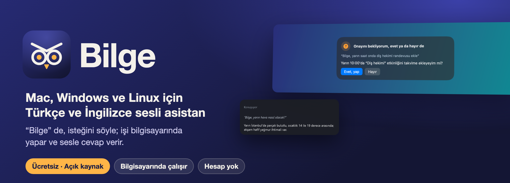

<p align="center">
  
</p>

<p align="center">
  <a href="https://github.com/serdarvaran/bilge-assistant/releases/latest"></a>
  <br>
  <sub>Ücretsiz ve açık kaynak · Mac, Windows ve Linux · hesap ve abonelik yok</sub>
</p>

<p align="center">
  <a href="LICENSE"></a>
  
  
  
  
  
</p>

<p align="center">
  <a href="README.md">English</a> · <b>Türkçe</b>
</p>

<p align="center">
  <a href="https://github.com/serdarvaran/bilge-assistant/releases/latest">
    
  </a>
</p>

<table>
  <tr>
    <td width="62%"></td>
    <td width="38%"></td>
  </tr>
  <tr>
    <td align="center">Mac'te: etkinlik eklemeden önce sorar.</td>
    <td align="center">Windows'ta: köşe penceresi cevabı gösterir.</td>
  </tr>
</table>

Bilge adını duyunca dinler, ne istediğini anlar, işi bilgisayarında yapar ve sesle cevap verir: takvim, e-posta,
mesajlar, dosyalar ve belgeler, müzik, tarayıcı, tablolar ve akıllı ev. Geri alınamayan her iş sesli bir “evet”
bekler. Konuşma tanıma, dil modeli ve ses tamamen bilgisayarında çalışabilir; internet yalnızca hava durumu ya da bir
şarkı gibi istediğin şeyler ve modellerin ilk indirmesi için kullanılır.

## İçindekiler

- [Neden Bilge?](#neden-bilge)
- [İndir ve kur](#i̇ndir-ve-kur)
- [Neler yapar](#neler-yapar)
- [Önce sorar](#önce-sorar)
- [Ekran görüntüleri](#ekran-görüntüleri)
- [Nasıl çalışır](#nasıl-çalışır)
- [Modeller ve konuşma tanıma](#modeller-ve-konuşma-tanıma)
- [Dil](#dil)
- [Gizlilik](#gizlilik)
- [Sorun giderme](#sorun-giderme)
- [Kaynaktan derleme](#kaynaktan-derleme)
- [Katkı](#katkı)
- [Lisans](#lisans)

## Neden Bilge?

- **Türkçe için yapıldı.** Günlük Türkçe konuşmayı anlar ve Türkiye'de sorulanı bilir: namaz vakitleri, AFAD deprem
  uyarıları, Süper Lig, Borsa İstanbul, altın ve akaryakıt fiyatları. İngilizce de konuşur.
- **Varsayılan olarak gizli.** Konuşma tanıma, dil modeli ve ses tamamen bilgisayarında çalışabilir. Hesap ve abonelik
  yok, ses kaydı saklanmaz.
- **Beyni sen seç.** Bilgisayarındaki bir model (Mac'te MLX; Ollama, LM Studio ya da llama.cpp) ya da kendi
  anahtarınla bir API (OpenAI, Anthropic, Google Gemini, OpenRouter, Groq, DeepSeek).
- **Güvenli tasarım.** Gönderme, silme, kapatma ve evdeki kilitler “evet” bekler; bir web sayfasından ya da
  e-postadan okunan metin kendi başına hiçbir şey gönderemez.
- **Kendini güncel tutar.** Yeni sürüm bir kez haber verilir ve uygulamanın içinden “Güncelle ve yeniden başlat” ile
  kurulur.

## İndir ve kur

Her sürümde üçü de var, [Sürümler](https://github.com/serdarvaran/bilge-assistant/releases/latest) sayfasında:

| Sistem | Dosya | Gerekenler |
|---|---|---|
| **Mac** | `Bilge-<sürüm>.dmg` | Apple Silicon'lı Mac'te macOS 27 ve sonrası, Apple Intelligence açık |
| **Windows** | `Bilge-Setup-<sürüm>.exe` | Windows 10 ya da 11, 64 bit |
| **Linux** | `Bilge-<sürüm>-x86_64.AppImage`, `Bilge-<sürüm>-aarch64.AppImage` | glibc 2.34+ (Ubuntu 22.04, Debian 12, Fedora 36 ve sonrası); arm64 için 2.39+ |

`SHA256SUMS` dosyası sağlama toplamlarını içerir.

<details open>
<summary><b>Mac</b></summary>

1. DMG'yi aç ve Bilge'yi Uygulamalar klasörüne sürükle.
2. Bilge'yi aç. Kurulum önce dili, sonra gereken izinleri (mikrofon, konuşma tanıma, Erişilebilirlik; istersen takvim
   ve kişiler) sorar, sesi hazırlar ve bir model seçmeni ister.
3. “Bilge, saat kaç?” de.

Uygulama henüz Apple'dan geçirilmediği (notarize edilmediği) için macOS ilk açılışta izin vermez: Sistem Ayarları >
Gizlilik ve Güvenlik'te **Yine de Aç**'a bas. Apple Intelligence açık olmalı: komutları Apple'ın cihaz içi modeli
anlar. Bilge menü çubuğunda durur. Ayrıntılar: [mac/README.tr.md](mac/README.tr.md).
</details>

<details open>
<summary><b>Windows</b></summary>

1. `Bilge-Setup-<sürüm>.exe` dosyasını çalıştır. Yönetici izni olmadan yalnızca senin kullanıcın için kurulur ve
   Windows ile birlikte başlayabilir.
2. Kurulum dili, dil modelini (bilgisayarındaki bir model ya da bir API) ve konuşma tanımayı sorar, ses modellerini
   indirir (1–2 GB).
3. “Bilge, saat kaç?” de.

Kurulum henüz imzalı olmadığından Windows ilk açılışta uyarır: **Ek bilgi → Yine de çalıştır**. Bilge bildirim
alanında durur. Ayrıntılar: [desktop/README.tr.md](desktop/README.tr.md).
</details>

<details open>
<summary><b>Linux</b></summary>

1. AppImage'ı çalıştırılabilir yap (`chmod +x Bilge-*.AppImage`) ve çalıştır.
2. Kurulum dili, dil modelini ve konuşma tanımayı sorar, ses modellerini indirir.
3. “Bilge, saat kaç?” de.

GNOME'da bildirim alanı simgesi için AppIndicator eklentisi gerekir (Ubuntu'da var); yoksa Bilge küçük bir pencere
açar. Bazı özellikler masaüstünün kendi araçlarını kullanır (`wpctl`, `xdotool`, Tesseract…); uygulamanın README'si
hepsini sayar. Ayrıntılar: [desktop/README.tr.md](desktop/README.tr.md).
</details>

**Bilge'yi çağırmak:** “Bilge” de ve isteğini söyle ya da Ayarlar'da seçtiğin dinleme kısayoluna bas. Cevaptan sonra
bir süre dinlemeye devam eder, devam sorusu için yeniden “Bilge” demen gerekmez; konuşurken “Bilge, dur” diyerek
sözünü kesebilirsin.

**Güncellemeler:** Bilge günde bir kez yeni sürüm olup olmadığına bakar ve bir kez haber verir. “Güncelle ve yeniden
başlat”, sistemine uygun paketi bu projenin sürümünden indirir, `SHA256SUMS` ile denetler, kurar ve yeni Bilge'yi
başlatır.

## Neler yapar

✓ orada çalıştığı anlamına gelir; yanındaki not neyi kullandığını ya da neyin farklı olduğunu söyler.

### Bilgisayarda

| | Şöyle diyebilirsin | Mac | Windows | Linux |
|---|---|---|---|---|
| Uygulamalar | “Safari'yi aç”, “hesap makinesini kapat”, “hangi uygulamalar açık” | ✓ | ✓ | ✓ menü girdileri ve Flatpak |
| Ses, parlaklık | “sesi yüzde 30 yap”, “ekranı karart” | ✓ | ✓ parlaklık dizüstünde | ✓ GNOME, Plasma, `brightnessctl`, `ddcutil` |
| Pencereler | “pencereyi küçült”, “tam ekran yap”, “bu pencereyi kapat” | ✓ | ✓ | ✓ X11, Sway, Hyprland, KDE; Wayland'de GNOME hariç |
| Sistem | “ekranı kilitle”, “karanlık modu aç”, “Wi-Fi'ı kapat”, “pil ne durumda”, “bilgisayarı yeniden başlat” | ✓ | ✓ | ✓ |
| Bluetooth, rahatsız etme | “Bluetooth'u kapat”, “rahatsız etmeyi aç” | ✓ odak bir Kestirme ile | Bluetooth ✓; rahatsız etme ayarını açar | ✓ GNOME, KDE, XFCE, Cinnamon, dunst |
| Dosyalar | “kira sözleşmesini bul”, “son indirdiğimi aç”, “Faturalar diye klasör oluştur”, “çöpe at” | ✓ Spotlight | ✓ | ✓ |
| Belgeler | “indirdiğim PDF'i özetle”, “sunum bütçe hakkında ne diyor”: PDF, Word, Excel, PowerPoint, OpenDocument, RTF, HTML, CSV, metin | ✓ | ✓ | ✓ |
| Ekran, “bu” | “ekranda ne yazıyor”, “bunu özetle”, “seçili metni çevir” | ✓ | ✓ Windows OCR | ✓ Tesseract |
| Yazma, dikte | “yaz: beşte görüşürüz”, “dikteyi başlat” | ✓ | ✓ | ✓ X11; Wayland'de `wtype`/`ydotool` |
| Tarayıcı | “sonraki sekme”, “geri git”, “sayfada fiyatı bul”, “internette tren saatlerini ara” | ✓ Safari, Chrome, Arc, Brave, Edge | ✓ öndeki tarayıcı | ✓ öndeki tarayıcı; Wayland'de GNOME hariç |
| Tablo | “B1 ile B2'nin toplamını D3'e yaz”, “B sütununun toplamı ne” | ✓ Excel | ✓ Excel ya da LibreOffice Calc | ✓ LibreOffice Calc |
| Kendi komutların | “yedekleme komutunu çalıştır”, “komutlarım neler” | ✓ ayrıca Kestirmeler | ✓ | ✓ |

### Bilgi

| | Şöyle diyebilirsin | Mac | Windows | Linux |
|---|---|---|---|---|
| Hava, saat, hesap | “bu akşam yağmur yağacak mı”, “Tokyo'da saat kaç”, “5 kilo kaç pound”, “125'in yüzde 18'i” | ✓ | ✓ | ✓ |
| Para | “50 sterlin kaç dolar”, “altın ne kadar”, “Ankara'da motorin kaç lira” | ✓ | ✓ | ✓ |
| Türkiye | “akşam ezanı ne zaman”, “son depremler”, “Beşiktaş ne zaman oynuyor”, “BIST 100” | ✓ | ✓ | ✓ |
| Haber, Vikipedi, web | “teknoloji haberleri”, “üçüncü haberi anlat”, “Ada Lovelace kimdir”, “bu sayfayı oku” | ✓ | ✓ | ✓ |
| Günün özeti | “günaydın” | ✓ | ✓ | ✓ |
| Çeviri, tercüman | “e-postayı Türkçe oku”, “tercüman modunu başlat: İngilizce ve Türkçe” | ✓ | ✓ | ✓ |
| YouTube özeti | “bu videoyu özetle” | ✓ | ✓ | ✓ |

### E-posta, takvim ve kişiler

| | Şöyle diyebilirsin | Mac | Windows | Linux |
|---|---|---|---|---|
| Takvim, anımsatıcılar | “yarın neler var”, “cuma 10'a diş hekimi randevusu ekle”, “toplantıyı 4'e al” | ✓ Takvim ve Anımsatıcılar | ✓ CalDAV, iCal ya da Outlook | ✓ CalDAV ya da iCal |
| E-posta | “e-postalarımı oku”, “yanıtla: yarın uygunum”, “Ayşe'ye e-posta at: geç kalacağım” | ✓ Mail: okuma, yanıt, gönderme | ✓ klasik Outlook: okuma, yanıt, gönderme | ✓ IMAP: yalnızca okuma |
| Mesaj, arama | “Ayşe'ye geç kalacağımı yaz”, “annemi ara” | ✓ Mesajlar, iPhone, FaceTime | — | ✓ KDE Connect ile SMS |
| Kişiler | “Ahmet'in numarası ne” | ✓ | ✓ Outlook | ✓ CardDAV |
| Notlar | “not al: tesisatçıyı ara”, “alışveriş notuma süt ekle” | ✓ Notlar | ✓ Markdown dosyaları | ✓ Markdown dosyaları |
| Hafıza | “kahvemi sade içtiğimi hatırla” | ✓ | ✓ | ✓ |
| Toplantılar | “toplantıyı kaydetmeye başla”, “son indirdiğim ses dosyasını yazıya dök” | ✓ | ✓ | ✓ |

### Müzik, zamanlayıcılar ve ev

| | Şöyle diyebilirsin | Mac | Windows | Linux |
|---|---|---|---|---|
| Müzik | “Tarkan çal”, “YouTube Music'te Kuzu Kuzu'yu aç”, “sonraki şarkı”, “karıştır” | ✓ Müzik, Spotify, YouTube, Deezer, Apple Music | ✓ tarayıcıda; çalarlar medya denetimleriyle | ✓ tarayıcıda; çalarlar MPRIS ile |
| Radyo, podcast | “Power FM'i aç”, “The Daily'nin son bölümünü aç” | ✓ | ✓ | ✓ |
| Zamanlayıcı, alarm | “10 dakikalık çay zamanlayıcısı kur”, “beni 7.30'da uyandır” | ✓ | ✓ | ✓ |
| Rutinler | “hafta içi her sabah 7'de haberleri oku” | ✓ | ✓ | ✓ |
| Akıllı ev | “salonun ışıklarını aç”, “ön kapı kilitli mi” | ✓ Home Assistant | ✓ Home Assistant | ✓ Home Assistant |

Tam liste, bütün ayarlar ve her özelliğin neye ihtiyaç duyduğu uygulamaların README'lerinde:
[Mac](mac/README.tr.md#neler-yapar) · [Windows ve Linux](desktop/README.tr.md).

## Önce sorar

Bir şeyi değiştiren, silen ya da gönderen her iş sesli bir “evet”i ya da Evet düğmesine tıklamayı bekler: dosyaları
çöpe atmak, takvime eklemek ya da değiştirmek, mesaj göndermek, dolu bir hücrenin üzerine yazmak, rutin kurmak,
Wi-Fi'ı ya da Bluetooth'u kapatmak, yeniden başlatmak ya da kapatmak, evde kilit, garaj kapısı ve alarm.

- **Evet:** “evet”, “olur”, “tamam”, “onaylıyorum”. **Hayır:** “hayır”, “iptal”, “vazgeç”.
- E-posta ya da mesaj göndermek, kapatmak ve kendi komutlarının ilk çalışması açık bir “evet”, “onaylıyorum” ya da
  “gönder” ister: televizyondan gelen bir “tamam” yetmez.
- Bilge beklerken duyulan başka sözler cevap sayılmaz; birkaç saniye içinde net bir cevap gelmezse hiçbir şey yapılmaz.
- Başka bir yerde okunan metni (web sayfası, e-posta, pano) taşıyabilecek bir adım önce sorulur ya da reddedilir.
  Rutinler, kimse cevap veremeyeceği için “evet” gerektiren hiçbir adımı yapmaz.
- Ses kimliği açıksa komut ve onayı yalnızca senin sesin verebilir.

## Ekran görüntüleri

<table>
  <tr>
    <td width="50%"></td>
    <td width="50%"></td>
  </tr>
  <tr>
    <td align="center">Mac: kurulum dil seçimiyle başlar.</td>
    <td align="center">Mac: indirilecek bir model, Mac'te zaten olan bir model ya da bir API.</td>
  </tr>
  <tr>
    <td width="50%"></td>
    <td width="50%"></td>
  </tr>
  <tr>
    <td align="center">Windows ve Linux: aynı kurulum.</td>
    <td align="center">Windows ve Linux: bilgisayardaki bir model ya da bir API.</td>
  </tr>
  <tr>
    <td width="50%"></td>
    <td width="50%"></td>
  </tr>
  <tr>
    <td align="center">Uyandırma kelimesi, dinleme kısayolu, hassasiyet ve hatırlatmalar.</td>
    <td align="center">İşlemcide ya da ekran kartında Whisper ve ses kimliği.</td>
  </tr>
</table>

## Nasıl çalışır

<p align="center">
  
</p>

1. Mikrofon açıktır ama ses yalnızca bellekte, kısa parçalar halinde işlenir. Kimse konuşmuyorsa hiçbir şey olmaz;
   “Bilge” ile başlamayan bir söz atılır.
2. Komut bilgisayarda yazıya dökülür: Mac'te Apple Dikte ya da Whisper; Windows ve Linux'ta işlemcide ya da ekran
   kartında Whisper. İstersen kendi anahtarınla OpenAI ya da Groq da yapabilir.
3. Sık kullanılan ifadeler kuralla doğrudan doğru araca gider. Diğerlerini bir dil modeli seçer: Mac'te Apple'ın
   cihaz içi modeli, Windows ve Linux'ta senin seçtiğin model.
4. Araç işi yapar. İş riskliyse Bilge önce sorar ve “evet” demeden hiçbir şey yapmaz.
5. Cevap bilgisayarda üretilen Supertonic-3 sesiyle söylenir: Türkçe, İngilizce ya da 29 başka dilde.

## Modeller ve konuşma tanıma

| | Mac | Windows ve Linux |
|---|---|---|
| Komutları anlamak | Her zaman Apple'ın cihaz içi modeli (Apple Intelligence) | Seçtiğin model |
| Sohbet ve genel bilgi | Apple'ın modeli ya da daha büyüğü: Bilge'nin içinde MLX ile (Qwen 3.8 27B, Gemma 4 31B ya da kendi modelin), LM Studio, vMLX, Ollama, llama.cpp ya da bir API | Ollama, LM Studio, llama.cpp ya da bir API |
| API'ler (kendi anahtarınla) | OpenAI, Anthropic, Google Gemini, OpenRouter, Groq, DeepSeek | aynısı |
| Konuşma tanıma | Apple Dikte, Whisper large-v3 turbo ya da OpenAI / Groq | İşlemcide, NVIDIA kartta (CUDA) ya da herhangi bir kartta (Vulkan) Whisper, ya da OpenAI / Groq |
| Ses | Supertonic-3 | Supertonic-3 |

API anahtarları sistemin anahtar deposunda (Anahtar Zinciri, Windows Kimlik Yöneticisi, Linux'ta Secret Service)
saklanır ve yalnızca o servise gönderilir. Bulutta konuşma tanımada uyandırma kelimesi yine bilgisayarda duyulur;
Bilge adını beklerken söylenen hiçbir şey dışarı çıkmaz.

## Dil

Türkçe ya da İngilizce kurulumun ilk adımında seçilir, sonra değiştirilebilir. Bilge o dilde dinler, konuşur ve
menülerini gösterir; her özellik iki dilde de çalışır. Bilge önce Türkçe için yapıldı: Türkiye özellikleri İngilizce de
cevap verir ama verileri Türkiye'ye dairdir. Ses bir cevabı 31 dilde okuyabilir (“haberleri Fransızca oku”).

## Gizlilik

- Ses kaydı saklanmaz. Uyandırma kelimesinden öncesi dinlenmez. Toplantı kaydında yalnızca metin tutulur.
- Modeller ve konuşma tanıma bilgisayarındaysa söylediklerin orada kalır. Bir API ya da bulutta tanıma seçersen o
  servis sohbeti ya da Bilge dinlerken söylediklerinin kaydını alır.
- Ayarlar, hafıza, rutinler, zamanlayıcılar, notlar, toplantı dökümleri ve Bilge'nin yaptıklarının kaydı
  bilgisayarında, yalnızca senin okuyabileceğin dosyalarda durur.
- Bilge bir servise yalnızca bir özellik gerektirdiğinde bağlanır: hava durumu (Open-Meteo), döviz (Frankfurter),
  haber kaynakları, Vikipedi, namaz vakitleri, altın ve akaryakıt fiyatları, depremler için AFAD ve Kandilli, ESPN,
  Yahoo Finance, radyo ve podcast kaynakları, müzik araması, güncellemeler için GitHub, model indirmeleri için
  Hugging Face, ve senin Home Assistant, takvim ve e-posta sunucuların. Her birinin ne öğrendiği uygulamaların
  README'lerinde yazılı.

## Sorun giderme

**“Bilge” dediğimde uyanmıyor.** Ayarlar > Genel'de hassasiyeti “Esnek”e doğru kaydır ya da diğer konuşma tanıma
motorunu dene.

**Kendi kendine uyanıyor.** Hassasiyeti “Katı”ya doğru kaydır ya da sesini ses kimliğine tanıt, yalnızca sana cevap
versin.

**macOS ya da Windows açmıyor.** Paketler henüz imzalı değil: Mac'te Sistem Ayarları > Gizlilik ve Güvenlik'te
**Yine de Aç**, Windows'ta **Ek bilgi → Yine de çalıştır**.

**Mac: “Dil modeli henüz hazır değil” diyor.** Sistem Ayarları'ndan Apple Intelligence'ı aç ve modelin inmesini bekle.

**API ile bağlanan model yanıt vermiyor.** Model ayarlarında anahtarı kontrol et; Mac'te “Modelleri getir” anahtarın
kabul edilip edilmediğini söyler ve servis yanıt verene kadar cevapları Apple modeli verir.

Daha fazlası uygulamaların README'lerinde: [Mac](mac/README.tr.md#sorun-giderme) ·
[Windows ve Linux](desktop/README.tr.md).

## Kaynaktan derleme

**Mac** (Xcode 27, [XcodeGen](https://github.com/yonaskolb/XcodeGen), Xcode'un Metal araç zinciri):

```bash
cd mac
xcodegen generate && open Asistan.xcodeproj
(cd Packages/AsistanKit && swift test)
scripts/release.sh          # build/release/Bilge-<sürüm>.dmg
```

**Windows ve Linux** (Python 3.14 ve [uv](https://docs.astral.sh/uv/)):

```bash
cd desktop
uv sync --extra app && uv run bilge-app      # kurulum ve ayarlarıyla bildirim alanı uygulaması
uv run bilge chat                            # ya da terminalde yazarak
uv run pytest
```

| Klasör | İçerik |
|---|---|
| `mac/` | Mac uygulaması ve test edilen çekirdek paketi (`mac/Packages/AsistanKit`) |
| `desktop/` | Windows ve Linux uygulaması, testleri ve kurulum paketleri |
| `bench/` | İki uygulamanın da ölçüldüğü konuşma tanıma, yönlendirme ve uçtan uca komut setleri |

Sürümler `.github/workflows/release.yml` ile bir `v*` etiketinden üretilir: DMG macOS'ta, kurulum Windows'ta,
AppImage'lar Docker'da derlenir ve tek bir taslak sürümde birlikte yayımlanır.

## Katkı

Hata bildirimleri, fikirler ve pull request'ler [Issues](https://github.com/serdarvaran/bilge-assistant/issues)
sayfasında memnuniyetle karşılanır; Bilge'nin yanlış anladığı bir cümle bile değerli bir bildirimdir. Derleme, test ve
değişiklik önerme [CONTRIBUTING.md](CONTRIBUTING.md) dosyasında, güvenlik açığını gizlice bildirme
[SECURITY.md](SECURITY.md) dosyasında anlatılıyor. Bilge işine yaradıysa bir ⭐ başkalarının da bulmasına yardım eder.

## Lisans

GPL-3.0, bkz. [LICENSE](LICENSE). Her uygulama kullandığı açık kaynak bileşenleri ve modelleri listeler.
