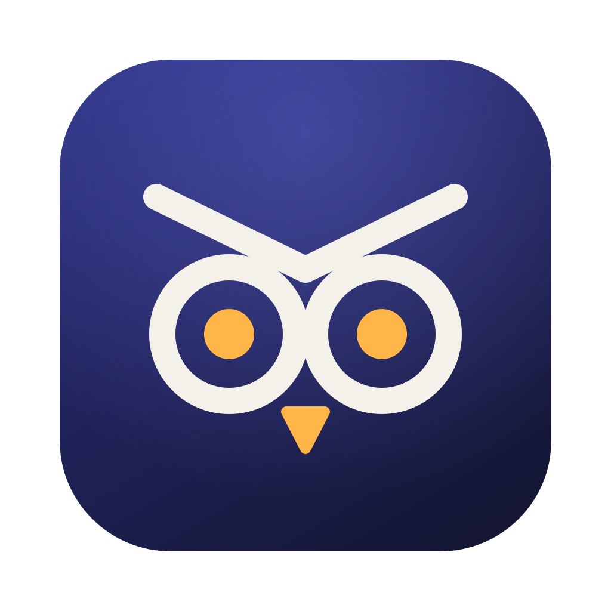
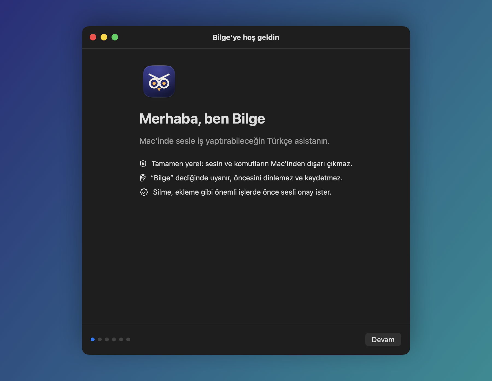
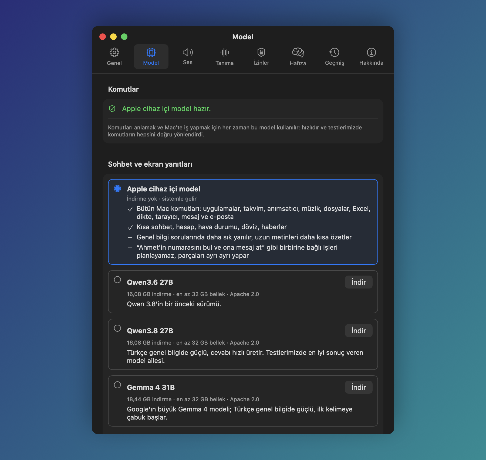
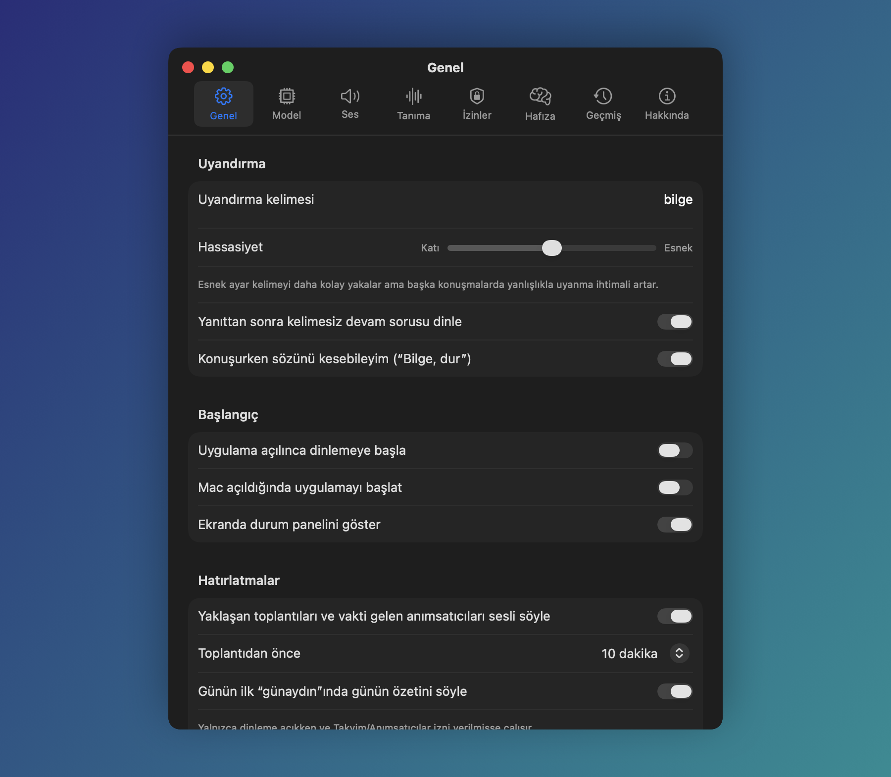
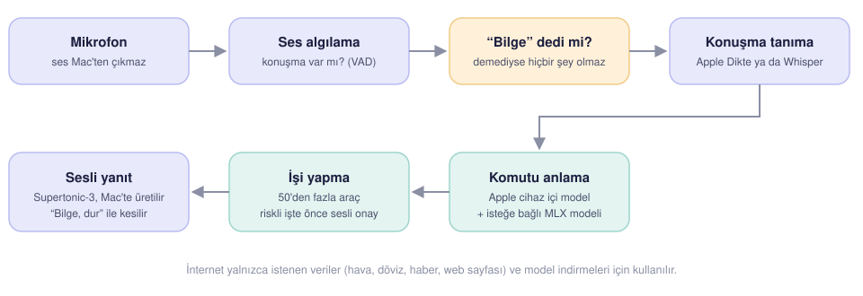

<p align="center">
  
</p>

<h1 align="center">Bilge</h1>

<p align="center">
  Mac için Türkçe ve İngilizce sesli asistan. Tamamen yerel çalışır: sesin ve komutların Mac'inden dışarı çıkmaz.
</p>

<p align="center">
  <a href="LICENSE"></a>
  
  
  
</p>

<p align="center">
  <a href="README.md">English</a> · <b>Türkçe</b>
</p>

<p align="center">
  
</p>

“Bilge” dediğinde uyanır, ne istediğini anlar, işi Mac'te yapar ve sesle cevap verir. Konuşma tanıma,
dil modelleri ve ses üretimi Mac'te çalışır; bulut hizmeti, hesap ya da abonelik yoktur. İnternet yalnızca
hava durumu, döviz, haber gibi istediğin veriler ve modellerin ilk indirmesi için kullanılır.

Windows ya da Linux mu kullanıyorsun? [Windows ve Linux için Bilge](https://github.com/coderssociety/bilge-desktop/blob/main/README.tr.md)
aynı asistanın onlar için yeniden yazılmış hâli.

## İçindekiler

- [Neler yapar](#neler-yapar)
- [Ekran görüntüleri](#ekran-görüntüleri)
- [Nasıl çalışır](#nasıl-çalışır)
- [Kurulum](#kurulum)
- [Kullanım](#kullanım)
- [Modeller](#modeller)
- [Dil](#dil)
- [Gizlilik](#gizlilik)
- [Sorun giderme](#sorun-giderme)
- [Kaynaktan derleme](#kaynaktan-derleme)
- [Lisans ve teşekkür](#lisans-ve-teşekkür)

## Neler yapar

| | |
|---|---|
| **Mac komutları** | Uygulama açma ve kapatma, ses düzeyi, müzik, ekran görüntüsü, Wi-Fi, karanlık mod, Kestirmeler, dosya bulma ve açma, Çöp Kutusu'na taşıma |
| **Takvim ve anımsatıcılar** | Sorma, ekleme, tamamlama; yaklaşan toplantıyı ve vakti gelen anımsatıcıyı kendiliğinden söyler |
| **İletişim** | Kişi bulma, okunmamış e-postaları okuma (“maillerimi oku”, “içeriğini oku”), Mail ve Mesajlar ile gönderme. Gönderme her zaman açık bir “evet” ister |
| **Çeviri** | Okuduğunu başka dilde okur: “İngilizce maili Türkçe oku”, “haberleri Fransızca oku”; ses 31 dilde konuşur |
| **Excel** | “D3'e B2 ile B1'i topla”, “B sütununun toplamı kaç”, “geri al” |
| **Bağlam** | Seçili metin, Finder'da seçili dosya ya da açık sayfa için “bunu özetle”, “bunu Ahmet'e gönder” |
| **Tarayıcı** | Sekmeler arasında geçme, geri ve ileri, kaydırma, sayfada arama |
| **Dikte** | Öndeki uygulamaya sesle yazma; “virgül”, “yeni satır”, “son cümleyi sil” |
| **Günlük özet** | “Günaydın” dediğinde hava, bugünkü etkinlikler, anımsatıcılar ve okunmamış e-postalar |
| **Hafıza** | “Şunu hatırla: …”, “bunu unut”. Hatırladıklarını Ayarlar'da görür ve silebilirsin |
| **Ses kimliği** | Sesini tanıtırsan yalnızca senin komutlarına ve onaylarına uyar |

Silme, gönderme ve ekleme gibi geri alınamayan işlerde önce sesli onay ister. Bilge konuşurken
“Bilge, dur” diyerek sözünü kesebilirsin.

## Ekran görüntüleri

<table>
  <tr>
    <td width="50%"></td>
    <td width="50%"></td>
  </tr>
  <tr>
    <td align="center">Kurulumun ilk adımı: Türkçe ya da English.</td>
    <td align="center">Sohbet modelini seç, indir ya da kendi MLX modelini ekle.</td>
  </tr>
  <tr>
    <td width="50%"></td>
    <td width="50%"></td>
  </tr>
  <tr>
    <td align="center">Uyandırma kelimesi, hassasiyet ve hatırlatmalar.</td>
    <td align="center">Ekranın üstündeki durum paneli ne duyduğunu ve ne cevap verdiğini gösterir.</td>
  </tr>
</table>

## Nasıl çalışır

<p align="center">
  
</p>

1. Mikrofon açıktır ama ses yalnızca bellekte, kısa parçalar halinde işlenir. Konuşma yoksa hiçbir şey yapılmaz.
2. Konuşmanın başında “Bilge” geçmiyorsa söylenen atılır.
3. Komut yazıya çevrilir (Apple Dikte ya da Whisper) ve Apple'ın cihaz içi modeli hangi aracın çağrılacağına
   karar verir. Sohbet ve genel bilgi sorularını istersen indirdiğin daha büyük bir model cevaplar.
4. Araç işi yapar. Riskli bir işse önce sorar, “evet” demeden yapmaz.
5. Cevap Supertonic-3 ile Mac'te seslendirilir.

## Kurulum

**Gerekenler**

- Apple Silicon Mac, **macOS 27** ya da üstü.
- **Apple Intelligence açık olmalı.** Komutları Apple'ın cihaz içi dil modeli anlar; bu model olmadan Bilge çalışmaz.
- İlk kurulumda ses modelleri için küçük bir indirme (Whisper tanımayı seçersen ayrıca 1,5 GB).
  İsteğe bağlı sohbet modeli için 16-19 GB indirme ve en az 32 GB bellek.

**Adımlar**

1. [Releases](../../releases) sayfasından son `Bilge-<sürüm>.dmg` dosyasını indir, Bilge'yi Uygulamalar klasörüne sürükle.
2. Bilge'yi aç. Kurulum sihirbazı önce dili (Türkçe ya da English) sorar, sonra gereken izinleri (mikrofon, konuşma tanıma, Erişilebilirlik; istersen takvim
   ve kişiler) ister, ses modellerini hazırlar ve sohbet modelini seçtirir.
3. “Bilge, saat kaç?” diyerek dene.

> Sürümler henüz Apple tarafından onaylanmış (notarize) değil. İlk açılışta macOS uyarı verirse
> Sistem Ayarları > Gizlilik ve Güvenlik'te “Yine de Aç”a bas ya da kaynaktan kendin derle.

Bilge menü çubuğunda çalışır, Dock'ta simgesi görünmez. Ayarlar'a ve kurulum rehberine menü çubuğundaki
simgeden ulaşırsın.

## Kullanım

Her komutu “Bilge” ile başlat: “Bilge, Safari'yi aç”. Bilge cevap verdikten sonra birkaç saniye daha dinler;
bu sırada devam sorusunu “Bilge” demeden sorabilirsin.

Ayarlar > Genel'den bir dinleme kısayolu da seçebilirsin (⌘ ya da ⌃ ile bir tuş veya bir F tuşu). Kısayola basmak
“Bilge” demekle aynıdır; Bilge konuşurken basarsan susar. Kısayol seçiliyken “Bilge” deyince dinlemeyi
kapatabilirsin; o zaman kısayola basana kadar hiçbir şey yazıya dökülmez.

<details>
<summary><b>Mac ve uygulamalar</b></summary>

- Safari'yi aç / Spotify'ı kapat / Hangi uygulamalar açık
- Sesi yüzde otuz yap / Müziği durdur / Sonraki şarkı
- Ekranı kilitle / Karanlık modu aç / Pil durumu nedir
- Masaüstündeki fatura dosyasını bul
- Sabah rutini kestirmesini çalıştır
</details>

<details>
<summary><b>Takvim, anımsatıcı, zamanlayıcı</b></summary>

- Bugün kaç toplantım var
- Yarın saat onda diş hekimi randevusu ekle
- Ekmek almayı anımsatıcılarıma ekle
- On dakikalık zamanlayıcı kur
</details>

<details>
<summary><b>Excel</b></summary>

Excel'de bir çalışma kitabı açıkken:

- D3'e B2 ile B1'i topla
- C5'e 1250 yaz
- B sütununun toplamı kaç
- Geri al
</details>

<details>
<summary><b>Seçili metin, dosya ya da sayfa</b></summary>

- (Bir metni seçip) Bunu özetle
- (Finder'da bir dosya seçip) Bunu Ahmet'e gönder
- Ekranda ne yazıyor
</details>

<details>
<summary><b>Tarayıcı ve web</b></summary>

- YouTube sekmesine geç
- Bu sayfada fiyat kelimesini ara
- YouTube'da kedi videoları ara
- Bugün hava nasıl / Dolar kaç / Haberleri oku
- Teknoloji haberleri / Başka var mı / Üçüncü haberi anlat / Tesla haberini aç (tarayıcıda da açar)
- TRT'den haberler / Başka bir kaynak (Anadolu Ajansı, TRT Haber, BBC Türkçe sırayla)
</details>

<details>
<summary><b>Dikte</b></summary>

- Dikteye başla, ardından konuş. “Virgül”, “nokta”, “yeni satır”, “son cümleyi sil” komut olarak işlenir.
- Dikteyi bitir
</details>

<details>
<summary><b>Hafıza</b></summary>

- Şunu hatırla: kahvemi şekersiz içerim
- Kahveyle ilgili bilgiyi unut
</details>

## Modeller

Komutları **her zaman** Apple'ın cihaz içi modeli yönlendirir: hızlıdır ve testlerde komutların hepsini
doğru araca gönderdi. Sohbet, genel bilgi soruları ve ekran özetleri için istersen daha bilgili bir model
indirebilirsin. Bilge bu modeli **kendi içinde, MLX ile** çalıştırır; LM Studio gibi ayrı bir program
gerekmez. Model “Bilge” dediğinde yüklenir, konuşma bitince bellekten çıkar (bu süre ayarlanabilir).

| Seçenek | İndirme | En az bellek | Not |
|---|---|---|---|
| Apple cihaz içi model | yok | - | Bütün komutlar, kısa sohbet. Genel bilgide daha sık yanılır, birbirine bağlı çok adımlı işleri planlayamaz. |
| Qwen3.6 27B (4-bit) | 16,1 GB | 32 GB | Qwen 3.8'in bir önceki sürümü. |
| Qwen3.8 27B (4-bit) | 16,1 GB | 32 GB | 20 Türkçe genel bilgi sorusunun 19'unu bildi (aynı konuşma içinde 20/20); ilk kelime ~2,2 sn. |
| Gemma 4 31B (4-bit) | 18,4 GB | 32 GB | Aynı testte 19/20 (vMLX ile ölçüldü); ilk kelimeye çabuk başlar. |

Ölçümler M5 Pro, 48 GB bellekte yapıldı. Qwen3.8 ölçümü aynı modelin bir topluluk türeviyle Bilge'nin
içinde, Gemma ölçümü başka bir 4-bit sürümüyle vMLX'te yapıldı. Apple modeli aynı testte 14/20 bildi.

Listedeki modeller Hugging Face'ten belirli bir sürüme sabitlenerek indirilir, büyük dosyalar SHA-256 ile
doğrulanır. Uzun talimatlar ve araç listesi bir kez okunup saklandığı için çok adımlı işlerde her adım
birkaç saniye sürer. LM Studio ya da vMLX kullanıyorsan oradaki modelleri de Ayarlar > Model'den seçebilirsin.

### Mac'inde zaten olan modeller

Bilge elindeki MLX modellerini kendisi bulur ve “Bu Mac'teki modeller” başlığı altında, nerede bulduğunu
yazarak listeler:

- LM Studio'nun model klasörü (`~/.lmstudio/models` ya da taşıdığın yer),
- mlx-lm gibi araçların indirdiği Hugging Face önbelleği (`~/.cache/huggingface/hub` ya da `HF_HOME` /
  `HF_HUB_CACHE`),
- “Klasör ekle…” ile eklediğin her klasör (üç seviye derinliğe kadar).

Bu modeller bulundukları yerden Bilge'nin içinde çalışır: hiçbir şey kopyalanmaz ya da yeniden indirilmez,
LM Studio'nun açık olması da gerekmez. GGUF modeller yalnızca LM Studio'nun kendisinde çalışır; onlar için
Ayarlar > Model'de sunucu olarak LM Studio'yu seç. vMLX'in JANG biçimindeki modeller listede görünür ama
yalnızca vMLX'te çalıştığı belirtilir.

### Kendi modelin

Listede olmayan bir modeli de kullanabilirsin. Hugging Face'ten MLX biçiminde bir model indir
(örneğin [mlx-community](https://huggingface.co/mlx-community)) ve klasörünü şuraya koy:

```
~/Library/Application Support/Asistan/Models/Kendi Modellerim/<model adı>/
```

Klasörde `config.json`, `tokenizer.json` (ya da `tokenizer.model`) ve `.safetensors` dosyaları olmalı.
Ayarlar > Model'deki “Bilge'nin klasörünü aç” düğmesi bu klasörü Finder'da açar, “Yenile” listeyi günceller. Modeli
kopyalamak yerine başka yerdeki klasörüne (örneğin LM Studio'nunkine) bir sembolik bağ da koyabilirsin.
Bilge'nin MLX sürümünün desteklemediği bir model türü açılamazsa o cevabı Apple modeli verir.

## Dil

Kurulumun ilk adımında Türkçe ya da İngilizce seçilir; Ayarlar > Genel'den değiştirilebilir (uygulama
yeniden başlar). Bilge seçilen dilde dinler, konuşur ve menülerini gösterir. Komutlar, Excel, dikte,
tarayıcı, hafıza ve günlük özet iki dilde de çalışır. İngilizcede:

- Konuşma tanıma varsayılan olarak Whisper'dır (1,5 GB indirme). Apple Dikte İngilizce modunda Türkçe
  söylenen “Bilge” adını neredeyse hiç tanımadı; Whisper 20 denemenin 17'sinde tanıdı.
- Haberler BBC News'ten okunur; döviz sorularında hedef söylenmezse dolar alınır.
- Bilge konuşurken araya girmek (“Bilge, stop”) Türkçedekinden daha az güvenilirdir: Whisper, Bilge'nin
  kendi sesinin yankısı arasında uyandırma kelimesini daha sık kaçırır.
- Testlerde İngilizce komutlar 76 denemenin 75'inde doğru araca gitti (geliştirmede hiç kullanılmamış
  cümlelerde 40'ta 37). Türkçedekinden biraz yavaştır (~1,8 sn), çünkü en sık Türkçe komutlar için olan
  kısayolun henüz İngilizcesi yok.

## Gizlilik

- Ses kaydı saklanmaz. Uyandırma kelimesinden öncesi dinlenmez.
- Bilge günde bir kez GitHub'a yeni sürüm çıkıp çıkmadığını sorar; çıktıysa menüde sayfasını gösterir. Kendiliğinden
  hiçbir şey indirmez; denetim Ayarlar > Genel'den kapatılabilir.
- Konuşma tanıma, dil modelleri ve ses üretimi Mac'te çalışır.
- Ağ bağlantıları yalnızca istediğin veriler (hava durumu, döviz, haber, web sayfası) ve model indirmeleri
  içindir. Web sayfası okurken yerel ağ adreslerine erişim engellenir.
- Hafıza, ses kimliği ve işlem kaydı `~/Library/Application Support/Asistan` altında, yalnızca senin
  okuyabileceğin dosyalarda durur.

## Sorun giderme

**“Bilge” dediğimde uyanmıyor.** Ayarlar > Genel'de hassasiyeti “Esnek”e doğru kaydır. Ayarlar > Tanıma'dan
konuşma tanıma motorunu değiştirmeyi de dene.

**Kendi kendine uyanıyor.** Hassasiyeti “Katı”ya doğru kaydır ya da Ayarlar > Tanıma > Ses kimliği'nden
sesini tanıt; o zaman yalnızca senin sesine cevap verir. Arka plandan yüksek hiçbir şey içermeyen kayıtlar ve
Whisper'ın sessizlikte uydurduğu altyazı cümleleri (“Altyazı M.K.”) zaten yok sayılır.

**“Dil modeli henüz hazır değil” diyor.** Sistem Ayarları > Apple Intelligence ve Siri'den Apple
Intelligence'ı aç ve modelin inmesini bekle.

**Bir uygulamayı kontrol edemiyor.** Sistem Ayarları > Gizlilik ve Güvenlik altında Erişilebilirlik ve
Otomasyon'da Bilge'ye izin verildiğini kontrol et. İzinlerin durumunu Bilge'nin Ayarlar > İzinler sekmesinde
de görebilirsin.

## Kaynaktan derleme

Gerekenler: Xcode 27, [XcodeGen](https://github.com/yonaskolb/XcodeGen) ve Xcode'un Metal araçları.

```bash
brew install xcodegen
xcodebuild -downloadComponent MetalToolchain
xcodegen generate
open Asistan.xcodeproj
```

İzinlerin her derlemede sıfırlanmaması için Apple ID'nle imzala: `Config/Signing.local.xcconfig`
dosyasını oluşturup içine `DEVELOPMENT_TEAM = <takım kimliğin>` yaz (bu dosya git'e girmez).

Testler:

```bash
cd Packages/AsistanKit && swift test
```

Dağıtım paketi (`build/release/Bilge-<sürüm>.dmg`):

```bash
scripts/release.sh
```

Developer ID sertifikası varsa uygulama dağıtım için imzalanır; `NOTARY_PROFILE` ortam değişkeni
`xcrun notarytool store-credentials` ile kaydedilmiş bir profili gösteriyorsa Apple onayından da geçirilir.
Sertifika yoksa DMG yalnızca geliştirme imzalıdır.

**Proje yapısı**

| Klasör | İçerik |
|---|---|
| `App/Sources/Assistant` | Dinleme döngüsü, uyandırma, onay ve araya girme |
| `App/Sources/Brain` | Komut yönlendirme, sohbet, çok adımlı işler, yerel modeller (MLX) |
| `App/Sources/Tools` | Mac'te iş yapan araçlar (takvim, Excel, tarayıcı, dosyalar…) |
| `App/Sources/UI` | Menü çubuğu, durum paneli, ayarlar, kurulum sihirbazı |
| `Packages/AsistanKit` | Arayüzden bağımsız, testli çekirdek: Türkçe ve İngilizce ayrıştırıcılar, sayı okuma, uyandırma eşleme |
| `Bench` | Konuşma tanıma, komut yönlendirme ve uçtan uca ölçüm setleri |

## Lisans ve teşekkür

Bilge [GNU GPL 3.0](LICENSE) ile dağıtılır. Kullandığı açık kaynak bileşenler ve modeller,
lisanslarıyla birlikte [THIRD_PARTY_NOTICES.md](THIRD_PARTY_NOTICES.md) dosyasında listelenir;
aynı liste uygulamada Ayarlar > Hakkında'da da görünür. Özellikle:

- Ses algılama, Türkçe ses üretimi, yankı giderme ve ses kimliği [FluidAudio](https://github.com/FluidInference/FluidAudio)
  (Apache 2.0) ile yapılır.
- Konuşma tanıma [WhisperKit](https://github.com/argmaxinc/argmax-oss-swift) (MIT) ya da Apple Dikte ile yapılır.
- Sohbet modelleri [MLX Swift](https://github.com/ml-explore/mlx-swift) ve
  [mlx-swift-lm](https://github.com/ml-explore/mlx-swift-lm) (MIT) ile çalışır.
- Türkçe ses [Supertonic-3](https://huggingface.co/Supertone/supertonic-3) modelidir (OpenRAIL-M);
  kullanım kısıtları bildirim dosyasında yazılıdır.
