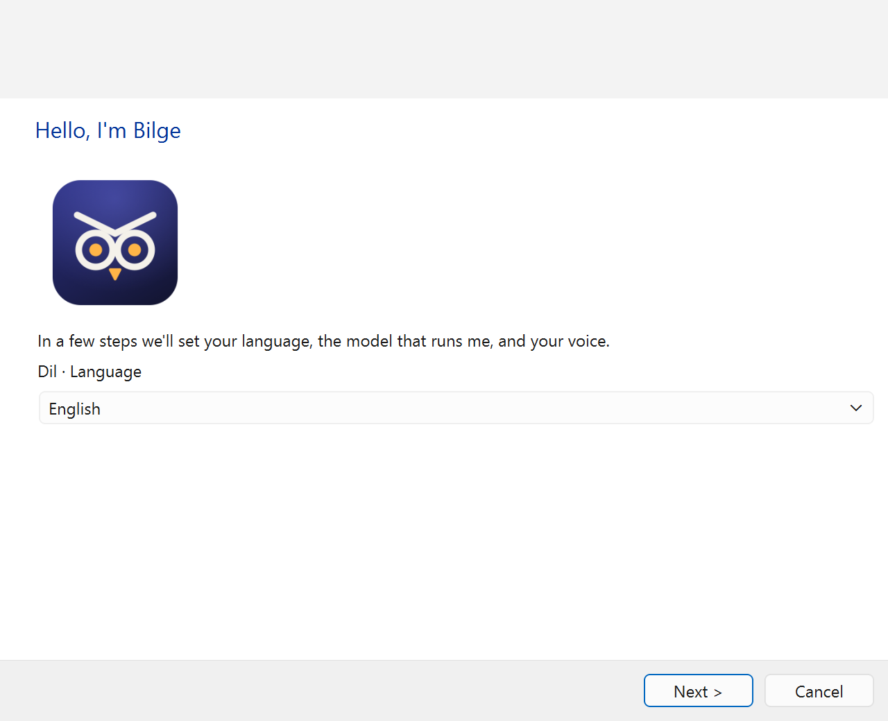
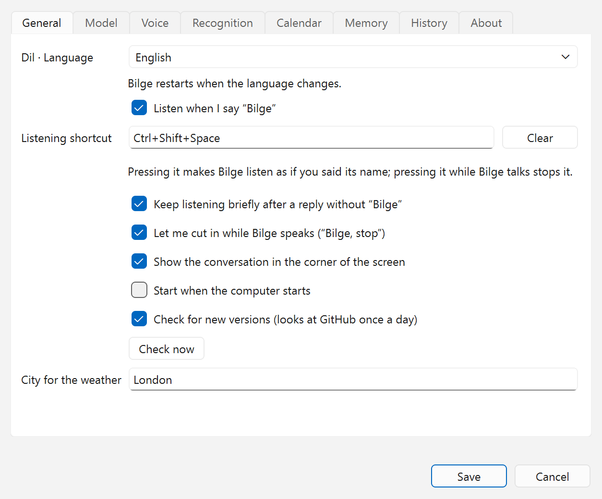
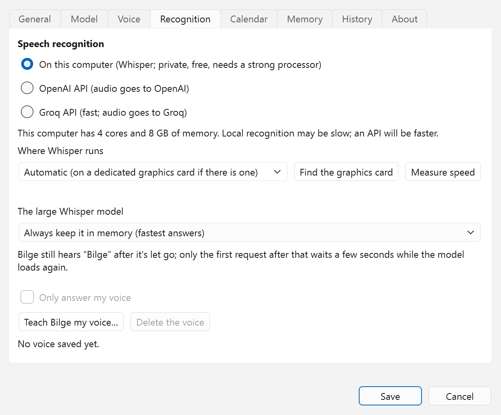

<p align="center">
  
</p>

<h1 align="center">Bilge for Windows and Linux</h1>

<p align="center">
  A voice assistant that speaks Turkish and English, for Windows and Linux.
</p>

<p align="center">
  <a href="https://github.com/coderssociety/bilge/releases/latest"></a>
  <br>
  <sub>Free and open source · Windows 10/11 installer · Linux AppImage for x86_64 and arm64 ·
  <a href="../mac/README.md">on a Mac? →</a></sub>
</p>

<p align="center">
  <a href="../LICENSE"></a>
  
  
  
</p>

<p align="center">
  <b>English</b> · <a href="README.tr.md">Türkçe</a>
</p>

<p align="center">
  
</p>

**Why Bilge**

- **Made for Turkish.** It understands everyday Turkish and knows what a Turkish user asks for: prayer times,
  earthquake alerts from AFAD, Süper Lig, Borsa İstanbul, gold and fuel prices. It speaks English too.
- **Your choice of brain.** A model on your computer (Ollama, LM Studio, llama.cpp) or a hosted API (OpenAI,
  Anthropic, Google Gemini, OpenRouter, Groq, DeepSeek), with keys in the system's key store.
- **It gets things done, safely.** Apps, files and documents, Excel or LibreOffice Calc, Outlook, calendars, music
  and your smart home, and it asks out loud before anything that can't be undone.
- **Private where you want it.** Whisper runs on your processor or graphics card, so your voice stays on your
  computer unless you pick a cloud recognizer.

**Get started:** run the Windows installer or the AppImage, choose a language and a model, then say “Bilge, what
time is it?”. [Installing](#installing) has the details.

It is the sibling of [Bilge for macOS](../mac/README.md): the same assistant and
the same rules (say “Bilge”, it asks before anything risky), rebuilt in Python because the Mac version is made of
Apple-only parts.

Unlike the Mac version, the language model can be a hosted API as well as a local one, chosen per setup:

| | Local | Hosted API |
|---|---|---|
| Language model | Ollama, LM Studio, llama.cpp | OpenAI, Anthropic, Google Gemini, OpenRouter, Groq, DeepSeek |

API keys are kept in the system's key store (Windows Credential Manager, the Secret Service on Linux), never
in a plain file.

## Status

All five phases are done. Since 0.6.0 the Windows and Linux app is released together with the Mac app, under one
version number.

1. **Core** (done): the Turkish and English parsers from the Mac version with the same test cases, the
   tool-calling agent with confirmations and prompt-injection rules, and a text chat to try it.
2. **Voice** (done): wake word or shortcut, speech recognition (Whisper on the processor or a graphics card, or
   the OpenAI or Groq API), the Supertonic-3 voice, echo cancellation so you can cut in, and voice recognition of
   the owner.
3. **Linux tools** (done): apps, volume, music players, files and documents, typing and dictation, timers,
   calendar and reminders, LibreOffice Calc, system controls.
4. **Windows tools** (done): the same, plus Excel, Outlook mail and Outlook's calendar and tasks.
5. **The app** (done): a tray icon, a corner window showing the conversation, settings, first-run setup, a
   Windows installer and a Linux AppImage.

## Screenshots

<table>
  <tr>
    <td width="50%"></td>
    <td width="50%"></td>
  </tr>
  <tr>
    <td align="center">Setup starts with the language: Türkçe or English.</td>
    <td align="center">The wake word, a listening shortcut, the corner window and update checks.</td>
  </tr>
  <tr>
    <td width="50%"></td>
    <td width="50%"></td>
  </tr>
  <tr>
    <td align="center">A model on this computer (LM Studio, Ollama, llama.cpp) or a hosted API.</td>
    <td align="center">Whisper on the processor or a graphics card, its speed, and your voice.</td>
  </tr>
  <tr>
    <td colspan="2" align="center"></td>
  </tr>
  <tr>
    <td colspan="2" align="center">The corner window shows what it heard and what it answered.</td>
  </tr>
</table>

The pictures are of Windows 11; on Linux the windows take the desktop's own look. `scripts/screenshots.py`
makes them again from the app's real windows, with sample settings.

## Installing

- **Windows 10/11 (64-bit):** run `Bilge-Setup-<version>.exe` from the releases. It installs for your user only,
  without administrator rights, and can start Bilge with Windows. The installer isn't signed, so Windows warns on
  the first start: **More info → Run anyway**.
- **Linux:** download `Bilge-<version>-x86_64.AppImage` (or `aarch64`), make it executable and run it. It needs
  glibc 2.34 or newer (Ubuntu 22.04+, Debian 12+, Fedora 36+) for x86_64, 2.39 for arm64. On GNOME the tray icon
  needs the AppIndicator extension (Ubuntu has it); without it Bilge opens a small window instead.

On first start, setup asks for the language, the language model, speech recognition, and downloads the voice
models (1-2 GB). After that Bilge sits in the tray: say “Bilge” and your request. `Bilge.AppImage cli …` and
`bilge-cli.exe` give the command line below.

## Trying it from source

Needs Python 3.14 and [uv](https://docs.astral.sh/uv/).

```bash
uv sync
uv run bilge use lmstudio <model id>       # or: openai, anthropic, gemini, openrouter, groq, deepseek, ollama
uv run bilge key openai                    # hosted providers only; stored in the system key store
uv run bilge chat                          # by typing
uv run bilge listen                        # by voice; downloads the voice models the first time
uv sync --extra app && uv run bilge-app    # the tray app with setup and settings
```

`uv run bilge models` lists the chosen provider's models. A few more commands:

```bash
uv run bilge devices          # microphones and speakers
uv run bilge gpu              # the graphics cards, and where Whisper runs
uv run bilge download         # download the voice models
uv run bilge say "Merhaba"    # say a sentence in Bilge's voice
uv run bilge enroll           # teach Bilge your voice
uv run bilge music youtube    # where named songs play (see "Choosing a music service")
uv run bilge calendar …       # connect a calendar (see "Connecting a calendar")
```

## Calling Bilge

Say “Bilge”, or press the listening shortcut chosen under Settings → General; pressing it while Bilge talks stops
it. With a shortcut chosen, the wake word can be turned off, and then nothing is transcribed until the shortcut is
pressed. Windows and X11 desktops take the shortcut directly; on Wayland the desktop asks you to approve it (KDE
Plasma 5.27+, GNOME 48+), once; on KDE it can be changed later under System Settings → Shortcuts. Where it can't, and
on Hyprland, which takes the request but binds no key itself, give `Bilge --listen` (the settings show the full
command) a shortcut in the desktop's own keyboard settings.

After a reply Bilge keeps listening for a moment, so a follow-up needs no “Bilge”. While it speaks you can cut in
(“Bilge, stop”). Both can be turned off under Settings → General.

## Speech recognition

Whisper on the computer runs on the processor, on an NVIDIA card through CUDA when CUDA 12 and cuDNN 9 are
installed, or on any graphics card (AMD, Intel or NVIDIA) through whisper.cpp with Vulkan, which the installers
include. Automatic uses a dedicated card when there is one; Settings → Recognition can pick a card built into the
processor too, or the processor alone. On a card the model is a separate download of about 870 MB.
“Measure speed” there times one request in each place, so the numbers show which to pick. The large model can also
be let go after 10, 30 or 60 minutes without a request; Bilge still hears its name, and only the first request
after that waits a few seconds while the model loads again.

A recording with nothing louder than its own background is not transcribed, and the subtitle credits Whisper
invents for silence (“Altyazı M.K.”, “Thanks for watching!”) are dropped from what it writes.

“Only answer my voice” under Settings → Recognition makes Bilge ignore other people. You read five short sentences
once (or run `bilge enroll`); only a summary of your voice is kept, never the recordings. If the check can't run,
Bilge lets speech through rather than lock you out.

## Updates

Once a day Bilge asks GitHub for the newest release; a newer one shows up in the tray menu with a link to its
page. Nothing is downloaded or installed by itself. Settings → General turns this off.

## What it can do

Bilge speaks the language chosen in setup, Turkish or English, and understands requests in that language. Common
phrasings go straight to the right tool; anything else goes to the language model, which picks one. The examples
below are in English; the [Turkish page](README.tr.md) has the Turkish ones. “Built in” means nothing else has to
be installed.

### On the computer

| | Examples | On Linux | On Windows |
|---|---|---|---|
| Apps | “open Firefox”, “close the calculator”, “which apps are open”. Closing asks first. | menu entries (`.desktop` files, Flatpak too), started with `gtk-launch` or `gio` | the Start menu, desktop and Store apps; closed like clicking their close button, so they can still ask to save |
| Volume | “set the volume to 30 percent”, “turn it up by 20”, “mute” | `wpctl`, `pactl` or `amixer` | Core Audio |
| Windows | “minimize the window”, “maximize it”, “full screen”, “close this window”. Acts on the window in front; closing asks first. | X11: `wmctrl` or `xdotool`; Sway and Hyprland; KDE on Wayland with `kdotool`. GNOME on Wayland lets no program do this, so Bilge tells you the keyboard shortcuts | built in |
| Browser | “next tab”, “go to tab 2”, “close this tab”, “bring back the tab I closed”, “go back”, “reload the page”, “scroll down”, “find price on this page”. Presses the browser's own shortcuts in the browser in front. A tab can't be picked by its title, and by number only 1 to 8. | `xdotool` (X11), `wtype` or `ydotool` (Wayland); not on GNOME on Wayland, which doesn't say which window is in front | built in |
| Typing and dictation | “type: see you at five”, “start dictation” … “stop dictation”. Types where the cursor is and never presses Enter. Refused in terminals, code editors, remote desktops, virtual machines and password managers. | `xdotool` (X11), `wtype` or `ydotool` (Wayland). GNOME on Wayland doesn't say which window is in front, so there Bilge asks before typing | built in; each character is sent as itself, so Turkish letters come out right with any keyboard layout |
| Files | “find the rental contract”, “open the second one”, “open my latest download”, “open the Downloads folder”, “create a folder called Invoices in Documents”, “move the old invoice to the trash”. The search goes through the home folder, newest first. A program it finds is shown in the file manager, never run. Moving to the trash asks first. | the freedesktop trash | the Recycle Bin |
| Documents | “summarize the PDF I just downloaded”, “what does the lease say about pets”, “read on”. Reads PDF, Word, Excel, PowerPoint, OpenDocument, RTF, HTML, Markdown, CSV and text files without opening them, a long one in parts. A scanned PDF holds pictures of pages, not text, so it can't be read. | built in | built in |
| Screen | “what does the screen say”, “read this error”, “summarize this page”. Reads the text of the window in front or the whole screen (OCR). The capture isn't kept. | Tesseract with its Turkish and English data (`tesseract-ocr`, `tesseract-ocr-tur` on Ubuntu) and a screenshot tool | the OCR built into Windows; needs the English or Turkish language pack |
| “This” and “that” | “summarize this”, “translate this into Turkish”, “explain that”, “open the selected file”. Uses the selected text, else the clipboard, else the file selected in the file manager, else the text in the window in front. | the selected file is the one copied with Ctrl+C in the file manager | the selection in the File Explorer window in front |
| Clipboard | “what's on the clipboard”, “translate the selected text”, “copy that” (the previous answer) | `wl-clipboard`, `xclip` or `xsel` | built in |
| Spreadsheet | “type Rent in A1”, “what's in D3”, “what's the total of column B”, “clear D3”, “undo”, “I'm done”. Once a sheet is in use, commands go to it until you say you're done. Writing over a filled cell asks first. | LibreOffice Calc (`python3-uno`) | Excel while it is open, or LibreOffice Calc |
| System | “lock the screen”, “put the computer to sleep”, “turn on dark mode”, “turn off Wi-Fi”, “take a screenshot of this window”, “open the Bluetooth settings”, “how's the battery”, “how much disk space is left”. The status covers free disk space, memory use, time since start, the system version, Wi-Fi and the IP address. Sleep and turning Wi-Fi off ask first. | `loginctl` or the desktop's screen locker; `gsettings`, Plasma, or the dark theme on XFCE and Cinnamon; `nmcli`; the desktop's screenshot tool (`gnome-screenshot`, Spectacle, `grim`, `maim`, `scrot`) or the desktop portal | built in |
| Screen and power | “set the brightness to 50 percent”, “dim the screen”, “turn on Do Not Disturb”, “turn off Bluetooth”, “restart the computer”, “log out”. Turning Bluetooth off, restarting, shutting down and logging out ask first. | brightness through GNOME or Plasma, else `brightnessctl` (laptop screen) or `ddcutil` (external monitor); Do Not Disturb on GNOME, Cinnamon, XFCE, KDE and dunst; `bluetoothctl` or `rfkill`; `systemctl` and the desktop's own log-out | brightness of laptop screens only (WMI); Bluetooth through the radio switch; `shutdown`. Windows lets no app change Do Not Disturb: Bilge says to press Win+N and opens the notification settings |
| Your commands | “run the backup command”, “what are my commands”. Programs you add yourself; see [Adding your own commands](#adding-your-own-commands). | built in | built in |

### Questions and information

| | Examples | On Linux | On Windows |
|---|---|---|---|
| Date, time, sums | “what's the date”, “what's 18 percent of 125” | built in | built in |
| Conversions and world time | “convert 5 kg to pounds”, “how many cups is 1 liter”, “what time is it in London”, “how many hours ahead is Tokyo”. Length, weight, volume, area, speed, temperature and data sizes, computed exactly, without the model. | built in | built in |
| Weather | “how's the weather”, “will it rain tonight”, “tomorrow afternoon”, “do I need an umbrella”. Without a city, the one under Settings → General. | Open-Meteo | the same |
| Money | “how much is £50 in dollars”, “what's the gold price”, “how much is an ounce of gold”, “diesel price in Ankara”. Gold: gram, quarter, half and full coins, the Republic coin and the ounce. Fuel: petrol, diesel and LPG per liter in a Turkish province, the weather city when none is said. | exchange rates of the European Central Bank (Frankfurter); gold from Truncgil, else Altınkaynak; fuel from Opet and Petrol Ofisi | the same |
| Prayer times | “when is maghrib”, “how long until iftar”, “today's prayer times”, “when is fajr in Konya tomorrow”. Without a city, the weather city. | Diyanet's monthly table (ezanvakti.emushaf.net), else Aladhan with Diyanet's method | the same |
| Encyclopedia | “who was Ada Lovelace”, “what is a black hole”, “tell me about the Ottoman Empire”. A short answer from Wikipedia. | English or Turkish Wikipedia | the same |
| News | “technology news”, “anything else”, “another source”, “tell me about the third story”, “open the Tesla story”, “read on”. General, economy, sports, world or technology headlines; “open” reads the story and shows it in the browser too. | BBC News, The Guardian, NPR in English; Anadolu Ajansı, TRT Haber, BBC Türkçe in Turkish | the same |
| Web | “read github.com/… and summarize it”, “search Google for train times”, “find cat videos on YouTube”, “open bbc.co.uk”. Reading downloads the page; searching and opening use the browser (Google, YouTube, Google Maps, Wikipedia). Addresses on the local network are never downloaded. | the default browser | the same |
| Earthquakes | “recent earthquakes”, “was there an earthquake today”, “where was the latest earthquake”. While Bilge runs, it also says unasked when a magnitude 4+ earthquake happens within 150 km of the weather city (Settings → General turns this off). | AFAD, or Kandilli Observatory when AFAD can't be reached | the same |
| Football | “when does Beşiktaş play”, “today's matches”, “yesterday's results”, “the league table”, a team's score or live minute. Süper Lig only. | ESPN | the same |
| Stocks | “how is the stock market”, “BIST 100”, “THY shares”. Borsa İstanbul: the index or a share's price and its daily change. Figures only, never advice. | Yahoo Finance | the same |
| Daily briefing | “good morning” (the first one of a morning), “give me my daily briefing”, “what does my day look like?”. The date, the weather, today's remaining events and the reminders due; a part that is slow or unavailable is left out. | built in | built in |
| Translation | “read the English email in Turkish”, “read the news in German”, “translate this into French”. The voice reads the result in that language, and “read on” keeps translating. | built in | built in |

### Mail, calendar and people

| | Examples | On Linux | On Windows |
|---|---|---|---|
| Calendar | “what's on tomorrow”, “add a dentist appointment on Friday at 10”, “cancel tomorrow's meeting”, “move the dentist to Friday”, “push the meeting back an hour”. Of a repeating event only that one changes, unless you say all of them. Adding, moving and deleting ask first. An iCal address can only be read. | CalDAV or an iCal address; see [Connecting a calendar](#connecting-a-calendar) | the same, or Outlook's calendar while classic Outlook is open |
| Reminders | “what's on my to-do list”, “add buy milk to my reminders”, “I paid the bill, tick it off”. With a day and time, Bilge says it when it's due. Adding asks first. | the CalDAV account's task lists | the same, or Outlook's tasks |
| Mail | “how many unread emails do I have”, “read Anna's email”, “read my latest email”, “what does it say”; on Windows also “reply to it: I'm free tomorrow”, “email Anna: I'll be late”, “send this to Anna”. An e-mail is read out with the address it goes to, and sent only after a yes. | IMAP, reading only; see [Connecting mail](#connecting-mail) | classic Outlook while it is open: reading, replying and sending. “Send this” sends the selected text or the clipboard, or attaches the files selected in File Explorer |
| Contacts | “what's Anna's number”, “Tom's email”. Also where Bilge finds who an e-mail or a text message goes to. | the CalDAV account's address book, when the server has one (CardDAV) | Outlook's contacts |
| Text messages | “text Anna: on my way”. Reads out the number and the message, and asks first. | a phone paired through KDE Connect or GSConnect (`kdeconnect-cli`) | not available |
| Notes | “take a note: call the plumber”, “add milk to my shopping note”, “what notes do I have”, “read my shopping note”. One Markdown file per note, which any text editor opens. Adding to a note asks first. | in Documents/Bilge Notes (Bilge Notlar in Turkish; a folder that already exists under either name is used) | the same |
| Memory | “remember that I take my coffee black”, “what do you remember about me”, “forget my coffee order”. Up to 50 short facts, given to the model with each request. Forgetting asks first. Settings → Memory lists and deletes them. | built in | built in |
| Meetings | “start recording the meeting”, “stop recording”, “read the summary”, “transcribe my latest audio download”. Writes down what the microphone hears until you stop, then saves the transcript with the model's summary in Documents/Bilge/Toplantılar. Audio and video files (m4a, mp3, wav, mp4) are transcribed the same way, and Bilge says when it's done. Only the text is kept, not the audio. Works when Bilge listens by voice. | built in | built in |
| Interpreter | “start interpreter mode: English and Turkish”, “interpret German”, “stop interpreting”. What either person says is translated into the other language and spoken; the corner window shows each translation. It ends by itself after two minutes with nothing to translate. Needs Whisper on the processor or an NVIDIA card, since whisper.cpp on other cards and the speech APIs are told the language beforehand and can't tell which one was spoken. | built in | built in |

### Music, radio and video

| | Examples | On Linux | On Windows |
|---|---|---|---|
| Music | “play Tarkan”, “play Kuzu Kuzu on YouTube”, “play Sezen Aksu on YouTube Music”, “play Tarkan on Deezer”, “play Tarkan on Apple Music”. Opens the first matching song on YouTube, YouTube Music, Deezer (its app when installed) or Apple Music in the browser. Spotify has no public search, so Bilge only opens Spotify's search for you to pick from. With no service named, the one chosen in the settings; see [Choosing a music service](#choosing-a-music-service). The browser's autoplay rules may keep YouTube from starting until you click the page. | the default browser | the same |
| Players | “pause the music”, “next song”, “what's playing”, “skip forward 30 seconds”, “start the song over”, “turn on shuffle”, “repeat this song”. Controls the open player (Spotify, Rhythmbox, VLC, a browser…); with none open, starts an installed one. | MPRIS | the system media controls |
| Radio | “play Power FM”, “play the radio” (the last station), “turn the radio down”, “which station is this”, “stop”. Plays inside Bilge and is turned down while Bilge listens or speaks. | stations by name from radio-browser.info | the same |
| Podcasts | “play the latest episode of The Daily”, “is there a new episode of Huberman Lab?”, “pause”, “resume”, “skip forward 30 seconds”. Plays inside Bilge and waits while Bilge listens or speaks. | shows found through Apple's podcast search, episodes from the show's own feed | the same |
| YouTube summary | “summarize this video: …”, “sum up the video on the clipboard”, “summarize the rest”. Uses the video's captions: in Bilge's language first, else the language the video speaks, else English. Without an address, the one on the clipboard or in the selected text. A private, removed or age-restricted video can't be read. | built in | built in |

### Timers, routines and the home

| | Examples | On Linux | On Windows |
|---|---|---|---|
| Timers and alarms | “set a 10 minute tea timer”, “wake me at 7:30 tomorrow”, “how long is left”, “cancel the tea timer”. Kept by Bilge, also across restarts; when one goes off, Bilge says it and shows a notification. | built in | built in |
| Routines | “every night at 9 tell me the weather”, “every weekday at 7 read the news”, “what routines do I have”, “delete the evening routine”. Setting one up asks first. A routine runs its command as if you had said it, only while Bilge listens, and never runs a step that needs a yes, since nobody is there to answer. Settings → Routines lists and deletes them. | built in | built in |
| Smart home | “turn on the living room lights”, “set the thermostat to 21”, “is the front door locked”, “turn off the lights”. Locks, the garage door and the alarm ask first. See [Connecting Home Assistant](#connecting-home-assistant). | Home Assistant's conversation API | the same |

### Asking first

Anything that changes, deletes or sends something waits for a spoken yes (or the Yes button in the corner window):
moving files to the trash, closing an app or a window, writing over a filled cell, adding to or changing the
calendar and reminders, adding to a note, forgetting, setting up a routine, putting the computer to sleep, turning
Wi-Fi or Bluetooth off, restarting, shutting down or logging out, a lock, garage door or alarm at home, and the first
run of each of your own commands. So does any step that could carry text Bilge has read somewhere else, such as a
web page, an e-mail or the clipboard. An e-mail is read out with the address it goes to before it is sent, and a
text message with its number. Sending an e-mail or a text, restarting, shutting down or logging out, and your own
commands need an explicit “yes” or “send” (“evet”, “onaylıyorum”, “gönder” in Turkish): a casual “okay” from the TV
is not enough. Anything else heard while Bilge waits is ignored, and with no clear answer within a few seconds nothing
is done. Settings → History shows what Bilge did, and what you said no to.

### Connecting a calendar

```bash
uv run bilge calendar caldav https://cloud.example.org/remote.php/dav --user ayse   # Nextcloud, iCloud, Fastmail…
uv run bilge calendar ics                   # read-only: e.g. Google Calendar's "secret address in iCal format"
uv run bilge calendar outlook               # Windows: Outlook's calendar and tasks, while Outlook is open
uv run bilge calendar off
```

The password (use an app password where the service has them) and the secret address are typed hidden and kept
in the system key store. CalDAV is only spoken to over HTTPS, except a server on the same computer. `--name` picks
the calendar new events go to; without it, the first one that takes events. Settings → Calendar does the same and
can test the connection. On Linux the reminders and the contacts come from the same CalDAV account.

### Connecting mail

On Linux, enter an IMAP account under Settings → Mail: the server (for example `imap.gmail.com`, or
`server:port`), the user name and an app password, then “Test the connection”. Bilge reads the inbox over TLS and
only reads it: nothing is marked read, moved or deleted, and it can't send or reply. The password is kept in the
system key store.

On Windows, mail comes from classic Outlook while it is open. The new Outlook can't be controlled by other programs,
so Bilge says so instead.

### Contacts

Contacts need no setup of their own. On Windows they come from Outlook; on Linux from the address book of the CalDAV
account under Settings → Calendar, when its server also offers one (Nextcloud, Radicale, Baïkal and others do).

### Adding your own commands

Under Settings → Commands, give a command a name and a command line, such as “backup” and
`rsync -a ~/Documents /media/backup`. Then say “run the backup command”, or ask “what are my commands”. A command
runs as written, without a shell: `~` is the only shortcut understood, a path with spaces goes in quotes, and
nothing you say is added to it. It must finish within 60 seconds, and Bilge reads out the start of what it prints.
Each command asks for your yes before its first run, and again after it is changed.

### Connecting Home Assistant

Under Settings → Smart home, enter Home Assistant's address (for example `http://homeassistant.local:8123`) and a
long-lived access token, which you create in Home Assistant under your profile's Security section. “Test the
connection” checks both. The token is kept only in the system key store.

Bilge passes your words to Home Assistant's conversation API, which decides which device you mean, so rooms and
devices go by the names Home Assistant knows. Requests go only to the address you entered.

### Choosing a music service

Settings → General → Music service, or `bilge music` with `auto`, `spotify`, `youtube`, `youtube_music`, `deezer`
or `apple_music` (without one it prints the current choice). Automatic means the Spotify app when it is installed,
otherwise YouTube Music. A service named in the request always wins: “play Tarkan on YouTube” uses YouTube.

## Privacy

With Whisper on the computer, your voice stays on it; with the OpenAI or Groq recognizer the audio of each request
goes to that company. The wake word is always recognized on the computer. With a hosted language model, what you
say and what the tools return (an e-mail, a document, a web page) go to that provider; a local model keeps them on
the computer.

Settings, memory, routines, timers, notes, meeting transcripts and the history of actions stay on the computer.

Bilge contacts these services only when a feature needs them:

| Service | For |
|---|---|
| the chosen language model provider; OpenAI or Groq for speech | when one of them is chosen in the settings |
| Hugging Face | downloading the voice models |
| GitHub | the daily update check (can be turned off) |
| Open-Meteo | the weather and finding a city |
| Frankfurter (European Central Bank rates) | exchange rates |
| Truncgil, Altınkaynak, Opet, Petrol Ofisi | gold and fuel prices |
| ezanvakti.emushaf.net, Aladhan | prayer times |
| Wikipedia | encyclopedia answers |
| Anadolu Ajansı, TRT Haber, BBC, The Guardian, NPR | news feeds, and a story's page when it is opened |
| AFAD, Kandilli Observatory | earthquakes; with alerts on, checked regularly while Bilge runs |
| ESPN | football |
| Yahoo Finance | stocks |
| radio-browser.info and the station itself | radio |
| Apple's iTunes Search, and each show's own feed | podcasts, and songs on Apple Music |
| YouTube, YouTube Music, Deezer | finding songs, and a video's captions |
| a web page you name | reading that page; addresses on the local network are refused |
| your CalDAV, iCal and IMAP servers | the calendar, reminders, contacts and mail |
| Home Assistant | only at the address you entered |

Searches and sites you ask to open are shown in your own browser.

## Development

```bash
uv run pytest
uv run ruff check src tests && uv run ruff format --check src tests
```

`../bench/` holds the command sets used to measure routing in the Mac version. `scripts/linux-check` runs the
whole suite on Ubuntu, plus tests that drive the real programs (typing, clipboard, sound, an MPRIS player,
notifications, LibreOffice Calc…) on a screenless desktop:

```bash
docker build -t bilge-linux-check scripts/linux-check
docker run --rm -v "$PWD":/src:ro bilge-linux-check
```

Installers are built by `.github/workflows/release.yml` on a version tag: PyInstaller (`packaging/bilge.spec`),
Inno Setup on Windows (`packaging/windows/bilge.iss`) and an AppImage built in Docker (`packaging/linux`). Both
include whisper.cpp's server built with Vulkan (`packaging/whisper`); a build without it runs Whisper on the
processor or an NVIDIA card only. To try a card from source, put a `whisper-server` on `PATH` or name it in
`BILGE_WHISPER_SERVER`.

On Windows, `tests/windows` does the same against the signed-in desktop (it opens and closes a few windows):

```powershell
$env:BILGE_REAL_DESKTOP = 1; uv run pytest tests/windows
```

## License

GPL-3.0, see [LICENSE](../LICENSE).
