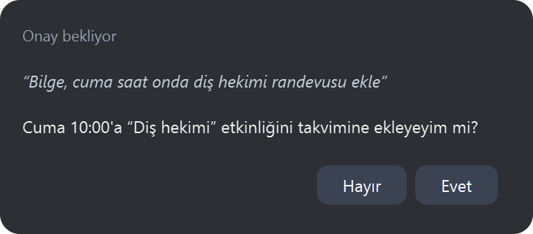
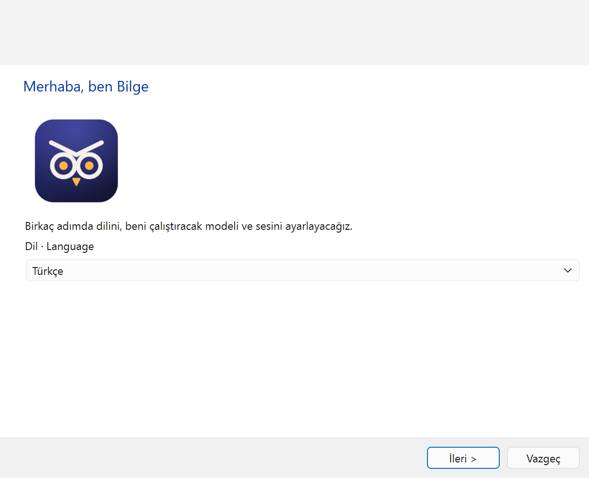
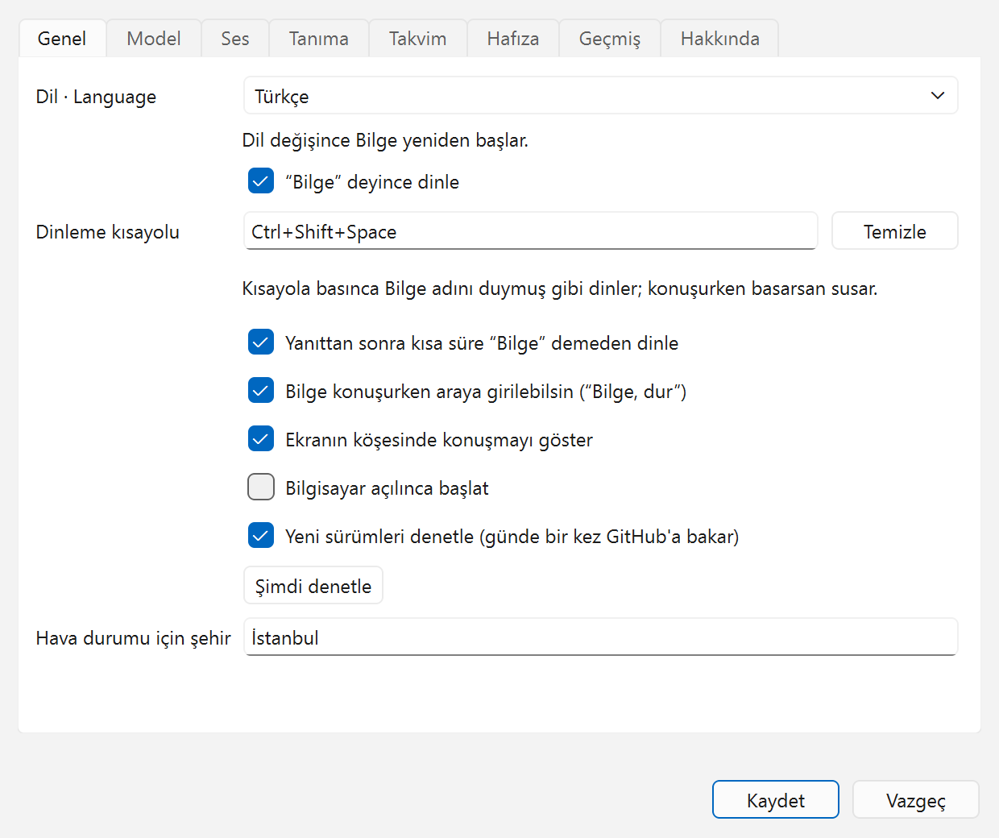
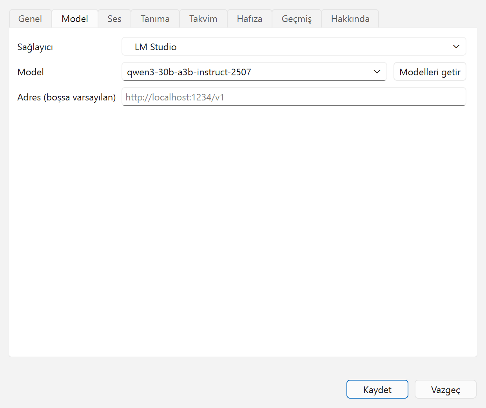
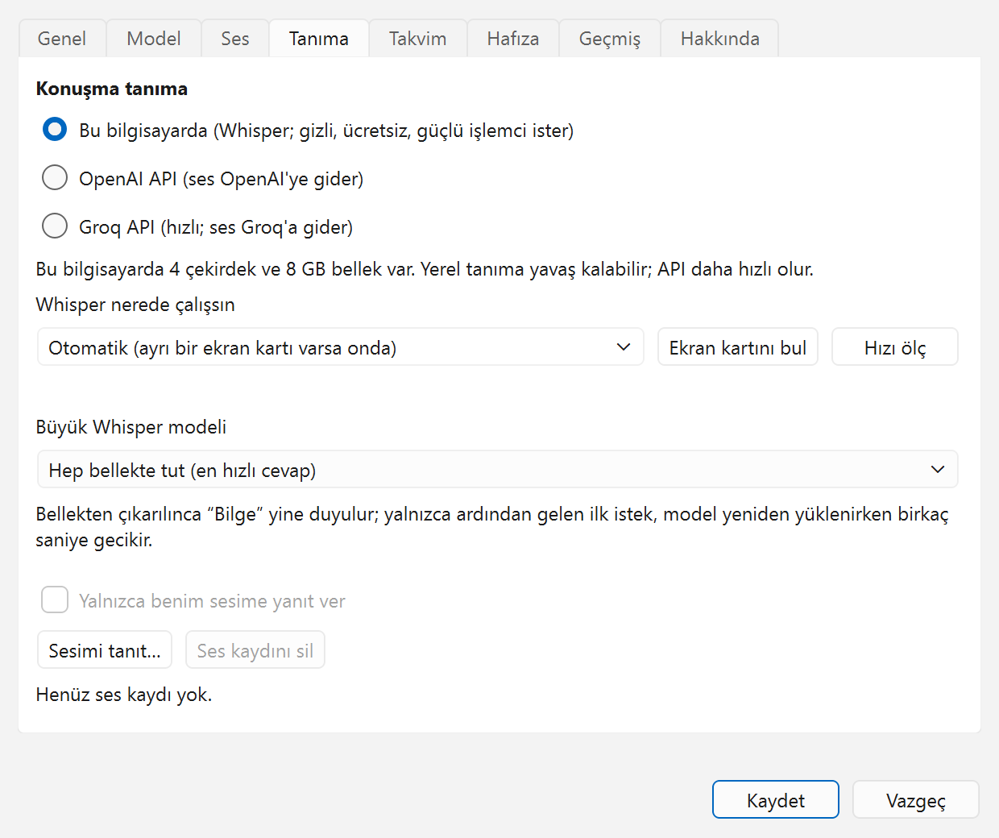
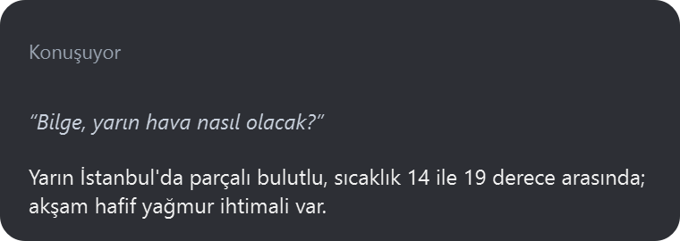

<p align="center">
  
</p>

<h1 align="center">Windows ve Linux için Bilge</h1>

<p align="center">
  Windows ve Linux için Türkçe ve İngilizce konuşan bir sesli asistan.
</p>

<p align="center">
  <a href="LICENSE"></a>
  
  
  
</p>

<p align="center">
  <a href="README.md">English</a> · <b>Türkçe</b>
</p>

<p align="center">
  
</p>

[Mac için Bilge](https://github.com/coderssociety/bilge-assistant)'nin kardeşidir: aynı asistan, aynı kurallar
(“Bilge” de, riskli bir şey yapmadan önce sorar). Mac sürümü yalnızca Apple'a özgü parçalardan oluştuğu için
Python ile yeniden yazıldı.

Mac sürümünden farklı olarak dil modeli bilgisayarında da çalışabilir, internetteki bir API de olabilir; kurulumda
seçilir:

| | Bu bilgisayarda | İnternetten (API) |
|---|---|---|
| Dil modeli | Ollama, LM Studio, llama.cpp | OpenAI, Anthropic, Google Gemini, OpenRouter, Groq, DeepSeek |

API anahtarları düz bir dosyada değil, sistemin anahtar deposunda durur (Windows'ta Kimlik Bilgileri Yöneticisi,
Linux'ta Secret Service).

## Durum

Beş aşamanın hepsi tamam; en yeni sürüm 0.1.3.

1. **Çekirdek** (tamam): Mac sürümündeki Türkçe ve İngilizce ayrıştırıcılar, aynı test örnekleriyle; onaylı ve
   istem enjeksiyonuna karşı kurallı araç çağıran ajan; denemek için yazılı sohbet.
2. **Ses** (tamam): uyandırma kelimesi ya da kısayol; konuşma tanıma (işlemcide ya da ekran kartında Whisper, ya da
   OpenAI veya Groq API'si); Supertonic-3 sesi; araya girebilmen için yankı giderme; sahibinin sesini tanıma.
3. **Linux araçları** (tamam): uygulamalar, ses seviyesi, müzik çalarlar, dosyalar ve belgeler, yazma ve dikte,
   zamanlayıcılar, takvim ve anımsatıcılar, LibreOffice Calc, sistem ayarları.
4. **Windows araçları** (tamam): aynıları, ayrıca Excel, Outlook e-postası ve Outlook takvimi ile görevleri.
5. **Uygulama** (tamam): bildirim alanı simgesi, konuşmayı gösteren köşe penceresi, ayarlar, ilk kurulum, Windows
   yükleyicisi ve Linux AppImage'ı.

## Ekran görüntüleri

<table>
  <tr>
    <td width="50%"></td>
    <td width="50%"></td>
  </tr>
  <tr>
    <td align="center">Kurulum dil seçimiyle başlar: Türkçe ya da English.</td>
    <td align="center">Uyandırma kelimesi, dinleme kısayolu, köşe penceresi ve güncelleme denetimi.</td>
  </tr>
  <tr>
    <td width="50%"></td>
    <td width="50%"></td>
  </tr>
  <tr>
    <td align="center">Bu bilgisayarda bir model (LM Studio, Ollama, llama.cpp) ya da bir API.</td>
    <td align="center">Whisper işlemcide mi ekran kartında mı, ne kadar hızlı, ve senin sesin.</td>
  </tr>
  <tr>
    <td colspan="2" align="center"></td>
  </tr>
  <tr>
    <td colspan="2" align="center">Köşe penceresi ne duyduğunu ve ne cevap verdiğini gösterir.</td>
  </tr>
</table>

Görüntüler Windows 11'den; Linux'ta pencereler masaüstünün kendi görünümünü alır. `scripts/screenshots.py`
görüntüleri uygulamanın gerçek pencerelerinden, örnek ayarlarla yeniden üretir.

## Kurulum

- **Windows 10/11 (64 bit):** sürümler sayfasından `Bilge-Setup-<sürüm>.exe`'yi çalıştır. Yalnızca senin kullanıcın
  için, yönetici izni istemeden kurulur ve Bilge'yi Windows'la birlikte başlatabilir. Yükleyici imzasız olduğundan
  Windows ilk açılışta uyarır: **Ek bilgi → Yine de çalıştır**.
- **Linux:** `Bilge-<sürüm>-x86_64.AppImage`'ı (ya da `aarch64`) indir, çalıştırılabilir yap ve aç. x86_64 için glibc
  2.34 ya da daha yenisi (Ubuntu 22.04+, Debian 12+, Fedora 36+), arm64 için 2.39 gerekir. GNOME'da bildirim alanı
  simgesi için AppIndicator eklentisi gerekir (Ubuntu'da var); yoksa Bilge küçük bir pencere açar.

İlk açılışta kurulum dili, dil modelini ve konuşma tanımayı sorar, ses modellerini indirir (1-2 GB). Sonra Bilge
bildirim alanında durur: “Bilge” de ve isteğini söyle. `Bilge.AppImage cli …` ve `bilge-cli.exe` aşağıdaki komut
satırını verir.

## Kaynaktan denemek

Python 3.14 ve [uv](https://docs.astral.sh/uv/) gerekir.

```bash
uv sync
uv run bilge use lmstudio <model kimliği>  # ya da: openai, anthropic, gemini, openrouter, groq, deepseek, ollama
uv run bilge key openai                    # yalnızca API sağlayıcıları; sistemin anahtar deposunda saklanır
uv run bilge chat                          # yazarak
uv run bilge listen                        # sesle; ilk seferde ses modellerini indirir
uv sync --extra app && uv run bilge-app    # kurulum ve ayarlarıyla bildirim alanı uygulaması
```

`uv run bilge models` seçili sağlayıcının modellerini listeler. Birkaç komut daha:

```bash
uv run bilge devices          # mikrofonlar ve hoparlörler
uv run bilge gpu              # ekran kartları ve Whisper'ın nerede çalıştığı
uv run bilge download         # ses modellerini indirir
uv run bilge say "Merhaba"    # bir cümleyi Bilge'nin sesiyle söyler
uv run bilge enroll           # Bilge'ye sesini öğretir
uv run bilge music youtube    # adı söylenen şarkıların nerede çalacağı ("Müzik servisi seçmek"e bak)
uv run bilge calendar …       # takvim bağlar ("Takvim bağlamak"a bak)
```

## Bilge'yi çağırmak

“Bilge” de ya da Ayarlar → Genel'de seçtiğin dinleme kısayoluna bas; Bilge konuşurken basarsan susar. Kısayol
seçiliyken uyandırma kelimesi kapatılabilir; o zaman kısayola basılana kadar hiçbir şey yazıya dökülmez. Windows ve
X11 masaüstleri kısayolu doğrudan alır; Wayland'de masaüstü bir kez onayını ister (KDE Plasma 5.27+, GNOME 48+); KDE'de
sonradan Sistem Ayarları → Kısayollar'dan değiştirilebilir. Bunun olmadığı yerde ve isteği alıp kendisi tuş atamayan
Hyprland'de, `Bilge --listen` komutuna (tam hâli ayarlarda yazar) masaüstünün kendi klavye ayarlarından bir kısayol ata.

Bilge cevap verdikten sonra kısa bir süre dinlemeye devam eder; ardından gelen soru için “Bilge” demen gerekmez.
Konuşurken araya girebilirsin (“Bilge, dur”). İkisi de Ayarlar → Genel'den kapatılabilir.

## Konuşma tanıma

Bilgisayardaki Whisper işlemcide; CUDA 12 ve cuDNN 9 kuruluysa NVIDIA kartta CUDA ile; ya da yükleyicilerin içinde
gelen Vulkan'lı whisper.cpp ile her ekran kartında (AMD, Intel ya da NVIDIA) çalışır. Otomatik seçenek, varsa ayrı
bir ekran kartını kullanır; Ayarlar → Tanıma'dan işlemciye gömülü kartı ya da yalnızca işlemciyi de seçebilirsin.
Ekran kartında model ayrıca yaklaşık 870 MB indirilir. Oradaki “Hızı ölç” her yerde bir isteğin süresini ölçer;
hangisini seçeceğini sayılar gösterir. Büyük model 10, 30 ya da 60 dakika kullanılmayınca bellekten de
çıkarılabilir; Bilge adını yine duyar, yalnızca ardından gelen ilk istek model yeniden yüklenirken birkaç saniye
bekler.

Arka planından yüksek hiçbir ses içermeyen bir kayıt yazıya dökülmez; Whisper'ın sessizlikte uydurduğu altyazı
cümleleri (“Altyazı M.K.”, “Thanks for watching!”) yazdıklarından çıkarılır.

Ayarlar → Tanıma'daki “Yalnızca benim sesime yanıt ver” seçeneği Bilge'nin başkalarını duymazdan gelmesini sağlar.
Bir kez beş kısa cümle okursun (ya da `bilge enroll` çalıştırırsın); kayıtlar değil, yalnızca sesinin bir özeti
saklanır. Denetim çalışamazsa Bilge seni dışarıda bırakmak yerine konuşmayı geçirir.

## Güncellemeler

Bilge günde bir kez GitHub'a en yeni sürümü sorar; daha yenisi varsa bildirim alanı menüsünde sayfasının
bağlantısıyla görünür. Kendiliğinden hiçbir şey indirilmez ya da kurulmaz. Ayarlar → Genel'den kapatılabilir.

## Neler yapar

Bilge kurulumda seçilen dili, Türkçe ya da İngilizceyi konuşur ve o dildeki istekleri anlar. Sık kullanılan
söyleyişler doğrudan ilgili araca gider; gerisini dil modeli alır ve uygun aracı seçer. Aşağıdaki örnekler Türkçe;
İngilizceleri [İngilizce sayfada](README.md). “Yerleşik”, başka bir şey kurmak gerekmediği anlamına gelir.

### Bilgisayarda

| | Örnekler | Linux'ta | Windows'ta |
|---|---|---|---|
| Uygulamalar | “Firefox'u aç”, “hesap makinesini kapat”, “açık uygulamalar neler”. Kapatmadan önce sorar. | menü girdileri (`.desktop` dosyaları, Flatpak da), `gtk-launch` ya da `gio` ile açılır | Başlat menüsü, masaüstü ve Store uygulamaları; kapatma düğmesine basılmış gibi kapatılır, böylece kaydetmeyi sorabilirler |
| Ses seviyesi | “sesi yüzde 30 yap”, “sesi 20 artır”, “sesi kapat” | `wpctl`, `pactl` ya da `amixer` | Core Audio |
| Pencereler | “pencereyi küçült”, “pencereyi büyüt”, “tam ekran yap”, “bu pencereyi kapat”. Öndeki pencereye uygulanır; kapatmadan önce sorar. | X11'de `wmctrl` ya da `xdotool`; Sway ve Hyprland; Wayland'deki KDE'de `kdotool`. Wayland'deki GNOME hiçbir programa izin vermez; Bilge klavye kısayollarını söyler | yerleşik |
| Tarayıcı | “sonraki sekmeye geç”, “üçüncü sekmeye geç”, “bu sekmeyi kapat”, “kapattığım sekmeyi geri aç”, “geri git”, “sayfayı yenile”, “aşağı kaydır”, “bu sayfada fiyat kelimesini ara”. Öndeki tarayıcıda tarayıcının kendi kısayollarına basar. Sekme adıyla seçilemez, numarayla yalnızca 1'den 8'e kadar. | `xdotool` (X11), `wtype` ya da `ydotool` (Wayland); öndeki pencereyi söylemeyen Wayland'deki GNOME'da çalışmaz | yerleşik |
| Yazma ve dikte | “şunu yaz: beşte görüşürüz”, “dikte modunu başlat” … “dikteyi bitir”. İmlecin olduğu yere yazar, Enter'a asla basmaz. Terminallerde, kod düzenleyicilerde, uzak masaüstlerinde, sanal makinelerde ve parola yöneticilerinde reddeder. | `xdotool` (X11), `wtype` ya da `ydotool` (Wayland). Wayland'deki GNOME öndeki pencereyi söylemediği için orada Bilge yazmadan önce sorar | yerleşik; her karakter kendisi olarak gönderilir, Türkçe harfler her klavye düzeninde doğru çıkar |
| Dosyalar | “kira sözleşmesini bul”, “ikincisini aç”, “son indirdiğim dosyayı aç”, “İndirilenler klasörünü aç”, “Belgeler'de Faturalar adında bir klasör oluştur”, “eski faturayı çöpe at”. Arama ev klasöründe yapılır, en yeniler önce gelir. Bulunan bir program çalıştırılmaz, dosya yöneticisinde gösterilir. Çöpe atmadan önce sorar. | freedesktop çöp kutusu | Geri Dönüşüm Kutusu |
| Belgeler | “son indirdiğim PDF'i özetle”, “sözleşmede evcil hayvanlar hakkında ne yazıyor”, “devamını oku”. PDF, Word, Excel, PowerPoint, OpenDocument, RTF, HTML, Markdown, CSV ve metin dosyalarını açmadan okur; uzun olanı parça parça. Taranmış bir PDF metin değil sayfa resmi içerdiği için okunamaz. | yerleşik | yerleşik |
| Ekran | “ekranda ne yazıyor”, “bu hatayı oku”, “bu sayfayı özetle”. Öndeki pencerenin ya da bütün ekranın yazısını okur (OCR). Alınan görüntü saklanmaz. | Türkçe ve İngilizce verisiyle Tesseract (Ubuntu'da `tesseract-ocr`, `tesseract-ocr-tur`) ve bir ekran görüntüsü aracı | Windows'un yerleşik OCR'ı; Türkçe ya da İngilizce dil paketi gerekir |
| “Bu” ve “şu” | “bunu özetle”, “seçili metni İngilizceye çevir”, “bunu açıklar mısın”, “şu dosyayı aç”. Seçili metni, yoksa panodakini, yoksa dosya yöneticisinde seçili dosyayı, yoksa öndeki penceredeki yazıyı kullanır. | seçili dosya, dosya yöneticisinde Ctrl+C ile kopyalanandır | öndeki Dosya Gezgini penceresindeki seçim |
| Pano | “panoda ne var”, “seçili metni çevir”, “bunu kopyala” (son cevap) | `wl-clipboard`, `xclip` ya da `xsel` | yerleşik |
| Tablo | “D3'e B2 ile B1'i topla”, “C5'e 1250 yaz”, “D3'te ne var”, “geri al”, “tamam bitti”. Bir tabloyla çalışmaya başlayınca, bitti diyene kadar komutlar ona gider. Dolu bir hücrenin üzerine yazmadan önce sorar. | LibreOffice Calc (`python3-uno`) | açıkken Excel, ya da LibreOffice Calc |
| Sistem | “ekranı kilitle”, “bilgisayarı uyut”, “karanlık modu aç”, “Wi-Fi'ı kapat”, “bu pencerenin ekran görüntüsünü al”, “Bluetooth ayarlarını aç”, “pil kaç”, “diskte ne kadar yer kaldı”. Durum bilgisi boş disk alanını, bellek kullanımını, açılıştan beri geçen süreyi, sistem sürümünü, Wi-Fi'ı ve IP adresini söyler. Uyutmadan ve Wi-Fi'ı kapatmadan önce sorar. | `loginctl` ya da masaüstünün ekran kilidi; `gsettings`, Plasma, ya da XFCE ve Cinnamon'da koyu tema; `nmcli`; masaüstünün ekran görüntüsü aracı (`gnome-screenshot`, Spectacle, `grim`, `maim`, `scrot`) ya da masaüstü portalı | yerleşik |
| Ekran ve güç | “parlaklığı yüzde 50 yap”, “ekranı karart”, “rahatsız etmeyini aç”, “Bluetooth'u kapat”, “bilgisayarı yeniden başlat”, “oturumu kapat”. Bluetooth'u kapatmadan, yeniden başlatmadan, kapatmadan ve oturumu kapatmadan önce sorar. | parlaklık GNOME ya da Plasma üzerinden, yoksa `brightnessctl` (dizüstü ekranı) ya da `ddcutil` (harici monitör); Rahatsız Etmeyin GNOME, Cinnamon, XFCE, KDE ve dunst'ta; `bluetoothctl` ya da `rfkill`; `systemctl` ve masaüstünün kendi oturum kapatması | parlaklık yalnızca dizüstü ekranlarında (WMI); Bluetooth radyo anahtarıyla; `shutdown`. Windows hiçbir uygulamanın Rahatsız Etmeyin'i değiştirmesine izin vermez: Bilge Win+N'ye basmanı söyler ve bildirim ayarlarını açar |
| Komutların | “yedekleme komutunu çalıştır”, “komutlarım neler”. Kendi eklediğin programlar; [Kendi komutlarını eklemek](#kendi-komutlarını-eklemek)'e bak. | yerleşik | yerleşik |

### Sorular ve bilgi

| | Örnekler | Linux'ta | Windows'ta |
|---|---|---|---|
| Tarih, saat, hesap | “bugün ayın kaçı”, “125'in yüzde 18'i kaç” | yerleşik | yerleşik |
| Birim çevirme ve dünya saati | “10 mil kaç kilometre”, “2 litre kaç bardak”, “Tokyo'da saat kaç”, “New York ile aramızda kaç saat fark var”. Uzunluk, ağırlık, hacim, alan, hız, sıcaklık ve veri boyutu; model kullanılmadan, tam olarak hesaplanır. | yerleşik | yerleşik |
| Hava durumu | “hava nasıl”, “akşam yağmur var mı”, “yarın sabah hava nasıl”, “şemsiye alayım mı”. Şehir söylenmezse Ayarlar → Genel'deki şehir. | Open-Meteo | aynı |
| Para | “dolar kaç lira”, “100 euro kaç dolar”, “gram altın kaç lira”, “çeyrek altın ne kadar”, “İzmir'de motorin”, “benzin ne kadar”. Altın: gram, çeyrek, yarım, tam, Cumhuriyet altını ve ons. Akaryakıt: bir ilde benzin, motorin ve LPG'nin litre fiyatı; il söylenmezse hava durumu şehri. | kurlar Avrupa Merkez Bankası'ndan (Frankfurter); altın Truncgil'den, olmazsa Altınkaynak'tan; akaryakıt Opet ve Petrol Ofisi'nden | aynı |
| Namaz vakitleri | “akşam ezanı kaçta”, “iftara kaç dakika kaldı”, “bugünkü namaz vakitleri”, “Konya'da yarın imsak kaçta”. Şehir söylenmezse hava durumu şehri. | Diyanet'in aylık takvimi (ezanvakti.emushaf.net), olmazsa Diyanet yöntemiyle Aladhan | aynı |
| Ansiklopedi | “Atatürk kimdir”, “fotosentez nedir”, “Mars hakkında bilgi ver”. Wikipedia'dan kısa bir cevap. | Türkçe ya da İngilizce Wikipedia | aynı |
| Haberler | “teknoloji haberleri”, “başka var mı”, “başka bir kaynak”, “TRT'den haberler”, “üçüncü haberi anlat”, “Tesla haberini aç”, “devamını oku”. Gündem, ekonomi, spor, dünya ya da bilim-teknoloji başlıkları; “aç” haberi okur ve tarayıcıda da açar. | Türkçede Anadolu Ajansı, TRT Haber, BBC Türkçe; İngilizcede BBC News, The Guardian, NPR | aynı |
| Web | “şu sayfayı oku ve özetle: …”, “Google'da tren saatlerini ara”, “YouTube'da kedi videoları bul”, “ntv.com.tr'yi aç”. Okumak için sayfa indirilir; arama ve site açma tarayıcıda olur (Google, YouTube, Google Haritalar, Wikipedia). Yerel ağdaki adresler asla indirilmez. | varsayılan tarayıcı | aynı |
| Depremler | “son depremler”, “İzmir'de deprem var mı”, “en son deprem nerede”. Bilge çalışırken, hava durumu şehrinin 150 km yakınında 4 ve üzeri bir deprem olunca sorulmadan da söyler (Ayarlar → Genel'den kapatılabilir). | AFAD, ulaşılamazsa Kandilli Rasathanesi | aynı |
| Futbol | “Galatasaray maçı kaç kaç”, “Fenerbahçe ne zaman oynuyor”, “puan durumu”, “dün maç sonuçları”; bir takımın skoru ya da maçın dakikası. Yalnızca Süper Lig. | ESPN | aynı |
| Borsa | “borsa nasıl”, “BIST 100 kaç”, “THY hissesi”, “Aselsan bugün”. Borsa İstanbul: endeks ya da bir hissenin fiyatı ve günlük değişimi. Yalnızca rakamlar, asla tavsiye değil. | Yahoo Finance | aynı |
| Günün özeti | “günaydın” (sabahın ilki), “günün özeti”, “bugün beni neler bekliyor”. Tarih, hava durumu, bugünün kalan etkinlikleri ve zamanı gelen anımsatıcılar; geciken ya da alınamayan bir kısım atlanır. | yerleşik | yerleşik |
| Çeviri | “İngilizce maili Türkçe oku”, “haberleri Fransızca oku”, “bunu Almancaya çevir”. Ses sonucu o dilde okur; “devamını oku” çevirmeye devam eder. | yerleşik | yerleşik |

### E-posta, takvim ve kişiler

| | Örnekler | Linux'ta | Windows'ta |
|---|---|---|---|
| Takvim | “yarın neler var”, “cuma 10'da diş hekimi ekle”, “yarınki toplantıyı iptal et”, “diş hekimini cumaya al”, “toplantıyı bir saat ertele”. Tekrarlanan bir etkinlikte, hepsi demedikçe yalnızca o gün değişir. Eklemeden, taşımadan ve silmeden önce sorar. Bir iCal adresi yalnızca okunur. | CalDAV ya da bir iCal adresi; [Takvim bağlamak](#takvim-bağlamak)'a bak | aynı, ya da klasik Outlook açıkken Outlook'un takvimi |
| Anımsatıcılar | “anımsatıcılarım neler”, “süt almayı anımsatıcılara ekle”, “faturayı ödedim, işaretle”. Gün ve saat verilirse zamanı gelince Bilge söyler. Eklemeden önce sorar. | CalDAV hesabının görev listeleri | aynı, ya da Outlook'un görevleri |
| E-posta | “okunmamış e-postalarım”, “Ahmet'in mailini oku”, “son e-postamı oku”, “içeriğini oku”; Windows'ta ayrıca “buna yanıt ver: yarın uygunum”, “Ahmet'e yarın geleceğimi yaz”, “bunu Ahmet'e gönder”. Bir e-posta gideceği adresle birlikte okunur ve yalnızca evet dersen gönderilir. | IMAP, yalnızca okuma; [E-posta bağlamak](#e-posta-bağlamak)'a bak | klasik Outlook açıkken: okuma, yanıtlama ve gönderme. “Bunu gönder” seçili metni ya da panodakini gönderir, ya da Dosya Gezgini'nde seçili dosyaları ekler |
| Kişiler | “Ahmet'in numarası ne”, “Ayşe'nin e-postası”. Bir e-postanın ya da SMS'in kime gideceği de buradan bulunur. | sunucusunda varsa CalDAV hesabının adres defteri (CardDAV) | Outlook'un kişileri |
| SMS | “Ahmet'e mesaj at: geliyorum”. Numarayı ve mesajı okur, önce sorar. | KDE Connect ya da GSConnect ile eşleşmiş bir telefon (`kdeconnect-cli`) | yok |
| Notlar | “not al: tesisatçıyı ara”, “alışveriş notuma süt ekle”, “notlarım neler”, “alışveriş notunu oku”. Her not, herhangi bir metin düzenleyicinin açabildiği bir Markdown dosyasıdır. Bir nota eklemeden önce sorar. | Belgeler/Bilge Notlar içinde (İngilizcede Bilge Notes; iki addan biriyle zaten var olan klasör kullanılır) | aynı |
| Hafıza | “kahvemi şekersiz içtiğimi unutma”, “neleri hatırlıyorsun”, “kahveyle ilgili bilgiyi unut”. En çok 50 kısa bilgi; her istekte dil modeline verilir. Unutmadan önce sorar. Ayarlar → Hafıza'da listelenip silinir. | yerleşik | yerleşik |
| Toplantılar | “toplantıyı kaydetmeye başla”, “kaydı bitir”, “özeti oku”, “son indirdiğim ses kaydını yazıya dök”. Durdurana kadar mikrofonun duyduğunu yazar, sonra dökümü modelin özetiyle birlikte Belgeler/Bilge/Toplantılar'a kaydeder. Ses ve video dosyaları (m4a, mp3, wav, mp4) da aynı şekilde yazıya dökülür; bitince Bilge söyler. Ses değil, yalnızca yazı saklanır. Bilge sesle dinlerken çalışır. | yerleşik | yerleşik |
| Tercüman | “tercüman modunu aç: Türkçe ve İngilizce”, “Almanca tercüme et”, “tercümanı kapat”. İki kişiden birinin söylediği diğer dile çevrilip seslendirilir; köşe penceresi her çeviriyi gösterir. Çevrilecek bir şey olmadan iki dakika geçince kendiliğinden kapanır. İşlemcide ya da NVIDIA kartta Whisper gerekir: diğer kartlardaki whisper.cpp'ye ve konuşma API'lerine dil önceden söylendiği için hangisinin konuşulduğunu ayırt edemezler. | yerleşik | yerleşik |

### Müzik, radyo ve video

| | Örnekler | Linux'ta | Windows'ta |
|---|---|---|---|
| Müzik | “Tarkan çal”, “YouTube'da Kuzu Kuzu aç”, “YouTube Music'te Sezen Aksu çal”, “Deezer'da Tarkan çal”, “Apple Music'te Tarkan çal”. İlk eşleşen şarkıyı tarayıcıda YouTube, YouTube Music, Deezer (yüklüyse Deezer uygulamasında) ya da Apple Music'te açar. Spotify'ın herkese açık bir araması olmadığından Bilge yalnızca Spotify aramasını açar, şarkıyı sen seçersin. Servis söylenmezse ayarlarda seçilen kullanılır; [Müzik servisi seçmek](#müzik-servisi-seçmek)'e bak. Tarayıcının otomatik oynatma kuralları YouTube'un, sayfaya tıklayana kadar başlamasını engelleyebilir. | varsayılan tarayıcı | aynı |
| Çalarlar | “müziği durdur”, “sonraki şarkı”, “ne çalıyor”, “30 saniye ileri sar”, “şarkıyı baştan başlat”, “karışık çal”, “bu şarkıyı tekrarla”. Açık çaları (Spotify, Rhythmbox, VLC, bir tarayıcı…) yönetir; açık çalar yoksa yüklü olanlardan birini başlatır. | MPRIS | sistemin medya denetimleri |
| Radyo | “Power FM aç”, “radyo aç” (son istasyon), “radyonun sesini kıs”, “hangi radyo çalıyor”, “durdur”. Bilge'nin içinde çalar; Bilge dinlerken ve konuşurken sesi kısılır. | istasyonlar adıyla radio-browser.info'dan | aynı |
| Podcast | “Fularsız Entellik podcastinin son bölümünü aç”, “Nasıl Olunur'un yeni bölümü var mı”, “durdur”, “devam et”, “30 saniye ileri sar”. Bilge'nin içinde çalar; Bilge dinlerken ve konuşurken bekler. | programlar Apple'ın podcast aramasından, bölümler programın kendi akışından | aynı |
| YouTube özeti | “şu videoyu özetle: …”, “panodaki videoyu özetle”, “devamını özetle”. Videonun altyazısını kullanır: önce Bilge'nin dilinde, yoksa videonun konuşulan dilinde, yoksa İngilizce. Adres söylenmezse panodaki ya da seçili metindeki adres. Gizli, kaldırılmış ya da yaş sınırlı bir video okunamaz. | yerleşik | yerleşik |

### Zamanlayıcılar, rutinler ve ev

| | Örnekler | Linux'ta | Windows'ta |
|---|---|---|---|
| Zamanlayıcı ve alarm | “10 dakikalık çay zamanlayıcısı kur”, “yarın 07:30'da uyandır”, “kaç dakika kaldı”, “çay zamanlayıcısını iptal et”. Bilge'de tutulur, yeniden başlatınca da kaybolmaz; süre dolunca Bilge söyler ve bildirim gösterir. | yerleşik | yerleşik |
| Rutinler | “her gece 21'de hava durumunu söyle”, “hafta içi her gün 7'de haberleri oku”, “rutinlerim neler”, “akşam rutinini sil”. Kurmadan önce sorar. Rutin, komutunu sen söylemişsin gibi çalıştırır; yalnızca Bilge dinlerken çalışır ve cevap verecek kimse olmadığı için onay gerektiren bir adımı asla atmaz. Ayarlar → Rutinler'de listelenip silinir. | yerleşik | yerleşik |
| Akıllı ev | “salonun ışığını aç”, “klimayı 22 dereceye ayarla”, “kapı kilitli mi”, “ışıkları kapat”. Kilit, garaj kapısı ve alarm için önce sorar. [Home Assistant bağlamak](#home-assistant-bağlamak)'a bak. | Home Assistant'ın konuşma API'si | aynı |

### Önce sorar

Bir şeyi değiştiren, silen ya da gönderen her iş sesli bir “evet”i (ya da köşe penceresindeki Evet düğmesini)
bekler: dosyaları çöpe atmak, bir uygulamayı ya da pencereyi kapatmak, dolu bir hücrenin üzerine yazmak, takvime ve
anımsatıcılara eklemek ya da onları değiştirmek, bir nota eklemek, unutmak, rutin kurmak, bilgisayarı uyutmak,
Wi-Fi'ı ya da Bluetooth'u kapatmak, yeniden başlatmak, kapatmak ya da oturumu kapatmak, evde bir kilit, garaj kapısı
ya da alarm, ve kendi komutlarının her birinin ilk çalışması. Bilge'nin başka bir yerde okuduğu metni (bir web
sayfası, bir e-posta, pano) taşıyabilecek her adım da öyle. Bir e-posta, gideceği adresle birlikte gönderilmeden
önce sesli okunur; bir SMS de numarasıyla birlikte. Ayarlar → Geçmiş, Bilge'nin ne yaptığını ve neye hayır dediğini
gösterir.

### Takvim bağlamak

```bash
uv run bilge calendar caldav https://cloud.example.org/remote.php/dav --user ayse   # Nextcloud, iCloud, Fastmail…
uv run bilge calendar ics                   # salt okunur: örn. Google Takvim'in "iCal biçiminde gizli adresi"
uv run bilge calendar outlook               # Windows: Outlook açıkken Outlook'un takvimi ve görevleri
uv run bilge calendar off
```

Parola (hizmet sunuyorsa uygulama parolası kullan) ve gizli adres gizli olarak yazılır ve sistemin anahtar
deposunda saklanır. CalDAV'a, aynı bilgisayardaki bir sunucu dışında yalnızca HTTPS üzerinden bağlanılır. `--name`
yeni etkinliklerin gideceği takvimi seçer; verilmezse etkinlik kabul eden ilk takvim. Ayarlar → Takvim aynısını
yapar ve bağlantıyı deneyebilir. Linux'ta anımsatıcılar ve kişiler de aynı CalDAV hesabından gelir.

### E-posta bağlamak

Linux'ta Ayarlar → E-posta'ya bir IMAP hesabı gir: sunucu (örneğin `imap.gmail.com` ya da `sunucu:port`), kullanıcı
adı ve uygulama parolası; sonra “Bağlantıyı dene”. Bilge gelen kutusunu TLS üzerinden okur ve yalnızca okur: hiçbir
ileti okundu olarak işaretlenmez, taşınmaz ya da silinmez; gönderemez ve yanıtlayamaz. Parola sistemin anahtar
deposunda saklanır.

Windows'ta e-posta, açıkken klasik Outlook'tan gelir. Yeni Outlook başka programlarca yönetilemediği için Bilge bunu
söyler.

### Kişiler

Kişiler için ayrıca bir ayar gerekmez. Windows'ta Outlook'tan, Linux'ta Ayarlar → Takvim'deki CalDAV hesabının adres
defterinden gelir; sunucu bunu da sunuyorsa (Nextcloud, Radicale, Baïkal ve başkaları sunar).

### Kendi komutlarını eklemek

Ayarlar → Komutlar'da bir komuta ad ve komut satırı ver, örneğin “yedekleme” ve
`rsync -a ~/Documents /media/backup`. Sonra “yedekleme komutunu çalıştır” de ya da “komutlarım neler” diye sor.
Komut yazıldığı gibi, kabuk olmadan çalışır: anlaşılan tek kısaltma `~`'dir, boşluklu bir yol tırnak içine yazılır ve
söylediğin hiçbir şey komuta eklenmez. 60 saniye içinde bitmelidir; Bilge yazdırdığı çıktının başını okur. Her komut
ilk çalışmasından önce, değiştirildikten sonra da yeniden, evet demeni bekler.

### Home Assistant bağlamak

Ayarlar → Akıllı ev'e Home Assistant'ın adresini (örneğin `http://homeassistant.local:8123`) ve uzun ömürlü bir
erişim anahtarı gir; anahtarı Home Assistant'ta profilinin Güvenlik bölümünde oluşturursun. “Bağlantıyı dene” ikisini
de denetler. Anahtar yalnızca sistemin anahtar deposunda saklanır.

Bilge söylediğini Home Assistant'ın konuşma API'sine iletir; hangi cihazı kastettiğine Home Assistant karar verir.
Bu yüzden odalar ve cihazlar Home Assistant'taki adlarıyla anılır. İstekler yalnızca girdiğin adrese gider.

### Müzik servisi seçmek

Ayarlar → Genel → Müzik servisi, ya da `bilge music` ile `auto`, `spotify`, `youtube`, `youtube_music`, `deezer`
veya `apple_music` (servis verilmezse geçerli seçimi yazar). Otomatik: Spotify uygulaması yüklüyse Spotify, değilse
YouTube Music. İstekte söylenen servis her zaman önceliklidir: “YouTube'da Tarkan çal” YouTube'u kullanır.

## Gizlilik

Whisper bilgisayarda çalışırken sesin bilgisayardan çıkmaz; OpenAI ya da Groq tanıyıcısıyla her isteğin sesi o
şirkete gider. Uyandırma kelimesi her zaman bilgisayarda tanınır. İnternetteki bir dil modeliyle, söylediklerin ve
araçların getirdikleri (bir e-posta, bir belge, bir web sayfası) o sağlayıcıya gider; yerel bir model bunları
bilgisayarda tutar.

Ayarlar, hafıza, rutinler, zamanlayıcılar, notlar, toplantı dökümleri ve yapılan işlerin geçmişi bilgisayarda kalır.

Bilge şu servislere yalnızca bir özellik gerektirdiğinde bağlanır:

| Servis | Ne için |
|---|---|
| seçilen dil modeli sağlayıcısı; konuşma için OpenAI ya da Groq | ayarlarda biri seçildiğinde |
| Hugging Face | ses modellerini indirmek |
| GitHub | günlük güncelleme denetimi (kapatılabilir) |
| Open-Meteo | hava durumu ve şehir bulma |
| Frankfurter (Avrupa Merkez Bankası kurları) | döviz kurları |
| Truncgil, Altınkaynak, Opet, Petrol Ofisi | altın ve akaryakıt fiyatları |
| ezanvakti.emushaf.net, Aladhan | namaz vakitleri |
| Wikipedia | ansiklopedi cevapları |
| Anadolu Ajansı, TRT Haber, BBC, The Guardian, NPR | haber akışları ve açılan haberin sayfası |
| AFAD, Kandilli Rasathanesi | depremler; uyarılar açıksa Bilge çalışırken düzenli olarak bakılır |
| ESPN | futbol |
| Yahoo Finance | borsa |
| radio-browser.info ve istasyonun kendisi | radyo |
| Apple'ın iTunes araması ve her programın kendi akışı | podcast'ler ve Apple Music şarkıları |
| YouTube, YouTube Music, Deezer | şarkı bulmak ve bir videonun altyazısı |
| adını verdiğin bir web sayfası | o sayfayı okumak; yerel ağdaki adresler reddedilir |
| CalDAV, iCal ve IMAP sunucuların | takvim, anımsatıcılar, kişiler ve e-posta |
| Home Assistant | yalnızca girdiğin adreste |

Açmasını istediğin aramalar ve siteler kendi tarayıcında gösterilir.

## Geliştirme

```bash
uv run pytest
uv run ruff check src tests && uv run ruff format --check src tests
```

`bench/`, Mac sürümünde yönlendirmeyi ölçmek için kullanılan komut kümelerini içerir. `scripts/linux-check` tüm
test paketini Ubuntu'da, ayrıca gerçek programları (yazma, pano, ses, bir MPRIS çalar, bildirimler, LibreOffice
Calc…) ekransız bir masaüstünde süren testlerle birlikte çalıştırır:

```bash
docker build -t bilge-linux-check scripts/linux-check
docker run --rm -v "$PWD":/src:ro bilge-linux-check
```

Yükleyiciler bir sürüm etiketinde `.github/workflows/release.yml` ile derlenir: PyInstaller (`packaging/bilge.spec`),
Windows'ta Inno Setup (`packaging/windows/bilge.iss`) ve Docker'da derlenen bir AppImage (`packaging/linux`). İkisi de
Vulkan'la derlenmiş whisper.cpp sunucusunu içerir (`packaging/whisper`); onsuz bir derleme Whisper'ı yalnızca
işlemcide ya da NVIDIA kartta çalıştırır. Kaynaktan bir kartla denemek için `PATH`'e bir `whisper-server` koy ya da
`BILGE_WHISPER_SERVER` ile göster.

Windows'ta `tests/windows` aynısını oturum açılmış masaüstünde yapar (birkaç pencere açıp kapatır):

```powershell
$env:BILGE_REAL_DESKTOP = 1; uv run pytest tests/windows
```

## Lisans

GPL-3.0, bkz. [LICENSE](LICENSE).
