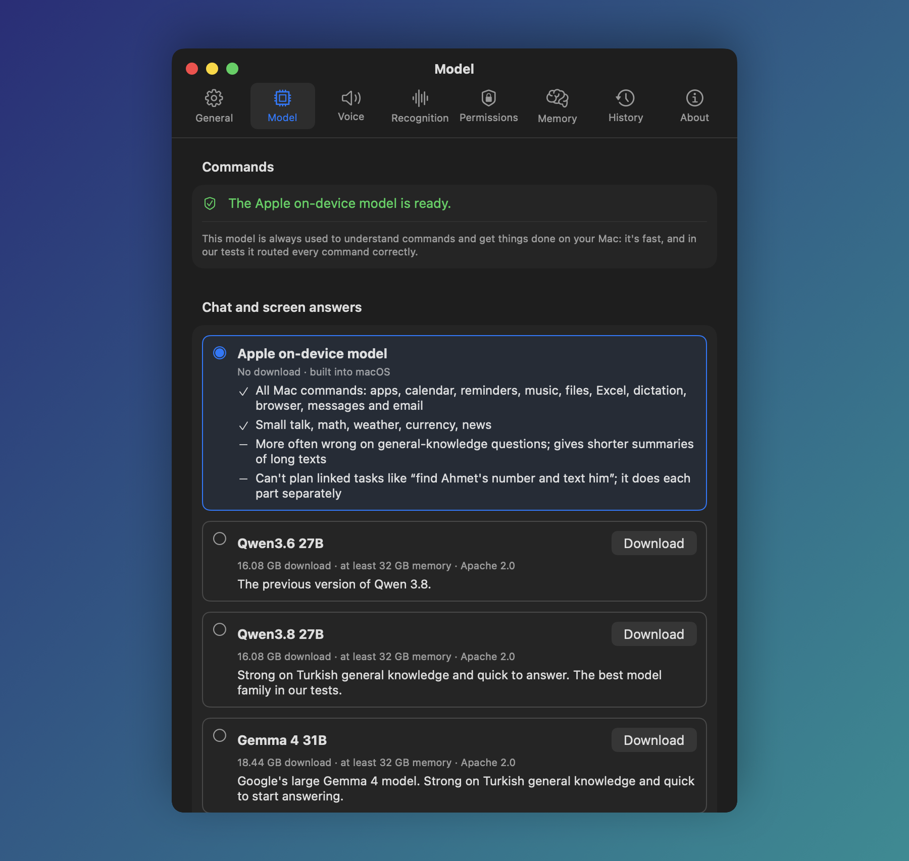
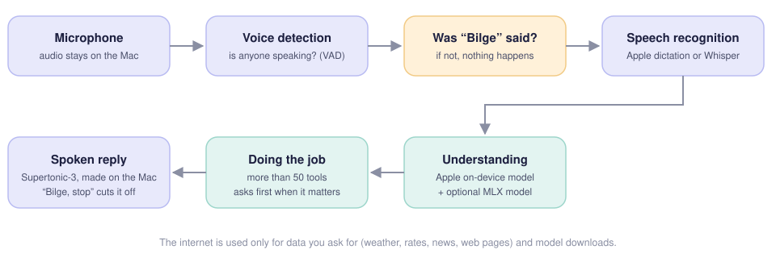

<p align="center">
  
</p>

<h1 align="center">Bilge</h1>

<p align="center">
  A voice assistant for the Mac that speaks Turkish and English. It runs entirely on your Mac:
  your voice and your commands never leave it, unless you choose a hosted model with your own API key.
</p>

<p align="center">
  <a href="https://github.com/coderssociety/bilge/releases/latest"></a>
  <br>
  <sub>Free and open source · macOS 27 or later on Apple silicon, with Apple Intelligence on ·
  <a href="../desktop/README.md">Windows and Linux →</a></sub>
</p>

<p align="center">
  <a href="../LICENSE"></a>
  
  
  
</p>

<p align="center">
  <b>English</b> · <a href="README.tr.md">Türkçe</a>
</p>

<p align="center">
  
</p>

**Why Bilge**

- **Made for Turkish.** It understands everyday Turkish and knows what a Turkish user asks for: prayer times,
  earthquake alerts from AFAD, Süper Lig, Borsa İstanbul, gold and fuel prices. It speaks English too.
- **Private by default.** Speech recognition, the language model and the voice run on your Mac. No account, no
  subscription, and no recording is kept.
- **It gets things done, safely.** Calendar, mail, messages, files, Excel, music, the browser and your smart home,
  and it asks out loud before anything that can't be undone.
- **Yours to shape.** Your own MLX model, Ollama or an API key; your own terminal commands; GPL-3.0 open source.

**Get started:** download the DMG, drag Bilge to Applications, open it and say “Bilge, what time is it?”.
[Installation](#installation) has the details.

Say “Bilge” and it wakes up, works out what you want, does it on your Mac and answers out loud. Speech
recognition, the language models and speech synthesis all run locally; there is no cloud service, account
or subscription. If you prefer, conversation can go to OpenAI, Anthropic, Google Gemini, OpenRouter, Groq or
DeepSeek, and speech recognition to OpenAI or Groq, with your own API key ([Over an API](#over-an-api)). The internet is used only for data you ask for, such as weather, news, prices or a song,
and for downloading models the first time. [Privacy](#privacy) lists which service each feature talks to.

“Bilge” means *wise* in Turkish and is pronounced *BIL-geh*. The wake word stays the same in English.

On Windows or Linux? [Bilge for Windows and Linux](../desktop/README.md) is the same
assistant rebuilt for them.

## Contents

- [What it does](#what-it-does)
- [Screenshots](#screenshots)
- [How it works](#how-it-works)
- [Installation](#installation)
- [Usage](#usage)
  - [Settings](#settings)
- [Models](#models)
- [Languages](#languages)
- [Privacy](#privacy)
- [Troubleshooting](#troubleshooting)
- [Building from source](#building-from-source)
- [License and credits](#license-and-credits)

## What it does

| | |
|---|---|
| **Mac control** | Open and quit apps, arrange windows, volume, brightness, Wi-Fi, Bluetooth, dark mode, Focus, lock, sleep, restart and shut down, screenshots, battery and system status, System Settings panes, Shortcuts |
| **Files** | Find files by name, kind or date and open them, read and summarize PDF, Word, Excel, PowerPoint, OpenDocument and text documents, create folders, move files to the Trash |
| **Calendar and reminders** | Read any day, week or month; add, move and cancel events; add and complete reminders. It tells you about upcoming meetings and due reminders on its own |
| **Timers and routines** | Timers and alarms you can list and cancel one by one, kept across restarts and shown as a notification when due; routines that run a command by themselves at a set time, every day or on chosen days |
| **Your commands** | Terminal commands you add in Settings > Commands, run by name: “run the backup command” |
| **Mail, messages, calls** | Read unread mail and what it says, reply to it, send with Mail and Messages, find contacts, call by phone (through your iPhone) or FaceTime |
| **Notes** | Create a note, read or list notes, add a line to an existing note |
| **Music, radio, podcasts** | Play a song on Music, Spotify, YouTube, YouTube Music, Deezer or Apple Music; pause, skip, seek, shuffle and repeat; internet radio and the latest episode of a podcast play inside Bilge |
| **Smart home** | Lights, climate, plugs, blinds, locks and other devices through your own Home Assistant |
| **News and information** | Weather, exchange rates, news from several sources and the story behind a headline, Wikipedia, the time in other cities, unit conversion, calculations |
| **Türkiye** | Prayer times, gold and fuel prices, recent earthquakes and alerts for strong ones nearby, Süper Lig scores and table, Borsa İstanbul prices |
| **Translation** | Reads mail, news or a page in another language; interpreter mode translates a conversation between two languages out loud. The voice speaks 31 languages |
| **Meetings** | Transcribes a meeting or an audio file on the Mac and saves the transcript with a summary |
| **Browser and web** | Switch tabs, go back and forward, scroll, find on the page, search the web, read or summarize the open page, summarize a YouTube video |
| **Excel** | “Put the sum of B1 and B2 into D3”, “what's the total of column B”, “undo” |
| **Context** | “Summarize this” or “send this to Ahmet” for selected text, the file selected in Finder, the clipboard, the open page or what is on screen |
| **Dictation** | Type into the front app by voice; “comma”, “new line”, “delete the last sentence” |
| **Daily briefing** | Say “good morning” for the weather, today's events, reminders and unread mail |
| **Memory** | “Remember that …”, “forget that”. You can see and delete what it remembers in Settings |
| **Voice ID** | Enroll your voice and it only follows your commands and confirmations |

Anything that can't be undone, like deleting, sending, calling or adding, needs a spoken yes first (“yes”,
“sure”, “okay”; “no” or “cancel” to refuse), or a click on the status panel's buttons. Sending a mail or a message,
restarting or shutting down, and your own commands need an explicit “yes”, “confirm” or “send”: a casual “okay”
from the TV is not enough. Anything else heard while Bilge waits is ignored, and with no clear answer within a few
seconds nothing is done. Routines run with nobody there to answer, so they never take a step that would need a yes. While Bilge is talking you
can cut it off with “Bilge, stop”.

New in 0.5.0: conversation over an API with your own key (OpenAI, Anthropic, Google Gemini, OpenRouter, Groq,
DeepSeek) or through Ollama and llama.cpp on your Mac, cloud speech recognition with OpenAI or Groq, your own
terminal commands, reading Excel, PowerPoint and OpenDocument files, timers that survive a restart and show a
notification, and a choice of microphone and speaker. Sending, powering off and your own commands now need an
explicit yes.

New in 0.4.0: smart home, routines, interpreter mode, meeting transcription, radio, podcasts, YouTube video
summaries, more music services, calls, editing calendar events and notes, mail replies, prayer times, gold and
fuel prices, earthquakes, Süper Lig, Borsa İstanbul, Wikipedia, world clock, unit conversion, and control of
brightness, Bluetooth, Focus, power and media playback.

## Screenshots

<table>
  <tr>
    <td width="50%"></td>
    <td width="50%"></td>
  </tr>
  <tr>
    <td align="center">Setup starts with the language: Türkçe or English.</td>
    <td align="center">Pick a conversation model, download one, or add your own MLX model.</td>
  </tr>
  <tr>
    <td width="50%"></td>
    <td width="50%"></td>
  </tr>
  <tr>
    <td align="center">Language, wake word, sensitivity and reminders.</td>
    <td align="center">The status panel at the top of the screen shows what it heard and what it answered.</td>
  </tr>
</table>

## How it works

<p align="center">
  
</p>

1. The microphone is on, but audio is only handled in memory, in short pieces. If nobody is speaking, nothing happens.
2. If an utterance doesn't start with “Bilge”, it is thrown away.
3. The command is transcribed (Apple dictation or Whisper) and Apple's on-device model decides which tool to call.
   Conversation and general-knowledge questions can go to a larger model you download, if you want one.
4. The tool does the job. If the job is risky, Bilge asks first and does nothing until you say yes.
5. The reply is spoken with Supertonic-3, generated on the Mac.

## Installation

**Requirements**

- An Apple Silicon Mac with **macOS 27** or later.
- **Apple Intelligence turned on.** Apple's on-device language model understands the commands; Bilge
  doesn't work without it.
- A small download for the voice models on first run (1.5 GB more for Whisper, the default in English).
  The optional conversation model is a 16-19 GB download and needs at least 32 GB of memory.

**Steps**

1. Download the latest `Bilge-<version>.dmg` from [Releases](../../releases) and drag Bilge into Applications.
2. Open Bilge. Setup asks for the language (Türkçe or English), then the permissions it needs
   (microphone, speech recognition, Accessibility; calendar and contacts if you want them), prepares the
   voice models and lets you choose a conversation model.
3. Try it: “Bilge, what time is it?”

> Releases are not notarized by Apple yet. If macOS warns you the first time, click “Open Anyway” in
> System Settings > Privacy & Security, or build it yourself from source.

Bilge lives in the menu bar and has no Dock icon. Settings and the setup guide are in the menu bar menu.

## Usage

Start every command with “Bilge”: “Bilge, open Safari”. After answering, Bilge keeps listening for a few
seconds, so you can ask a follow-up without saying its name again.

You can also choose a listening shortcut in Settings > General (it needs ⌘ or ⌃, or an F key). Pressing it works
like saying “Bilge”; pressing it while Bilge talks stops it. With a shortcut chosen, listening for the wake word
can be turned off, and then nothing is transcribed until you press it.

The examples below are things Bilge understands; you don't have to say them word for word.

<details>
<summary><b>Mac and apps</b></summary>

- Open Safari / Close Spotify / What apps are open
- Set the volume to 30 percent / Make the screen brighter / Set brightness to 40 percent
- Turn wi-fi on / Turn bluetooth off / Is bluetooth on
- Turn on dark mode / Turn off do not disturb
- Lock the screen / Put the Mac to sleep / Restart my Mac / Shut down the computer
- Minimize this window / Move the window to the left / Make it full screen / Hide the other apps
- Take a screenshot of this window
- What's my battery level / How much disk space is left / What's my IP address
- Open Bluetooth settings
- What shortcuts do I have / Run the shortcut called Good Morning

Restarting, shutting down and logging out only happen after a clear yes, and so do turning Wi-Fi or Bluetooth
off and running a shortcut. macOS has no public way to switch Focus, so Bilge runs a shortcut of yours: create
one in Shortcuts with the “Set Focus” action and a name such as “Focus On” or “Focus Off”. If there is none,
Bilge offers to open Shortcuts.
</details>

<details>
<summary><b>Files and documents</b></summary>

- Find the budget presentation from last week / Open the last PDF I downloaded
- Open my Downloads folder
- Summarize the report on my Desktop / What does this PDF say about the deadline
- Create a folder called Invoices on the Desktop
- Move the old invoice to the Trash

Files are found with Spotlight. Moving to the Trash asks first and never deletes for good.
</details>

<details>
<summary><b>Calendar, reminders, timers</b></summary>

- What's on my calendar today / What do I have next week
- Add a dentist appointment tomorrow at 10
- Move the dentist appointment to Friday / Move the 3 o'clock meeting to 4 / Cancel tomorrow's meeting
- Add eggs to my shopping list / What are my reminders / I paid the bill, check it off
- Set a timer for 10 minutes / Set an alarm for 7:30
- How much time is left / Cancel the tea timer / Cancel all timers

Adding, moving and cancelling events and adding reminders ask first. Timers and alarms live in Bilge, not in the
Clock app: when one is due, Bilge says so out loud and shows a notification. They are kept across restarts; one
that came due while Bilge was closed is announced the next time it starts.
</details>

<details>
<summary><b>Mail, messages, calls</b></summary>

- Read my email / Any new mail? / What does it say?
- Reply to it: I'm available tomorrow / Answer Ahmet that I'll be there
- Send Ahmet an email saying the report is ready / Message Ayşe that I'll be late
- What's Ahmet's phone number
- Call mom / FaceTime Ahmet / Call Ahmet Yılmaz on FaceTime

Before anything is sent or a call is made, Bilge reads out who it goes to and what it says, and waits for a
yes. Phone calls go through an iPhone linked to the Mac (Calls from iPhone); FaceTime calls start on the Mac.
</details>

<details>
<summary><b>Notes</b></summary>

- Create a note: buy a birthday present for Elif
- Add milk to my shopping note / Append “the budget is approved” to the meeting note
- Read my recipe note / Read my latest note / List my notes

Adding to an existing note asks first.
</details>

<details>
<summary><b>Music, radio, podcasts</b></summary>

- Play Tarkan / Pause the music / Next song / What's playing
- Play Tarkan on YouTube / Play Kuzu Kuzu on YouTube Music / Can you play some Sezen Aksu on Deezer
- Put on Kuzu Kuzu in Apple Music / Listen to Tarkan on Spotify
- Skip ahead 15 seconds / Go back 2 minutes / Restart the song / Turn on shuffle / Repeat this song
- Play Power FM / Turn the radio down / What's on the radio / Turn off the radio
- Play the latest episode of The Daily / Does Lex Fridman have a new episode

When you don't name a service, the song plays on the default one in Settings > General. “Automatic” uses the
app that is playing, else Spotify if it is open or installed, else Music. How each service plays:

- **Music**: a matching playlist or song in your library plays. Otherwise the song is found in the Apple Music
  catalog and opened in Music, which usually only shows it; press play there.
- **YouTube, YouTube Music, Deezer**: the first matching song opens and plays (YouTube in your browser, Deezer
  in its app if installed, else on its website).
- **Spotify**: Spotify has no search Bilge can use without an account, so it opens Spotify's search results
  and you pick the song.

Seeking, shuffle and repeat work in Music and Spotify (seeking also in podcasts); play, pause and skipping also
reach a video in the browser and other players through the media keys. Radio stations come from radio-browser.info, stations in
Türkiye first. Radio and podcasts play inside Bilge: while Bilge listens or talks, the radio turns down and a
podcast pauses.
</details>

<details>
<summary><b>Smart home</b></summary>

- Turn on the living room lights / Turn off the kitchen light
- Set the thermostat to 21 / Set the air conditioner to 22 degrees
- Is the front door locked / Lock the front door / Open the garage door

This needs a [Home Assistant](https://www.home-assistant.io) server. In Settings > Smart home, enter its
address (for example `http://192.168.1.20:8123`) and a long-lived access token, which you create in Home
Assistant under Profile > Security. “Test connection” checks both. The token is kept in the Keychain and is
sent only to that address.

Commands that name a home device or a room go to Home Assistant as you said them; Home Assistant matches them
to the devices you have exposed to its Assist and Bilge reads its answer. Changing a lock, the garage door or the alarm asks first. Asking
whether the door is locked doesn't.
</details>

<details>
<summary><b>Your own commands</b></summary>

- Run the backup command / What are my commands

In Settings > Commands, give a command a name and a command line, such as “backup” and
`rsync -a ~/Documents /Volumes/Backup`. A command runs as written, without a shell: `~` is the only shortcut
understood, a path with spaces goes in quotes, and nothing you say is added to it. It must finish within 60
seconds, and Bilge reads out the start of what it prints. The first run of each command, and the first after it is
changed, reads the command line out and waits for a yes; after that, naming it exactly runs it. For what an app can
do, Shortcuts are still the way (“run the shortcut called Good Morning”).
</details>

<details>
<summary><b>Routines</b></summary>

- Every night at 9 tell me the weather
- Every weekday at 7 read the news
- At 8:30 every Monday and Wednesday, read my calendar
- Every morning at 8 read the daily briefing
- What are my routines / Delete the evening routine / Delete all routines

At the set time the command runs as if you had said it. Bilge reads the schedule back and asks before saving a
routine. Routines run only while Bilge is open and listening; a time missed while the Mac sleeps or listening
is off is skipped, not run late. A step that would need a yes, such as sending or turning something off, is
not done; Bilge says the routine needs you instead. Settings > Routines lists routines and deletes them.
</details>

<details>
<summary><b>News, weather, information</b></summary>

- Good morning (the daily briefing: weather, today's events, reminders and unread mail)
- What's the weather in London / Will it rain tomorrow
- How much is the dollar in lira / Convert 100 euros to lira
- Technology news / Anything else? / Tell me more about the third one / Open the Tesla story (in the browser too)
- News from the Guardian / Another source (BBC News, The Guardian, NPR in turn)
- Tell me about the Eiffel Tower / What is photosynthesis
- What time is it in Tokyo / What's the time difference with New York
- How many kilometers is 10 miles / Convert 100 Fahrenheit to Celsius / 5 feet 10 inches in cm
- What's 18 percent of 125

Without a city, weather uses the city set in Settings > General. Wikipedia answers come from the English
Wikipedia (the Turkish one in Turkish) and are kept short. The world clock and unit conversion work offline.
</details>

<details>
<summary><b>Türkiye</b></summary>

- When is maghrib / How long until iftar / Prayer times for tomorrow
- How much is gold / Price of a quarter gold coin / Gold price per ounce
- Fuel prices in Izmir / How much is diesel
- Was there a big earthquake near me today / Earthquake in Izmir
- When do Galatasaray play next / What's the Super Lig table
- How is Turkish Airlines stock doing

Prayer times follow Diyanet's monthly list for the province (another source using Diyanet's method for places
outside Türkiye). Earthquakes come from AFAD, or from Kandilli Observatory when AFAD doesn't answer. Football
covers only the Süper Lig, stocks only Borsa İstanbul; Bilge gives prices and the day's change, never advice.

With “Tell me about earthquakes near me” turned on in Settings > General, Bilge checks AFAD every two minutes
while it runs and announces, once, any earthquake of magnitude 4 or more within 150 km of your weather city,
with a notification.
</details>

<details>
<summary><b>Translation and interpreter mode</b></summary>

- Read my email in Turkish / Translate the news into German
- Read more / Summarize the rest (goes on with a long text, in the same language)
- Be my German interpreter / Start interpreter mode: English and Turkish
- Stop interpreting

In interpreter mode everything said is translated into the other language of the pair and spoken in it, with
a caption on screen. Naming one language pairs it with Bilge's own. The mode ends when either person says the
stop phrase, in either language, or after two minutes of silence. It needs the Whisper speech model on the Mac,
because Whisper tells the two languages apart; if you use Apple dictation, download Whisper once in
Settings > Recognition.
</details>

<details>
<summary><b>Meetings and audio files</b></summary>

- Record the meeting / Stop recording (or “End recording” in the menu bar menu)
- (With an audio or video file selected in Finder) Transcribe this audio file
- Transcribe the last recording I downloaded

While a meeting is recorded, everything heard is transcribed on the Mac and no audio is kept; only the stop
phrase is acted on. Afterwards the on-device model writes a summary with decisions, action items and open
questions, and the notes are saved as a Markdown file in `~/Documents/Bilge/Toplantılar`. Bilge asks whether to
read the summary. Like interpreter mode, this needs the Whisper model on the Mac.
</details>

<details>
<summary><b>Excel</b></summary>

With a workbook open in Excel:

- Put the sum of B1 and B2 into D3
- Write 1250 in C5
- What's the total of column B
- Undo

Writing into a cell that already holds something asks first.
</details>

<details>
<summary><b>Selected text, clipboard, screen</b></summary>

- (With text selected) Summarize this / Explain the highlighted paragraph
- Translate the selected text to Turkish
- (With a file selected in Finder) Send this to Ahmet / Open this file
- Summarize what I copied / Copy that
- What's on my screen / What does this error mean
</details>

<details>
<summary><b>Browser and web</b></summary>

- Switch to the YouTube tab / Close this tab / Go back / Scroll down
- Find price on this page
- Search YouTube for cat videos / Search Google for train times / Open github.com
- Read this page to me / Give me a summary of this article
- Summarize this video / What's this video about / Summarize the video on the clipboard

Tabs and the open page work in Safari, Chrome, Arc, Brave and Edge. A YouTube video is summarized from its
captions, so a video without captions can't be summarized; “summarize the rest” goes on with a long one.
</details>

<details>
<summary><b>Dictation</b></summary>

- Start dictation, then talk. “Comma”, “period”, “new line” and “delete the last sentence” work as commands.
- Stop dictation
</details>

<details>
<summary><b>Memory</b></summary>

- Remember that I take my coffee without sugar
- What do you know about me
- Forget my coffee order
</details>

### Settings

| Tab | What you can set |
|---|---|
| General | Language, listening by wake word, the wake word itself, listening shortcut, sensitivity, follow-up questions, cutting Bilge off, start at login, status panel, meeting and reminder announcements, morning briefing, earthquake alerts, update check, default music service, weather city |
| Model | Conversation model: Apple's, a listed download, a model already on your Mac, your own, or one over an API with your key |
| Voice | Bilge's voice and speaking speed, the microphone and the speaker, with a microphone level meter |
| Recognition | Speech recognition engine (Apple dictation, Whisper, or OpenAI or Groq in the cloud) and voice ID |
| Permissions | What Bilge is allowed to use, with buttons to grant or open System Settings |
| Memory | What Bilge remembers about you; delete items or everything |
| Routines | Your routines, each with a delete button |
| Commands | Your own terminal commands, each with a name to say |
| Smart home | Home Assistant address and access token, and a connection test |
| History | What Bilge did and what waited for your yes, with the log file |
| About | Version and the open-source licenses |

## Models

Commands are **always** routed by Apple's on-device model: it is fast, and in our tests it sent every
Turkish command to the right tool. For conversation, general-knowledge questions and screen summaries you
can download a more knowledgeable model. Bilge runs it **inside the app with MLX**; you don't need LM Studio
or any other program. The model loads when you say “Bilge” and leaves memory after the conversation (the
delay is adjustable).

| Option | Download | Minimum memory | Notes |
|---|---|---|---|
| Apple on-device model | none | - | All commands, small talk. More often wrong on general knowledge; can't plan linked multi-step tasks. |
| Qwen3.6 27B (4-bit) | 16.1 GB | 32 GB | The previous version of Qwen 3.8. |
| Qwen3.8 27B (4-bit) | 16.1 GB | 32 GB | Got 19 of 20 Turkish general-knowledge questions (20/20 within one conversation); first word in ~2.2 s. |
| Gemma 4 31B (4-bit) | 18.4 GB | 32 GB | 19/20 on the same test (measured in vMLX); quick to start answering. |

Measured on an M5 Pro with 48 GB of memory. Qwen3.8 was measured inside Bilge with a community build of the
same model, Gemma with another 4-bit build in vMLX. Apple's model got 14/20 on the same test.

Listed models are downloaded from Hugging Face pinned to an exact revision, and large files are checked
against their SHA-256. Long instructions and the tool list are read once and kept, so each step of a
multi-step task takes a few seconds. If you use LM Studio or vMLX, you can pick their models in Settings > Model too.

### Models already on your Mac

Bilge looks for MLX models you already have and lists them under “Models on this Mac”, with where each
was found:

- LM Studio's models folder (`~/.lmstudio/models`, or wherever you moved it),
- the Hugging Face cache (`~/.cache/huggingface/hub`, or `HF_HOME` / `HF_HUB_CACHE`), where mlx-lm and
  similar tools download,
- any folder you add with “Add Folder…” (searched three levels deep).

These models run inside Bilge from where they are: nothing is copied or downloaded again, and LM Studio
doesn't need to be open. GGUF models only run in LM Studio itself; for those, pick LM Studio as the server
in Settings > Model. Models in vMLX's JANG format are listed but marked as vMLX-only.

### Your own model

You can use a model that isn't on the list. Download an MLX model from Hugging Face (for example from
[mlx-community](https://huggingface.co/mlx-community)) and put its folder here:

```
~/Library/Application Support/Asistan/Models/Kendi Modellerim/<model name>/
```

The folder needs `config.json`, `tokenizer.json` (or `tokenizer.model`) and the `.safetensors` files.
“Open Bilge's Folder” in Settings > Model opens this folder in Finder and “Refresh” updates the list. Instead of
copying a model you can also put a symbolic link to its folder elsewhere (LM Studio's, for instance). If
Bilge's MLX version can't open a model type, Apple's model answers instead.

### Over an API

Instead of a model on the Mac, conversation can use a hosted model with your own API key: OpenAI, Anthropic,
Google Gemini, OpenRouter, Groq or DeepSeek. Ollama and llama.cpp running on your Mac are offered the same way,
without a key. In Settings > Model, under “Model over an API”, pick the service, save the key, press “Fetch
models” (which also checks the key) and choose one, or type its name.

- The key is kept in the Keychain and sent only to that service's address; requests follow no redirects.
- Commands are still understood by Apple's on-device model and Mac actions stay on the Mac. What goes to the
  service is the conversation and the text Bilge reads to answer it (the screen, a document, a web page, a mail),
  and multi-step plans. It is billed to your key's account.
- If the service doesn't answer, Apple's model answers that question instead.

Speech recognition can also run in the cloud: choose OpenAI or Groq in Settings > Recognition (the key is the same
as for its models). “Bilge” is still heard on the Mac, by Apple dictation in Turkish and by Whisper in English, so
nothing said while Bilge waits for its name is sent. What is said once it listens goes to the service: the command
after “Bilge”, follow-up questions, answers to its questions, and dictation. Interpreter mode and meeting transcription keep using Whisper
on the Mac.

## Languages

Turkish or English is chosen in the first setup step and can be changed in Settings > General (the app
restarts). Bilge then listens, speaks and shows its menus in that language. Every feature in [Usage](#usage)
works in both. The Türkiye features answer in English too, but their data is about Türkiye.

Bilge was built for Turkish first. In English:

- Speech recognition defaults to Whisper (a 1.5 GB download). Apple dictation in English almost never
  recognized a Turkish-pronounced “Bilge” (it wrote “Bill” or “Build”); Whisper got it in 17 of 20 tries.
- News comes from BBC News first, then The Guardian and NPR. Exchange rates default to the dollar when you
  don't name a currency.
- Cutting Bilge off while it talks (“Bilge, stop”) is less reliable than in Turkish: Whisper misses the wake
  word more often over the echo of Bilge's own voice.
- In tests English commands were routed correctly 75 of 76 times (37 of 40 on sentences never used in
  development). They take a little longer than Turkish ones (~1.8 s), because the shortcut for the most common
  Turkish commands has no English version yet.

## Privacy

- No audio is stored. Nothing before the wake word is listened to. A meeting recording keeps only the text.
- Speech recognition, the language models, translation and speech synthesis run on the Mac, unless you choose a
  model over an API or cloud speech recognition ([Over an API](#over-an-api)).
- Network connections are only for data you ask for and for model downloads. Each feature talks to these
  services, and only when you use it:

  | Feature | Service | What it learns |
  |---|---|---|
  | Weather | Open-Meteo | The city |
  | Exchange rates | Frankfurter (European Central Bank rates) | The currencies |
  | News | Anadolu Ajansı, TRT Haber, BBC Türkçe; BBC News, The Guardian, NPR | Their news feeds are read; a story you ask about is opened on its site |
  | Wikipedia | Wikipedia (Turkish or English) | The subject |
  | Prayer times | ezanvakti.emushaf.net (Diyanet's lists), Aladhan as a fallback | The city |
  | Gold prices | finans.truncgil.com, Altınkaynak, gold-api.com | Nothing beyond the request |
  | Fuel prices | Opet, Petrol Ofisi | The province |
  | Earthquakes and alerts | AFAD, Kandilli Observatory as a fallback; Open-Meteo to locate a place that isn't a province | Nothing beyond the request; Open-Meteo gets that place name |
  | Süper Lig | ESPN | Nothing beyond the request |
  | Borsa İstanbul | Yahoo Finance | The stock or index |
  | Radio | radio-browser.info, then the station's own stream | The station name |
  | Podcasts | iTunes Search, then the podcast's own feed and episode file | The podcast name |
  | Music | YouTube, YouTube Music, Deezer or iTunes Search (Apple Music); Spotify's own search | The song or artist |
  | YouTube summaries | YouTube | The video |
  | Web pages | The site you ask for | The page address |
  | Smart home | Only the Home Assistant address you entered | Your command and the access token |
  | Update check | GitHub, once a day | Nothing beyond the request |
  | Models | Hugging Face | The model being downloaded |
  | Model over an API (if chosen) | OpenAI, Anthropic, Google Gemini, OpenRouter, Groq or DeepSeek | Your conversation and the text read for it |
  | Cloud speech recognition (if chosen) | OpenAI or Groq | The recording of what is said while Bilge listens: commands, follow-ups, answers, dictation |

- Local network addresses are blocked when reading web pages, radio streams and feeds. Home Assistant is the
  one exception: a separate connection goes only to the address in Settings > Smart home, follows no redirects
  and bypasses proxies. Its token is kept in the Keychain and is never logged.
- The update check only offers the new version's page in the menu; nothing is downloaded by itself. Settings >
  General turns it off.
- Memory, routines, your commands, timers, the voice ID and the action log are kept under `~/Library/Application Support/Asistan`, and
  meeting notes in `~/Documents/Bilge/Toplantılar`, in files only you can read.

## Troubleshooting

**It doesn't wake up when I say “Bilge”.** Move the sensitivity towards “Flexible” in Settings > General.
You can also try the other speech recognition engine in Settings > Recognition.

**It wakes up by itself.** Move the sensitivity towards “Strict”, or enroll your voice under Settings >
Recognition > Voice ID so it only answers you. Recordings with nothing louder than their own background, and the
subtitle lines Whisper makes up for silence (“Thanks for watching!”), are already ignored.

**It says the language model isn't ready yet.** Turn on Apple Intelligence in System Settings > Apple
Intelligence & Siri and wait for the model to download.

**It can't control an app.** Check that Bilge is allowed under Accessibility and Automation in System
Settings > Privacy & Security. Bilge's own Settings > Permissions tab shows the status too.

**A browser or music app ignores it.** macOS asks once per app whether Bilge may control it with Apple Events:
your browser (Safari, Chrome, Arc, Brave, Edge), Music, Spotify, Mail, Messages, Notes, Excel and System Events.
If you declined, turn Bilge back on for that app under System Settings > Privacy & Security > Automation.

**Home Assistant can't be reached.** Check the address in Settings > Smart home and that the Mac is on the same
network, then press “Test connection”. macOS also asks whether Bilge may use the local network; if you declined,
allow it under System Settings > Privacy & Security > Local Network. If Home Assistant answers 401, the token
was not accepted: create a new long-lived access token and save it again.

**Interpreter mode or meeting recording says it needs Whisper.** Choose Whisper once in Settings > Recognition
to download it (about 1.5 GB). You can switch back to Apple dictation afterwards; the sessions still use Whisper.

**“Turn on do not disturb” doesn't work.** Bilge needs a shortcut of yours with the “Set Focus” action and a
name such as “Focus On” or “Focus Off”. See Mac and apps under [Usage](#usage).

**The model over an API doesn't answer.** Press “Fetch models” in Settings > Model: it says whether the key was
accepted. Until the service answers, Apple's model replies instead. For Ollama or llama.cpp, the server must be
running on this Mac on its usual port (11434 or 8080).

**A routine didn't run.** Routines run only while Bilge is open and listening, and a time missed while the Mac
slept is skipped. A routine whose command needs a yes stops at that step.

## Building from source

You need Xcode 27, [XcodeGen](https://github.com/yonaskolb/XcodeGen) and Xcode's Metal toolchain.

```bash
brew install xcodegen
xcodebuild -downloadComponent MetalToolchain
xcodegen generate
open Asistan.xcodeproj
```

Sign with your Apple ID so permissions aren't reset on every build: create `Config/Signing.local.xcconfig`
containing `DEVELOPMENT_TEAM = <your team ID>` (git ignores this file).

Tests:

```bash
cd Packages/AsistanKit && swift test
```

Release package (`build/release/Bilge-<version>.dmg`):

```bash
scripts/release.sh
```

With a Developer ID certificate the app is signed for distribution, and if `NOTARY_PROFILE` names a profile
saved with `xcrun notarytool store-credentials`, it is notarized too. Without a certificate the DMG only has
a development signature.

**Project layout**

| Folder | Contents |
|---|---|
| `App/Sources/Assistant` | The listening loop, wake word, confirmations and interruptions |
| `App/Sources/Brain` | Command routing, conversation, multi-step tasks, local models (MLX) |
| `App/Sources/Tools` | The tools that act on the Mac (calendar, Excel, browser, files…) |
| `App/Sources/UI` | Menu bar, status panel, settings, setup |
| `Packages/AsistanKit` | The tested, UI-free core: Turkish and English parsers, number reading, wake word matching |
| `../bench` | Speech recognition, routing and end-to-end test sets |

## License and credits

Bilge is released under the [GNU GPL 3.0](../LICENSE). The open-source components and models it uses are
listed with their licenses in [THIRD_PARTY_NOTICES.md](THIRD_PARTY_NOTICES.md); the same list is in the
app under Settings > About. In particular:

- Voice activity detection, speech synthesis, echo cancellation and voice ID use
  [FluidAudio](https://github.com/FluidInference/FluidAudio) (Apache 2.0).
- Speech recognition uses [WhisperKit](https://github.com/argmaxinc/argmax-oss-swift) (MIT) or Apple dictation.
- Conversation models run on [MLX Swift](https://github.com/ml-explore/mlx-swift) and
  [mlx-swift-lm](https://github.com/ml-explore/mlx-swift-lm) (MIT).
- The voice is the [Supertonic-3](https://huggingface.co/Supertone/supertonic-3) model (OpenRAIL-M); its use
  restrictions are listed in the notices file.
