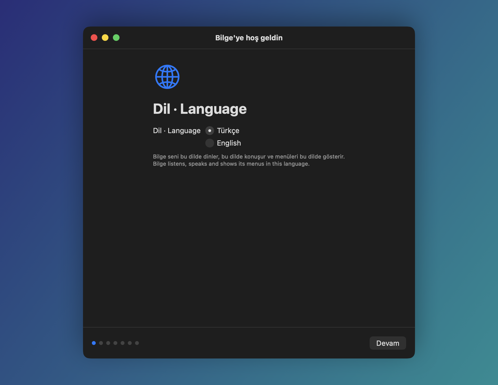
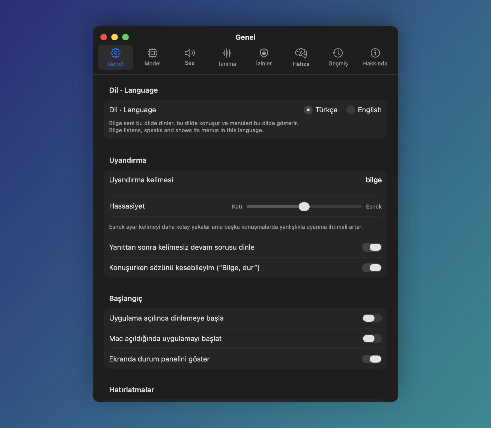

<p align="center">
  
</p>

<h1 align="center">Bilge</h1>

<p align="center">
  Mac için Türkçe ve İngilizce sesli asistan. Tamamen yerel çalışır: kendi API anahtarınla bulutta bir model
  seçmedikçe sesin ve komutların Mac'inden dışarı çıkmaz.
</p>

<p align="center">
  <a href="https://github.com/coderssociety/bilge/releases/latest"></a>
  <br>
  <sub>Ücretsiz ve açık kaynak · Apple Silicon'lı Mac'te macOS 27 ve sonrası, Apple Intelligence açık ·
  <a href="../desktop/README.tr.md">Windows ve Linux →</a></sub>
</p>

<p align="center">
  <a href="../LICENSE"></a>
  
  
  
</p>

<p align="center">
  <a href="README.md">English</a> · <b>Türkçe</b>
</p>

<p align="center">
  
</p>

**Neden Bilge?**

- **Türkçe için yapıldı.** Günlük Türkçe konuşmayı anlar ve Türkiye'de sorulanı bilir: namaz vakitleri, AFAD
  deprem uyarıları, Süper Lig, Borsa İstanbul, altın ve akaryakıt fiyatları. İngilizce de konuşur.
- **Varsayılan olarak gizli.** Konuşma tanıma, dil modeli ve ses Mac'inde çalışır. Hesap ve abonelik yok, ses
  kaydı saklanmaz.
- **İşi yapar, güvenle.** Takvim, e-posta, mesaj, dosyalar, Excel, müzik, tarayıcı ve akıllı ev; geri alınamayan
  her işten önce sesli sorar.
- **Senin kurallarınla.** Kendi MLX modelin, Ollama ya da API anahtarın; kendi terminal komutların; GPL-3.0 açık
  kaynak.

**Hemen başla:** DMG'yi indir, Bilge'yi Uygulamalar klasörüne sürükle, aç ve “Bilge, saat kaç?” de. Ayrıntılar
[Kurulum](#kurulum) bölümünde.

“Bilge” dediğinde uyanır, ne istediğini anlar, işi Mac'te yapar ve sesle cevap verir. Konuşma tanıma,
dil modelleri ve ses üretimi Mac'te çalışır; bulut hizmeti, hesap ya da abonelik yoktur. İstersen sohbet
kendi API anahtarınla OpenAI, Anthropic, Google Gemini, OpenRouter, Groq ya da DeepSeek'e, konuşma tanıma da
OpenAI ya da Groq'a gidebilir ([API ile bağlanan model](#api-ile-bağlanan-model)). İnternet yalnızca
hava durumu, haber, fiyat ya da şarkı gibi istediğin veriler ve modellerin ilk indirmesi için kullanılır.
Hangi özelliğin hangi hizmete bağlandığı [Gizlilik](#gizlilik) bölümünde yazılı.

Windows ya da Linux mu kullanıyorsun? [Windows ve Linux için Bilge](../desktop/README.tr.md)
aynı asistanın onlar için yeniden yazılmış hâli.

## İçindekiler

- [Neler yapar](#neler-yapar)
- [Ekran görüntüleri](#ekran-görüntüleri)
- [Nasıl çalışır](#nasıl-çalışır)
- [Kurulum](#kurulum)
- [Kullanım](#kullanım)
  - [Ayarlar](#ayarlar)
- [Modeller](#modeller)
- [Dil](#dil)
- [Gizlilik](#gizlilik)
- [Sorun giderme](#sorun-giderme)
- [Kaynaktan derleme](#kaynaktan-derleme)
- [Lisans ve teşekkür](#lisans-ve-teşekkür)

## Neler yapar

| | |
|---|---|
| **Mac komutları** | Uygulama açma ve kapatma, pencere düzenleme, ses düzeyi, parlaklık, Wi-Fi, Bluetooth, karanlık mod, odak modu, kilitleme, uyutma, yeniden başlatma ve kapatma, ekran görüntüsü, pil ve sistem durumu, Sistem Ayarları bölümleri, Kestirmeler |
| **Dosyalar** | Dosyayı adına, türüne ya da tarihine göre bulup açma; PDF, Word, Excel, PowerPoint, OpenDocument ve metin belgelerini okuyup özetleme; klasör oluşturma; Çöp Kutusu'na taşıma |
| **Takvim ve anımsatıcılar** | Herhangi bir günü, haftayı ya da ayı okuma; etkinlik ekleme, taşıma ve iptal etme; anımsatıcı ekleme ve tamamlama. Yaklaşan toplantıyı ve vakti gelen anımsatıcıyı kendiliğinden söyler |
| **Zamanlayıcı ve rutinler** | Listelenip tek tek iptal edilebilen, yeniden başlatmada kaybolmayan ve süresi dolunca bildirim gösteren zamanlayıcı ve alarmlar; her gün ya da seçilen günlerde belli bir saatte kendiliğinden çalışan rutinler |
| **Kendi komutların** | Ayarlar > Komutlar'a eklediğin terminal komutlarını adıyla çalıştırma: “yedekleme komutunu çalıştır” |
| **E-posta, mesaj, arama** | Okunmamış e-postaları ve içeriklerini okuma, yanıtlama, Mail ve Mesajlar ile gönderme, kişi bulma, telefonla (iPhone üzerinden) ya da FaceTime ile arama |
| **Notlar** | Not oluşturma, notları okuma ve listeleme, var olan bir notun sonuna ekleme |
| **Müzik, radyo, podcast** | Müzik, Spotify, YouTube, YouTube Music, Deezer ya da Apple Music'te şarkı çalma; duraklatma, geçme, sarma, karışık çalma ve tekrar; internet radyosu ve podcast'in son bölümü Bilge'nin içinde çalar |
| **Akıllı ev** | Kendi Home Assistant'ın üzerinden ışık, klima, priz, perde, kilit ve diğer cihazlar |
| **Haber ve bilgi** | Hava durumu, döviz, farklı kaynaklardan haberler ve bir başlığın ayrıntısı, Vikipedi, başka şehirlerde saat, birim çevirme, hesap |
| **Türkiye'ye özel** | Namaz vakitleri, altın ve akaryakıt fiyatları, son depremler ve yakındaki güçlü depremler için uyarı, Süper Lig skorları ve puan durumu, Borsa İstanbul fiyatları |
| **Çeviri** | E-postayı, haberleri ya da bir sayfayı başka dilde okur; tercüman modu iki dil arasındaki konuşmayı sesli çevirir. Ses 31 dilde konuşur |
| **Toplantılar** | Toplantıyı ya da bir ses dosyasını Mac'te yazıya döker, dökümü özetiyle birlikte kaydeder |
| **Tarayıcı ve web** | Sekmeler arasında geçme, geri ve ileri, kaydırma, sayfada arama, web'de arama, açık sayfayı okuma ya da özetleme, YouTube videosunu özetleme |
| **Excel** | “D3'e B2 ile B1'i topla”, “B sütununun toplamı kaç”, “geri al” |
| **Bağlam** | Seçili metin, Finder'da seçili dosya, pano, açık sayfa ya da ekrandakiler için “bunu özetle”, “bunu Ahmet'e gönder” |
| **Dikte** | Öndeki uygulamaya sesle yazma; “virgül”, “yeni satır”, “son cümleyi sil” |
| **Günlük özet** | “Günaydın” dediğinde hava, bugünkü etkinlikler, anımsatıcılar ve okunmamış e-postalar |
| **Hafıza** | “Şunu hatırla: …”, “bunu unut”. Hatırladıklarını Ayarlar'da görür ve silebilirsin |
| **Ses kimliği** | Sesini tanıtırsan yalnızca senin komutlarına ve onaylarına uyar |

Silme, gönderme, arama ve ekleme gibi geri alınamayan işlerde önce sesli onay ister (“evet”, “olur”, “tamam”,
“onaylıyorum”; reddetmek için “hayır” ya da “iptal”); durum panelindeki düğmelere de tıklayabilirsin. E-posta ya da
mesaj göndermek, yeniden başlatmak ya da kapatmak ve kendi komutların açık bir “evet”, “onaylıyorum” ya da “gönder”
ister: televizyondan gelen bir “tamam” yetmez. Bilge beklerken duyulan başka sözler cevap sayılmaz; birkaç saniye
içinde net bir cevap gelmezse hiçbir şey yapılmaz. Rutinler sen yokken
çalıştığı için onay gerektiren bir adımı hiçbir zaman yapmaz. Bilge konuşurken “Bilge, dur” diyerek sözünü
kesebilirsin.

0.5.0 ile gelenler: kendi API anahtarınla sohbet modeli (OpenAI, Anthropic, Google Gemini, OpenRouter, Groq,
DeepSeek) ya da Mac'indeki Ollama ve llama.cpp, OpenAI ya da Groq ile bulutta konuşma tanıma, kendi terminal
komutların, Excel, PowerPoint ve OpenDocument dosyalarını okuma, yeniden başlatmada kaybolmayan ve bildirim
gösteren zamanlayıcılar, mikrofon ve hoparlör seçimi. Gönderme, kapatma ve kendi komutların artık açık bir “evet”
ister.

0.4.0 ile gelenler: akıllı ev, rutinler, tercüman modu, toplantı dökümü, radyo, podcast, YouTube video özeti,
yeni müzik servisleri, telefon ve FaceTime araması, takvim etkinliklerini ve notları düzenleme, e-postaya yanıt,
namaz vakitleri, altın ve akaryakıt fiyatları, depremler, Süper Lig, Borsa İstanbul, Vikipedi, dünya saati,
birim çevirme; parlaklık, Bluetooth, odak modu, güç ve medya oynatma kontrolü.

## Ekran görüntüleri

<table>
  <tr>
    <td width="50%"></td>
    <td width="50%"></td>
  </tr>
  <tr>
    <td align="center">Kurulumun ilk adımı: Türkçe ya da English.</td>
    <td align="center">Sohbet modelini seç, indir ya da kendi MLX modelini ekle.</td>
  </tr>
  <tr>
    <td width="50%"></td>
    <td width="50%"></td>
  </tr>
  <tr>
    <td align="center">Uyandırma kelimesi, hassasiyet ve hatırlatmalar.</td>
    <td align="center">Ekranın üstündeki durum paneli ne duyduğunu ve ne cevap verdiğini gösterir.</td>
  </tr>
</table>

## Nasıl çalışır

<p align="center">
  
</p>

1. Mikrofon açıktır ama ses yalnızca bellekte, kısa parçalar halinde işlenir. Konuşma yoksa hiçbir şey yapılmaz.
2. Konuşmanın başında “Bilge” geçmiyorsa söylenen atılır.
3. Komut yazıya çevrilir (Apple Dikte ya da Whisper) ve Apple'ın cihaz içi modeli hangi aracın çağrılacağına
   karar verir. Sohbet ve genel bilgi sorularını istersen indirdiğin daha büyük bir model cevaplar.
4. Araç işi yapar. Riskli bir işse önce sorar, “evet” demeden yapmaz.
5. Cevap Supertonic-3 ile Mac'te seslendirilir.

## Kurulum

**Gerekenler**

- Apple Silicon Mac, **macOS 27** ya da üstü.
- **Apple Intelligence açık olmalı.** Komutları Apple'ın cihaz içi dil modeli anlar; bu model olmadan Bilge çalışmaz.
- İlk kurulumda ses modelleri için küçük bir indirme (Whisper tanımayı seçersen ayrıca 1,5 GB).
  İsteğe bağlı sohbet modeli için 16-19 GB indirme ve en az 32 GB bellek.

**Adımlar**

1. [Releases](../../releases) sayfasından son `Bilge-<sürüm>.dmg` dosyasını indir, Bilge'yi Uygulamalar klasörüne sürükle.
2. Bilge'yi aç. Kurulum sihirbazı önce dili (Türkçe ya da English) sorar, sonra gereken izinleri (mikrofon, konuşma tanıma, Erişilebilirlik; istersen takvim
   ve kişiler) ister, ses modellerini hazırlar ve sohbet modelini seçtirir.
3. “Bilge, saat kaç?” diyerek dene.

> Sürümler henüz Apple tarafından onaylanmış (notarize) değil. İlk açılışta macOS uyarı verirse
> Sistem Ayarları > Gizlilik ve Güvenlik'te “Yine de Aç”a bas ya da kaynaktan kendin derle.

Bilge menü çubuğunda çalışır, Dock'ta simgesi görünmez. Ayarlar'a ve kurulum rehberine menü çubuğundaki
simgeden ulaşırsın.

## Kullanım

Her komutu “Bilge” ile başlat: “Bilge, Safari'yi aç”. Bilge cevap verdikten sonra birkaç saniye daha dinler;
bu sırada devam sorusunu “Bilge” demeden sorabilirsin.

Ayarlar > Genel'den bir dinleme kısayolu da seçebilirsin (⌘ ya da ⌃ ile bir tuş veya bir F tuşu). Kısayola basmak
“Bilge” demekle aynıdır; Bilge konuşurken basarsan susar. Kısayol seçiliyken “Bilge” deyince dinlemeyi
kapatabilirsin; o zaman kısayola basana kadar hiçbir şey yazıya dökülmez.

Aşağıdaki örnekler Bilge'nin anladığı komutlardır; kelimesi kelimesine söylemen gerekmez.

<details>
<summary><b>Mac ve uygulamalar</b></summary>

- Safari'yi aç / Spotify'ı kapat / Hangi uygulamalar açık
- Sesi yüzde otuz yap / Ekran parlaklığını artır / Ekranı biraz karart
- Wi-Fi'ı aç / Bluetooth'u kapat / Bluetooth açık mı
- Karanlık modu aç / Rahatsız etmeyi kapat
- Ekranı kilitle / Mac'i uyut / Bilgisayarı yeniden başlat / Mac'i kapat
- Pencereyi küçült / Pencereyi sola yerleştir / Tam ekran yap / Diğer uygulamaları gizle
- Bu pencerenin ekran görüntüsünü al
- Pil durumu nedir / Diskte ne kadar yer kaldı / IP adresim ne
- Bluetooth ayarlarını aç
- Hangi kestirmelerim var / Sabah rutini kestirmesini çalıştır

Yeniden başlatma, kapatma ve oturumu kapatma ancak açık bir “evet”ten sonra yapılır; Wi-Fi'ı ya da Bluetooth'u
kapatmak ve kestirme çalıştırmak da önce onay ister. macOS'ta odak modunu açıp kapatmanın herkese açık bir yolu
olmadığından Bilge senin kestirmeni çalıştırır: Kestirmeler'de “Odak Ayarla” eylemini içeren ve adında
“Rahatsız Etme Aç” ya da “Rahatsız Etme Kapat” geçen bir kestirme oluştur. Böyle bir kestirme yoksa Bilge
Kestirmeler'i açmayı önerir.
</details>

<details>
<summary><b>Dosyalar ve belgeler</b></summary>

- Geçen haftaki bütçe sunumunu bul / Son indirdiğim PDF'i aç
- İndirilenler klasörünü aç
- Masaüstündeki raporu özetle / Bu PDF'te teslim tarihi ne yazıyor
- Masaüstünde Faturalar adında bir klasör oluştur
- Eski faturayı çöp kutusuna taşı

Dosyalar Spotlight ile bulunur. Çöp Kutusu'na taşımadan önce sorar, hiçbir dosyayı kalıcı olarak silmez.
</details>

<details>
<summary><b>Takvim, anımsatıcı, zamanlayıcı</b></summary>

- Bugün kaç toplantım var / Haftaya neler var
- Yarın saat onda diş hekimi randevusu ekle
- Diş hekimi randevusunu cumaya al / Saat 3'teki toplantıyı 4'e ertele / Yarınki toplantıyı iptal et
- Ekmek almayı anımsatıcılarıma ekle / Anımsatıcılarımda ne var / Faturayı ödedim, işaretle
- On dakikalık zamanlayıcı kur / Yarın sabah 7 buçuğa alarm kur
- Kaç dakika kaldı / Çay zamanlayıcısını iptal et / Bütün alarmları sil

Etkinlik eklemek, taşımak, iptal etmek ve anımsatıcı eklemek önce onay ister. Zamanlayıcı ve alarmlar Saat
uygulamasında değil Bilge'nin içinde kurulur: süre dolunca Bilge bunu sesli söyler ve bildirim gösterir. Yeniden
başlatmada kaybolmazlar; Bilge kapalıyken süresi dolan zamanlayıcıyı bir sonraki açılışta söyler.
</details>

<details>
<summary><b>E-posta, mesaj, arama</b></summary>

- Maillerimi oku / Yeni e-posta var mı / İçeriğini oku
- Buna yanıt ver: yarın uygunum / Ahmet'e cevap yaz: tamam, geliyorum
- Ahmet'e rapor hazır diye e-posta gönder / Ayşe'ye geç kalacağım diye mesaj at
- Ahmet'in numarasını bul
- Annemi ara / Ahmet'i FaceTime'la ara / Eşimi görüntülü ara

Bir şey gönderilmeden ya da arama başlamadan önce Bilge kime ne gideceğini okur ve “evet” bekler. Telefon
aramaları Mac'e bağlı iPhone üzerinden yapılır (iPhone'dan aramalar); FaceTime aramaları Mac'te başlar.
</details>

<details>
<summary><b>Notlar</b></summary>

- Not al: Elif'e doğum günü hediyesi al
- Alışveriş notuma süt ekle / Toplantı notuna şunu ekle: bütçe onaylandı
- Tarif notumu oku / Son notumu oku / Notlarımı listele

Var olan bir nota ekleme yapmadan önce onay ister.
</details>

<details>
<summary><b>Müzik, radyo, podcast</b></summary>

- Tarkan çal / Müziği durdur / Sonraki şarkı / Ne çalıyor
- YouTube'da Tarkan aç / YouTube Music'te Sezen Aksu çal / Deezer'da Kuzu Kuzu çal
- Apple Music'te Tarkan çal / Spotify'da Tarkan'ın şarkılarını çal
- 30 saniye ileri sar / Bir dakika geri sar / Baştan başlat / Karışık çal / Şarkıyı tekrarla
- Power FM aç / Radyonun sesini kıs / Hangi radyo çalıyor / Radyoyu kapat
- Mesele Ekonomi podcastinin son bölümünü aç / Medyascope'un yeni bölümü var mı

Servis söylemezsen şarkı Ayarlar > Genel'deki varsayılan serviste çalar. “Otomatik” seçiliyse çalan uygulama,
yoksa açık ya da yüklüyse Spotify, o da yoksa Müzik kullanılır. Servisler şöyle çalışır:

- **Müzik**: Arşivindeki uyan çalma listesi ya da şarkı çalar. Yoksa şarkı Apple Music kataloğunda bulunup
  Müzik'te açılır; Müzik onu çoğunlukla yalnızca gösterir, çalmak için oynat düğmesine basman gerekir.
- **YouTube, YouTube Music, Deezer**: İlk uyan şarkı açılır ve çalar (YouTube tarayıcında, Deezer yüklüyse
  kendi uygulamasında, değilse sitesinde).
- **Spotify**: Spotify'ın hesapsız kullanılabilen bir araması olmadığından Bilge Spotify'ın arama sonuçlarını
  açar, şarkıyı sen seçersin.

İleri-geri sarma, karışık çalma ve tekrar Müzik ile Spotify'da çalışır (sarma podcast'lerde de). Oynatma,
duraklatma ve sonrakine geçme medya tuşlarıyla tarayıcıdaki videoya ve diğer oynatıcılara da ulaşır. Radyo
istasyonları radio-browser.info'dan gelir, önce Türkiye'deki istasyonlara bakılır. Radyo ve podcast Bilge'nin
içinde çalar: Bilge dinlerken ya da konuşurken radyonun sesi kısılır, podcast duraklar.
</details>

<details>
<summary><b>Akıllı ev</b></summary>

- Salonun ışığını aç / Mutfak ışığını kapat
- Klimayı 22 dereceye ayarla / Kombiyi 21 dereceye ayarla
- Kapı kilitli mi / Kapıyı kilitle / Garaj kapısını aç

Bunun için bir [Home Assistant](https://www.home-assistant.io) sunucusu gerekir. Ayarlar > Akıllı ev'de
adresini (örneğin `http://192.168.1.20:8123`) ve Home Assistant'ta Profil > Güvenlik bölümünden oluşturduğun
uzun ömürlü erişim anahtarını gir. “Bağlantıyı dene” ikisini de denetler. Anahtar Anahtar Zinciri'nde saklanır
ve yalnızca bu adrese gönderilir.

Ev cihazı ya da oda adı geçen komutlar Home Assistant'a söylediğin gibi gönderilir; Home Assistant onları
Assist'e açtığın cihazlarla eşleştirir, Bilge de cevabı okur. Kilit, garaj kapısı ve alarm değişiklikleri önce
onay ister; kapının kilitli olup olmadığını sormak istemez.
</details>

<details>
<summary><b>Kendi komutların</b></summary>

- Yedekleme komutunu çalıştır / Komutlarım neler

Ayarlar > Komutlar'da bir komuta ad ve komut satırı ver, örneğin “yedekleme” ve
`rsync -a ~/Documents /Volumes/Yedek`. Komut kabuk olmadan, yazıldığı gibi çalışır: yalnızca `~` açılır, boşluklu
yol tırnağa alınır ve söylediğin hiçbir şey komuta eklenmez. 60 saniyede bitmeli; Bilge çıktısının başını okur. Her
komutun ilk çalıştırılması ve değiştikten sonraki ilk çalıştırılması komut satırını okuyup onay bekler; sonrasında
adını tam söylemen yeter. Bir uygulamanın yapabildiği işler için yine Kestirmeler kullanılır (“Günaydın kestirmesini
çalıştır”).
</details>

<details>
<summary><b>Rutinler</b></summary>

- Her gece 21'de hava durumunu söyle
- Hafta içi her gün 7'de haberleri oku
- Pazartesi ve çarşamba günleri sabah 9'da haberleri oku
- Her sabah 8'de günün özetini oku
- Rutinlerim neler / Akşam rutinini sil / Bütün rutinleri sil

Vakti gelince komut sanki sen söylemişsin gibi çalışır. Bilge rutini kaydetmeden önce zamanını okuyup onay
ister. Rutinler yalnızca Bilge açıkken ve dinlerken çalışır; Mac uykudayken ya da dinleme kapalıyken kaçan bir
vakit sonradan telafi edilmez. Göndermek ya da bir şeyi kapatmak gibi onay gerektiren bir adım sen yokken
yapılmaz; Bilge bunun yerine rutinin seni beklediğini söyler. Ayarlar > Rutinler'de rutinler listelenir ve
silinebilir.
</details>

<details>
<summary><b>Haber, hava durumu, bilgi</b></summary>

- Günaydın (günün özeti: hava, bugünkü etkinlikler, anımsatıcılar ve okunmamış e-postalar)
- Bugün hava nasıl / Yarın yağmur yağacak mı / Londra'da hava nasıl
- Dolar kaç / 100 euro kaç TL
- Teknoloji haberleri / Başka var mı / Üçüncü haberi anlat / Tesla haberini aç (tarayıcıda da açar)
- TRT'den haberler / Başka bir kaynak (Anadolu Ajansı, TRT Haber, BBC Türkçe sırayla)
- Mustafa Kemal Atatürk kimdir / Fotosentez nedir / Everest hakkında bilgi ver
- Tokyo'da saat kaç / New York ile aramızda kaç saat fark var
- 10 mil kaç kilometre / 100 fahrenheit kaç derece / 1 su bardağı kaç mililitre
- 125'in yüzde 18'i kaç

Şehir söylemezsen hava durumu Ayarlar > Genel'deki şehir için verilir. Vikipedi cevapları Türkçe Vikipedi'den
alınır ve kısa tutulur. Dünya saati ve birim çevirme internet olmadan çalışır.
</details>

<details>
<summary><b>Türkiye'ye özel</b></summary>

- Akşam ezanı kaçta / İftara ne kadar var / Yarın imsak kaçta / Bugünkü namaz vakitleri
- Gram altın ne kadar / Çeyrek altın kaç lira / Ons ne kadar
- Benzin ne kadar / İzmir'de motorin fiyatı / LPG kaç lira
- Bugün büyük deprem oldu mu / Van'da deprem oldu mu
- Galatasaray maçı kaç kaç / Beşiktaş'ın sıradaki maçı / Puan durumu
- Borsa nasıl / BIST 100 kaç / THY hissesi ne kadar

Namaz vakitleri ilin Diyanet aylık listesinden okunur (Türkiye dışındaki yerler için Diyanet yöntemini kullanan
başka bir kaynaktan). Depremler AFAD'dan, AFAD yanıt vermezse Kandilli Rasathanesi'nden gelir. Futbolda yalnızca
Süper Lig, borsada yalnızca Borsa İstanbul vardır; Bilge fiyatı ve günlük değişimi söyler, tavsiye vermez.

Ayarlar > Genel'de “Yakınımdaki depremleri söyle” açıksa Bilge açık olduğu sürece iki dakikada bir AFAD'a bakar;
hava durumu şehrine 150 km içindeki 4 ve üzeri depremleri bir kez sesli söyler ve bildirim gösterir.
</details>

<details>
<summary><b>Çeviri ve tercüman modu</b></summary>

- İngilizce maili Türkçe oku / Haberleri İngilizce oku
- Devamını oku / Devamını özetle (uzun bir metni aynı dilde sürdürür)
- Bana Rusça çevirmen ol / Tercüman modunu aç: Türkçe ve İngilizce
- Tercümanı kapat

Tercüman modunda söylenen her şey çiftin öbür diline çevrilir ve o dilde seslendirilir; ekranda da yazısı
görünür. Tek bir dil söylersen Bilge'nin kendi diliyle eşleşir. Mod, iki taraftan biri kapatma cümlesini (iki
dilden birinde) söyleyince ya da iki dakika sessizlikten sonra biter. İki dili ayırt eden Whisper olduğu için
Whisper konuşma modelinin Mac'te olması gerekir; Apple Dikte kullanıyorsan Whisper'ı Ayarlar > Tanıma'dan bir
kez indir.
</details>

<details>
<summary><b>Toplantılar ve ses dosyaları</b></summary>

- Toplantıyı kaydetmeye başla / Kaydı bitir (ya da menü çubuğundaki “Kaydı bitir”)
- (Finder'da bir ses ya da video dosyası seçiliyken) Bu ses dosyasını yazıya dök
- Son indirdiğim ses kaydını yazıya dök

Toplantı kaydedilirken duyulan her şey Mac'te yazıya dökülür, sesin kendisi saklanmaz; yalnızca kaydı bitirme
komutuna uyulur. Kayıt bitince cihaz içi model kararları, yapılacakları ve açık soruları içeren bir özet yazar;
notlar `~/Documents/Bilge/Toplantılar` klasörüne Markdown dosyası olarak kaydedilir. Bilge özeti okumak isteyip
istemediğini sorar. Tercüman modu gibi bu da Whisper modelinin Mac'te olmasını gerektirir.
</details>

<details>
<summary><b>Excel</b></summary>

Excel'de bir çalışma kitabı açıkken:

- D3'e B2 ile B1'i topla
- C5'e 1250 yaz
- B sütununun toplamı kaç
- Geri al

Dolu bir hücrenin üzerine yazmadan önce onay ister.
</details>

<details>
<summary><b>Seçili metin, pano, ekran</b></summary>

- (Bir metni seçip) Bunu özetle / Bunu açıkla
- Seçili metni İngilizceye çevir
- (Finder'da bir dosya seçip) Bunu Ahmet'e gönder / Şu dosyayı aç
- Kopyaladığım metni özetle / Bunu kopyala
- Ekranda ne yazıyor / Bu hata ne demek
</details>

<details>
<summary><b>Tarayıcı ve web</b></summary>

- YouTube sekmesine geç / Bu sekmeyi kapat / Geri git / Aşağı kaydır
- Bu sayfada fiyat kelimesini ara
- YouTube'da kedi videoları ara / Google'da tren saatlerini ara / github.com'u aç
- Bu sayfayı oku / Bu sayfayı özetle
- Bu videoyu özetle / Bu video ne anlatıyor / Panodaki videoyu özetle

Sekmeler ve açık sayfa Safari, Chrome, Arc, Brave ve Edge'de çalışır. YouTube videosu altyazısından özetlenir;
altyazısı olmayan video özetlenemez. Uzun bir videoda “devamını özetle” diyerek sürdürebilirsin.
</details>

<details>
<summary><b>Dikte</b></summary>

- Dikteye başla, ardından konuş. “Virgül”, “nokta”, “yeni satır”, “son cümleyi sil” komut olarak işlenir.
- Dikteyi bitir
</details>

<details>
<summary><b>Hafıza</b></summary>

- Şunu hatırla: kahvemi şekersiz içerim
- Benim hakkımda ne biliyorsun
- Kahveyle ilgili bilgiyi unut
</details>

### Ayarlar

| Sekme | Neler ayarlanır |
|---|---|
| Genel | Dil, uyandırma kelimesiyle dinleme, uyandırma kelimesinin kendisi, dinleme kısayolu, hassasiyet, devam sorusu, sözünü kesme, oturum açılınca başlama, durum paneli, toplantı ve anımsatıcı hatırlatmaları, sabah özeti, deprem uyarısı, güncelleme denetimi, varsayılan müzik servisi, hava durumu şehri |
| Model | Sohbet modeli: Apple'ınki, listeden indirilen, Mac'inde zaten olan, kendi modelin ya da anahtarınla API üzerinden bağlanan |
| Ses | Bilge'nin sesi ve konuşma hızı, mikrofon ve hoparlör, mikrofon seviye göstergesi |
| Tanıma | Konuşma tanıma motoru (Apple Dikte, Whisper ya da bulutta OpenAI veya Groq) ve ses kimliği |
| İzinler | Bilge'nin neleri kullanabildiği; izin verme ve Sistem Ayarları'nı açma düğmeleri |
| Hafıza | Bilge'nin senin hakkında hatırladıkları; tek tek ya da hepsini silme |
| Rutinler | Kurulu rutinler ve her birini silme düğmesi |
| Komutlar | Söyleyeceğin adlarıyla kendi terminal komutların |
| Akıllı ev | Home Assistant adresi, erişim anahtarı ve bağlantı denemesi |
| Geçmiş | Bilge'nin yaptıkları ve onayını bekleyenler, günlük dosyasıyla |
| Hakkında | Sürüm ve açık kaynak lisansları |

## Modeller

Komutları **her zaman** Apple'ın cihaz içi modeli yönlendirir: hızlıdır ve testlerde komutların hepsini
doğru araca gönderdi. Sohbet, genel bilgi soruları ve ekran özetleri için istersen daha bilgili bir model
indirebilirsin. Bilge bu modeli **kendi içinde, MLX ile** çalıştırır; LM Studio gibi ayrı bir program
gerekmez. Model “Bilge” dediğinde yüklenir, konuşma bitince bellekten çıkar (bu süre ayarlanabilir).

| Seçenek | İndirme | En az bellek | Not |
|---|---|---|---|
| Apple cihaz içi model | yok | - | Bütün komutlar, kısa sohbet. Genel bilgide daha sık yanılır, birbirine bağlı çok adımlı işleri planlayamaz. |
| Qwen3.6 27B (4-bit) | 16,1 GB | 32 GB | Qwen 3.8'in bir önceki sürümü. |
| Qwen3.8 27B (4-bit) | 16,1 GB | 32 GB | 20 Türkçe genel bilgi sorusunun 19'unu bildi (aynı konuşma içinde 20/20); ilk kelime ~2,2 sn. |
| Gemma 4 31B (4-bit) | 18,4 GB | 32 GB | Aynı testte 19/20 (vMLX ile ölçüldü); ilk kelimeye çabuk başlar. |

Ölçümler M5 Pro, 48 GB bellekte yapıldı. Qwen3.8 ölçümü aynı modelin bir topluluk türeviyle Bilge'nin
içinde, Gemma ölçümü başka bir 4-bit sürümüyle vMLX'te yapıldı. Apple modeli aynı testte 14/20 bildi.

Listedeki modeller Hugging Face'ten belirli bir sürüme sabitlenerek indirilir, büyük dosyalar SHA-256 ile
doğrulanır. Uzun talimatlar ve araç listesi bir kez okunup saklandığı için çok adımlı işlerde her adım
birkaç saniye sürer. LM Studio ya da vMLX kullanıyorsan oradaki modelleri de Ayarlar > Model'den seçebilirsin.

### Mac'inde zaten olan modeller

Bilge elindeki MLX modellerini kendisi bulur ve “Bu Mac'teki modeller” başlığı altında, nerede bulduğunu
yazarak listeler:

- LM Studio'nun model klasörü (`~/.lmstudio/models` ya da taşıdığın yer),
- mlx-lm gibi araçların indirdiği Hugging Face önbelleği (`~/.cache/huggingface/hub` ya da `HF_HOME` /
  `HF_HUB_CACHE`),
- “Klasör ekle…” ile eklediğin her klasör (üç seviye derinliğe kadar).

Bu modeller bulundukları yerden Bilge'nin içinde çalışır: hiçbir şey kopyalanmaz ya da yeniden indirilmez,
LM Studio'nun açık olması da gerekmez. GGUF modeller yalnızca LM Studio'nun kendisinde çalışır; onlar için
Ayarlar > Model'de sunucu olarak LM Studio'yu seç. vMLX'in JANG biçimindeki modeller listede görünür ama
yalnızca vMLX'te çalıştığı belirtilir.

### Kendi modelin

Listede olmayan bir modeli de kullanabilirsin. Hugging Face'ten MLX biçiminde bir model indir
(örneğin [mlx-community](https://huggingface.co/mlx-community)) ve klasörünü şuraya koy:

```
~/Library/Application Support/Asistan/Models/Kendi Modellerim/<model adı>/
```

Klasörde `config.json`, `tokenizer.json` (ya da `tokenizer.model`) ve `.safetensors` dosyaları olmalı.
Ayarlar > Model'deki “Bilge'nin klasörünü aç” düğmesi bu klasörü Finder'da açar, “Yenile” listeyi günceller. Modeli
kopyalamak yerine başka yerdeki klasörüne (örneğin LM Studio'nunkine) bir sembolik bağ da koyabilirsin.
Bilge'nin MLX sürümünün desteklemediği bir model türü açılamazsa o cevabı Apple modeli verir.

### API ile bağlanan model

Sohbet için Mac'teki bir model yerine kendi API anahtarınla bulutta bir model kullanabilirsin: OpenAI, Anthropic,
Google Gemini, OpenRouter, Groq ya da DeepSeek. Mac'inde çalışan Ollama ve llama.cpp de anahtarsız olarak aynı yerde
sunulur. Ayarlar > Model'de “API ile bağlanan model” altında servisi seç, anahtarı kaydet, “Modelleri getir”e bas
(anahtarı da böyle denetler) ve bir model seç ya da adını yaz.

- Anahtar Anahtar Zinciri'nde saklanır ve yalnızca o servisin adresine gönderilir; istekler yönlendirme izlemez.
- Komutları yine Apple'ın cihaz içi modeli anlar, Mac'teki işler Mac'te kalır. Servise giden, sohbet ve Bilge'nin
  onu yanıtlamak için okuduğu metinlerdir (ekran, belge, web sayfası, e-posta) ve çok adımlı planlardır. Ücreti
  anahtarının hesabına yazılır.
- Servis yanıt vermezse o soruyu Apple modeli yanıtlar.

Konuşma tanıma da bulutta çalışabilir: Ayarlar > Tanıma'da OpenAI ya da Groq'u seç (anahtar, aynı servisin
modelleriyle ortaktır). “Bilge” adı yine Mac'te duyulur, Türkçede Apple Dikte, İngilizcede Whisper ile; Bilge adını
beklerken söylenen hiçbir şey gönderilmez. Dinlemeye geçtiğinde söylenenler servise gider: “Bilge”den sonraki komut,
devam soruları, sorularına verdiğin cevaplar ve dikte. Tercüman modu ve toplantı kaydı Mac'teki Whisper'ı kullanmaya devam
eder.

## Dil

Kurulumun ilk adımında Türkçe ya da İngilizce seçilir; Ayarlar > Genel'den değiştirilebilir (uygulama
yeniden başlar). Bilge seçilen dilde dinler, konuşur ve menülerini gösterir. [Kullanım](#kullanım)
bölümündeki bütün özellikler iki dilde de çalışır; Türkiye'ye özel olanlar İngilizce de cevap verir ama
verileri Türkiye'yle ilgilidir. İngilizcede:

- Konuşma tanıma varsayılan olarak Whisper'dır (1,5 GB indirme). Apple Dikte İngilizce modunda Türkçe
  söylenen “Bilge” adını neredeyse hiç tanımadı; Whisper 20 denemenin 17'sinde tanıdı.
- Haberler önce BBC News'ten, sonra The Guardian ve NPR'dan okunur; döviz sorularında hedef söylenmezse dolar
  alınır.
- Bilge konuşurken araya girmek (“Bilge, stop”) Türkçedekinden daha az güvenilirdir: Whisper, Bilge'nin
  kendi sesinin yankısı arasında uyandırma kelimesini daha sık kaçırır.
- Testlerde İngilizce komutlar 76 denemenin 75'inde doğru araca gitti (geliştirmede hiç kullanılmamış
  cümlelerde 40'ta 37). Türkçedekinden biraz yavaştır (~1,8 sn), çünkü en sık Türkçe komutlar için olan
  kısayolun henüz İngilizcesi yok.

## Gizlilik

- Ses kaydı saklanmaz. Uyandırma kelimesinden öncesi dinlenmez. Toplantı kaydında yalnızca yazıya dökülen metin
  tutulur.
- Konuşma tanıma, dil modelleri, çeviri ve ses üretimi Mac'te çalışır; API ile bağlanan bir model ya da bulutta
  konuşma tanıma seçersen o kısım hariç ([API ile bağlanan model](#api-ile-bağlanan-model)).
- Ağ bağlantıları yalnızca istediğin veriler ve model indirmeleri içindir. Her özellik yalnızca kullandığında
  şu hizmetlere bağlanır:

  | Özellik | Hizmet | Ne öğrenir |
  |---|---|---|
  | Hava durumu | Open-Meteo | Şehri |
  | Döviz | Frankfurter (Avrupa Merkez Bankası kurları) | Para birimlerini |
  | Haberler | Anadolu Ajansı, TRT Haber, BBC Türkçe; BBC News, The Guardian, NPR | Haber akışları okunur; ayrıntısını istediğin haber kendi sitesinde açılır |
  | Vikipedi | Vikipedi (Türkçe ya da İngilizce) | Konuyu |
  | Namaz vakitleri | ezanvakti.emushaf.net (Diyanet listeleri), olmazsa Aladhan | Şehri |
  | Altın fiyatları | finans.truncgil.com, Altınkaynak, gold-api.com | İstekten fazlasını değil |
  | Akaryakıt fiyatları | Opet, Petrol Ofisi | İli |
  | Depremler ve uyarılar | AFAD, olmazsa Kandilli Rasathanesi; il olmayan bir yeri bulmak için Open-Meteo | İstekten fazlasını değil; Open-Meteo o yerin adını |
  | Süper Lig | ESPN | İstekten fazlasını değil |
  | Borsa İstanbul | Yahoo Finance | Hisseyi ya da endeksi |
  | Radyo | radio-browser.info, sonra istasyonun kendi yayını | İstasyon adını |
  | Podcast | iTunes Search, sonra podcast'in kendi akışı ve bölüm dosyası | Podcast adını |
  | Müzik | YouTube, YouTube Music, Deezer ya da iTunes Search (Apple Music); Spotify'ın kendi araması | Şarkıyı ya da sanatçıyı |
  | YouTube özeti | YouTube | Videoyu |
  | Web sayfaları | İstediğin site | Sayfa adresini |
  | Akıllı ev | Yalnızca girdiğin Home Assistant adresi | Komutunu ve erişim anahtarını |
  | Güncelleme denetimi ve güncelleme | GitHub, günde bir kez; güncellemeyi seçince dosyalar | İstekten fazlasını değil |
  | Modeller | Hugging Face | İndirilen modeli |
  | API ile bağlanan model (seçilirse) | OpenAI, Anthropic, Google Gemini, OpenRouter, Groq ya da DeepSeek | Sohbeti ve onun için okunan metni |
  | Bulutta konuşma tanıma (seçilirse) | OpenAI ya da Groq | Bilge dinlerken söylenenlerin kaydını: komutlar, devam soruları, cevaplar, dikte |

- Web sayfası, radyo yayını ve haber akışı okunurken yerel ağ adreslerine erişim engellenir. Tek istisna Home
  Assistant'tır: ayrı bir bağlantı yalnızca Ayarlar > Akıllı ev'deki adrese gider, yönlendirmeleri izlemez ve
  vekil sunucuları (proxy) atlar. Erişim anahtarı Anahtar Zinciri'nde saklanır, hiçbir zaman günlüğe yazılmaz.
- Güncelleme denetimi yalnızca yeni sürümü haber verir; kendiliğinden hiçbir şey indirmez. Menüdeki (ya da Ayarlar >
  Genel'deki) “Güncelle ve yeniden başlat”, DMG'yi bu projenin sürümünden indirir, sürümün `SHA256SUMS` listesiyle ve
  içinde o sürümdeki Bilge'nin imzası bozulmamış olarak bulunduğuyla denetler, uygulamanın yerine koyar ve yeniden
  başlatır. Bunun için Bilge'nin yazılabilir bir klasörde, örneğin Uygulamalar'da olması gerekir; değilse menü sürüm
  sayfasını açar. Güncellemeden sonra macOS mikrofon ve Erişilebilirlik izinlerini yeniden sorabilir. Denetim
  Ayarlar > Genel'den kapatılabilir.
- Hafıza, rutinler, kendi komutların, zamanlayıcılar, ses kimliği ve işlem kaydı `~/Library/Application Support/Asistan` altında, toplantı notları
  `~/Documents/Bilge/Toplantılar` içinde, yalnızca senin okuyabileceğin dosyalarda durur.

## Sorun giderme

**“Bilge” dediğimde uyanmıyor.** Ayarlar > Genel'de hassasiyeti “Esnek”e doğru kaydır. Ayarlar > Tanıma'dan
konuşma tanıma motorunu değiştirmeyi de dene.

**Kendi kendine uyanıyor.** Hassasiyeti “Katı”ya doğru kaydır ya da Ayarlar > Tanıma > Ses kimliği'nden
sesini tanıt; o zaman yalnızca senin sesine cevap verir. Arka plandan yüksek hiçbir şey içermeyen kayıtlar ve
Whisper'ın sessizlikte uydurduğu altyazı cümleleri (“Altyazı M.K.”) zaten yok sayılır.

**“Dil modeli henüz hazır değil” diyor.** Sistem Ayarları > Apple Intelligence ve Siri'den Apple
Intelligence'ı aç ve modelin inmesini bekle.

**Bir uygulamayı kontrol edemiyor.** Sistem Ayarları > Gizlilik ve Güvenlik altında Erişilebilirlik ve
Otomasyon'da Bilge'ye izin verildiğini kontrol et. İzinlerin durumunu Bilge'nin Ayarlar > İzinler sekmesinde
de görebilirsin.

**Tarayıcı ya da müzik uygulaması komutlara tepki vermiyor.** macOS, Bilge'nin bir uygulamayı Apple Events ile
kontrol edip edemeyeceğini her uygulama için bir kez sorar: tarayıcın (Safari, Chrome, Arc, Brave, Edge), Müzik,
Spotify, Mail, Mesajlar, Notlar, Excel ve Sistem Olayları. Reddettiysen Sistem Ayarları > Gizlilik ve Güvenlik >
Otomasyon'da o uygulama için Bilge'yi yeniden aç.

**Home Assistant'a ulaşamıyor.** Ayarlar > Akıllı ev'deki adresi ve Mac'in aynı ağda olduğunu kontrol et, sonra
“Bağlantıyı dene”ye bas. macOS ayrıca Bilge'nin yerel ağı kullanıp kullanamayacağını sorar; reddettiysen Sistem
Ayarları > Gizlilik ve Güvenlik > Yerel Ağ'dan izin ver. Home Assistant 401 dönüyorsa anahtar kabul edilmemiştir:
yeni bir uzun ömürlü erişim anahtarı oluşturup yeniden kaydet.

**Tercüman modu ya da toplantı kaydı Whisper gerektiğini söylüyor.** Ayarlar > Tanıma'da Whisper'ı bir kez seçip
indir (yaklaşık 1,5 GB). Sonra Apple Dikte'ye dönebilirsin; bu oturumlar yine Whisper'ı kullanır.

**“Rahatsız etmeyi aç” çalışmıyor.** Bilge'nin “Odak Ayarla” eylemini içeren ve adında “Rahatsız Etme Aç” ya da
“Rahatsız Etme Kapat” geçen bir kestirmene ihtiyacı var. Ayrıntı [Kullanım](#kullanım) bölümünde, Mac ve
uygulamalar başlığında.

**API ile bağlanan model yanıt vermiyor.** Ayarlar > Model'de “Modelleri getir”e bas: anahtarın kabul edilip
edilmediğini söyler. Servis yanıt verene kadar cevapları Apple modeli verir. Ollama ya da llama.cpp için sunucu bu
Mac'te, alıştığı bağlantı noktasında (11434 ya da 8080) çalışıyor olmalı.

**Rutin çalışmadı.** Rutinler yalnızca Bilge açıkken ve dinlerken çalışır; Mac uykudayken kaçan bir vakit
atlanır. Komutu onay gerektiren bir rutin o adımda durur.

## Kaynaktan derleme

Gerekenler: Xcode 27, [XcodeGen](https://github.com/yonaskolb/XcodeGen) ve Xcode'un Metal araçları.

```bash
brew install xcodegen
xcodebuild -downloadComponent MetalToolchain
xcodegen generate
open Asistan.xcodeproj
```

İzinlerin her derlemede sıfırlanmaması için Apple ID'nle imzala: `Config/Signing.local.xcconfig`
dosyasını oluşturup içine `DEVELOPMENT_TEAM = <takım kimliğin>` yaz (bu dosya git'e girmez).

Testler:

```bash
cd Packages/AsistanKit && swift test
```

Dağıtım paketi (`build/release/Bilge-<sürüm>.dmg`):

```bash
scripts/release.sh
```

Developer ID sertifikası varsa uygulama dağıtım için imzalanır; `NOTARY_PROFILE` ortam değişkeni
`xcrun notarytool store-credentials` ile kaydedilmiş bir profili gösteriyorsa Apple onayından da geçirilir.
Sertifika yoksa DMG yalnızca geliştirme imzalıdır.

**Proje yapısı**

| Klasör | İçerik |
|---|---|
| `App/Sources/Assistant` | Dinleme döngüsü, uyandırma, onay ve araya girme |
| `App/Sources/Brain` | Komut yönlendirme, sohbet, çok adımlı işler, yerel modeller (MLX) |
| `App/Sources/Tools` | Mac'te iş yapan araçlar (takvim, Excel, tarayıcı, dosyalar…) |
| `App/Sources/UI` | Menü çubuğu, durum paneli, ayarlar, kurulum sihirbazı |
| `Packages/AsistanKit` | Arayüzden bağımsız, testli çekirdek: Türkçe ve İngilizce ayrıştırıcılar, sayı okuma, uyandırma eşleme |
| `../bench` | Konuşma tanıma, komut yönlendirme ve uçtan uca ölçüm setleri |

## Lisans ve teşekkür

Bilge [GNU GPL 3.0](../LICENSE) ile dağıtılır. Kullandığı açık kaynak bileşenler ve modeller,
lisanslarıyla birlikte [THIRD_PARTY_NOTICES.md](THIRD_PARTY_NOTICES.md) dosyasında listelenir;
aynı liste uygulamada Ayarlar > Hakkında'da da görünür. Özellikle:

- Ses algılama, Türkçe ses üretimi, yankı giderme ve ses kimliği [FluidAudio](https://github.com/FluidInference/FluidAudio)
  (Apache 2.0) ile yapılır.
- Konuşma tanıma [WhisperKit](https://github.com/argmaxinc/argmax-oss-swift) (MIT) ya da Apple Dikte ile yapılır.
- Sohbet modelleri [MLX Swift](https://github.com/ml-explore/mlx-swift) ve
  [mlx-swift-lm](https://github.com/ml-explore/mlx-swift-lm) (MIT) ile çalışır.
- Türkçe ses [Supertonic-3](https://huggingface.co/Supertone/supertonic-3) modelidir (OpenRAIL-M);
  kullanım kısıtları bildirim dosyasında yazılıdır.
